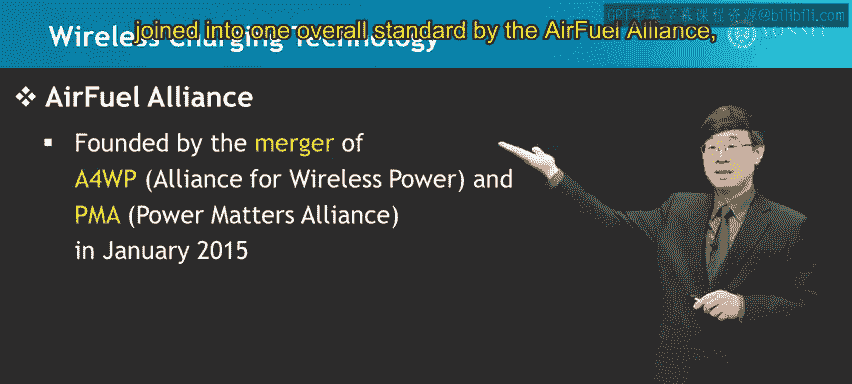
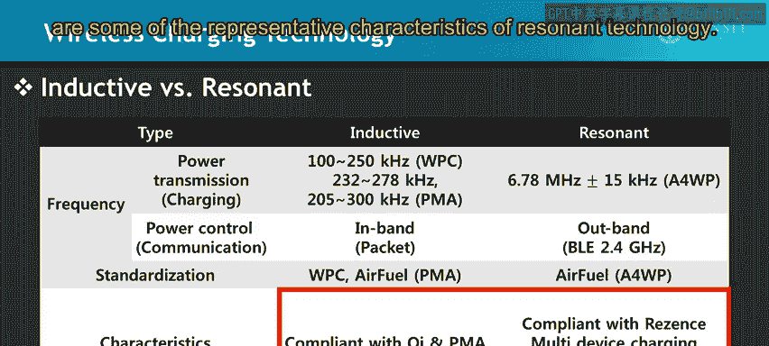

# 46：无线充电技术 🔋

在本节课中，我们将学习智能设备中使用的无线充电技术。我们将从介绍主要的行业联盟和标准开始，然后深入探讨两种核心的无线充电技术：电磁感应与磁共振，并比较它们的关键特性。

---

## 无线充电联盟与标准

无线充电技术的发展离不开行业联盟的推动。以下是几个主要的标准化组织。

### 无线充电联盟

**无线充电联盟**成立于2008年12月。其目标是**创建一个通用的无线充电标准**，使得各种移动电子设备可以放置在单一的电力传输垫上进行充电。该联盟采用的技术是**电磁感应充电**。

其核心标准是 **Qi 标准**。其中“Qi”源自中文的“气”字，代表自然能量。WPC标准支持**最远4厘米距离**的感应式电能传输。

Qi标准包含以下两种功率规范：
*   **低功率标准**：基础功率规范，最高可传输 **5瓦** 功率。
*   **中功率标准**：扩展功率规范，最高可传输 **15瓦** 功率。

### 电力事务联盟

**电力事务联盟**是一个全球性的非营利性行业组织，由宝洁公司和Powermat Technologies于2012年创立。

其技术特点包括：
*   感应耦合
*   数字收发通信
*   基于云端的电源管理

### 无线电力联盟

**无线电力联盟**成立于2012年。它开发了 **Rezence** 标准（其标志如图所示）。这是一个基于**磁共振**的无线电力传输接口标准。可以看到“Rezence”与“resonance”（共振）一词相似。

该标准支持**最高50瓦**的功率传输（这是一个显著的功率水平），传输距离**最远可达5厘米**。

### AirFuel 联盟

**AirFuel 联盟**由A4WP和PMA于2015年合并而成。A4WP和PMA的技术特点被整合进AirFuel联盟的统一标准中（使用如图所示的标志）。

该联盟开发了 **AirFuel Resonant**（共振）和 **AirFuel RF**（射频）无线充电技术。由于是两个标准的合并，因此它将感应式与共振式技术结合到了一个 **AirFuel 标准** 之下。

---

## 感应式与共振式技术对比

上一节我们介绍了主要的无线充电联盟，本节中我们来详细看看构成这些标准基础的两种核心技术：感应式与共振式。由于AirFuel标准合并了两种技术，因此我们需要考虑以下两种模式。

以下是感应式与共振式技术的对比：

| 特性 | 感应式 | 共振式 |
| :--- | :--- | :--- |
| **标准化组织** | WPC, PMA (PMA已并入AirFuel联盟) | A4WP (已并入AirFuel联盟) |
| **充电功率传输频率** | 100 kHz ~ 300 kHz (基于WPC或PMA标准) | **6.78 MHz** (基于A4WP标准) |
| **功率控制通信方式** | **带内分组通信**：在此频率范围内交换数据包。 | **蓝牙低功耗**：使用 **2.4 GHz** 频段传输控制数据包。由于未使用功率传输频率进行通信，这被称为**带外通信**。 |
| **兼容标准** | 兼容 **Qi** 和 **PMA** 标准。 | 兼容 **Rezence** 标准。 |
| **关键特点** | - | **支持多设备充电**和**自由定位**是共振技术的代表性特点。 |

---

## 总结

本节课中，我们一起学习了智能设备的无线充电技术。我们首先了解了推动技术标准化的主要联盟，如WPC、PMA、A4WP以及合并后的AirFuel联盟。然后，我们深入探讨了两种核心的无线充电原理：**电磁感应**和**磁共振**，并从标准化、工作频率、通信方式等方面对它们进行了详细的对比。特别是，共振式技术因其支持多设备充电和自由摆放的特点，展现了更大的应用灵活性。