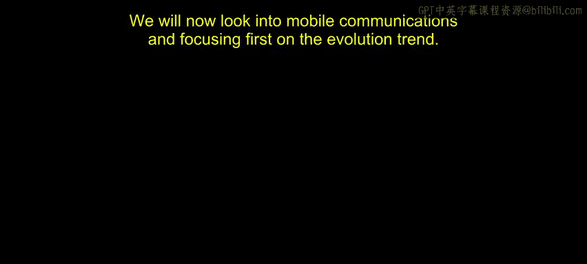
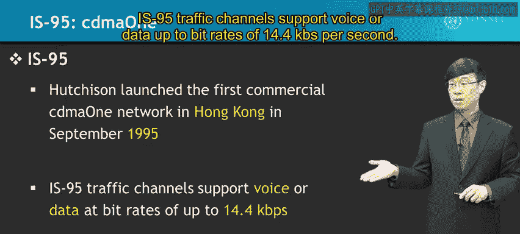
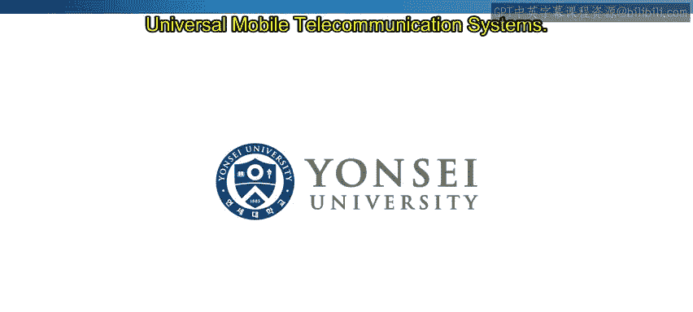

# 延世大学《新兴技术从智能手机到物联网再到大数据》 - P47：11_3.1 移动通信演进（第1部分）📡

在本节课中，我们将学习移动通信技术从第一代到第二代的演进过程，重点关注其核心技术原理和关键特性。

---

## 概述 📋

我们将首先了解全球移动通信的演进趋势。本节内容从第一代模拟移动电话系统开始，逐步深入到第二代数字移动通信技术，包括GSM和CDMA。

---

## 第一代移动通信：AMPS 📞

我们首先介绍**AMPS**，即高级移动电话系统。这是第一代移动蜂窝电话。移动电话的历史由此开始。

这些技术基于**FDMA**和模拟信号。这意味着整体信道根据频分多址技术被划分为多个基于频率的子信道。在一个信道内，信号以模拟方式发送。

模拟方式通常指我们拥有的调制选项，例如**频率调制**、**相位调制**，在某些情况下也结合**幅度调制**。

AMPS由贝尔实验室开发，并于1983年在北美推出。

---

## 第二代移动通信：GSM 📱

上一节我们介绍了模拟的第一代移动通信，本节中我们来看看数字化的第二代技术。

接下来我们进入**GSM**，即全球移动通信系统。这是第二代移动蜂窝电话，基于数字技术。它于1991年在芬兰推出，并成为全球主导标准。

一旦进入数字领域，就可以实现一些附加功能。

以下是数字无线通信系统的主要优势：

1.  **错误检测**：如果通信中存在错误，数字系统可以检测出错误位置。利用这一点，信息交换的可靠性得以提高。
2.  **压缩**：可以对数据进行压缩。
3.  **时分多址**：这带来了巨大优势。一旦采用TDMA，从整体信道划分出的一个子信道内，多个用户可以基于时间共享该子信道。

GSM占据了超过90%的市场份额，并在全球超过219个国家和地区运营。

GSM结合使用了FDMA和TDMA。FDMA是频分多址。因此，分配的整体频率信道被划分为多个块，这些就是子信道。

在第一代移动蜂窝通信AMPS中，这些子信道之一必须分配给一个用户。因此效率非常低。但当我们采用TDMA时，这些信道中的每一个都被划分为多个时隙。因此，一个子信道可以划分为多个时隙，由多个用户共享。这使得多个用户共享一个子信道以及整个频域的通信效率变得更高、更有效。这是通过FDMA和TDMA技术结合在GSM中实现的革命之一。

显然，你可以看到它为何在全球如此流行。

GSM服务包括语音通信，但也包括数据传输。在每秒9.6千比特的速率下，这是可能的，因为我们使用了数字技术，而数字技术的可用性是因为我们采用了基于FDMA架构的TDMA。

你还可以发送短消息服务。SMS从这里成为可能。数据传送和SMS成为基于第二代GSM技术的移动蜂窝电话上实现的两大主要功能。

此外，他们开始使用SIM卡。

什么是SIM卡？SIM卡是用户身份模块。它看起来像这样。或者当你购买SIM卡时，通常它可能看起来像一张大卡，但你可以把它弹出来，弹出这个小东西，然后插入你的移动蜂窝电话。这是一张可拆卸的智能卡。

它包含用户订阅信息，此外还包含电话簿，所以非常方便。

以下是SIM卡的优势：

*   **用户信息可移植**：SIM卡使用户在更换手机后仍能保留用户信息。这意味着通过更换手机上的SIM卡，如果你有两张SIM卡并交换它们，那么你也交换了你的电话簿以及你对移动通信服务提供商的身份识别。这意味着你可以在使用同一部手机的同时更换你的移动蜂窝电话运营商。
*   **设备灵活性**：例如，我有多部手机。这是红色的。这是蓝色的。这是白色的。根据我今天的时尚搭配，我今天穿黑色。那么我可能想要一部黑色的手机。然后我拿一部黑色的手机，把我的SIM卡放进去，这样我的时尚就和我的手机协调了。你可以做类似的事情。因此，SIM卡使你拥有这个选项，以及更换手机的选项。因为你放入手机的是什么SIM卡，就会激活手机连接到该蜂窝电话运营商的那种模式。

这是GSM技术的一个主要特性。

---

## 第二代增强技术：IS-95 (CDMA) 🔄

上一节我们探讨了基于FDMA/TDMA的GSM，本节中我们来看看另一种不同的多址技术。

然后我们进入一个更先进的系统，即**IS-95**。这是临时标准95，第一个基于CDMA的2G蜂窝标准。

我们谈论CDMA，什么是CDMA？CDMA是码分多址。这意味着，我们不使用FDMA和TDMA，而是使用代码来划分用户对频率信道的共享。

因此，这能很好地对抗窄带干扰和多径信号衰落。所以通信质量、比特错误数（因为我们在第二代移动电话中使用数字技术）可以显著减少。

以下是CDMA的主要优势：

*   **抗干扰**：来自其他设备的干扰，因为邻近小区有其他设备使用相同频率，它们的信号可能进入我们的小区、邻近小区，并干扰我的设备与基站之间的通信。这种类型的干扰可以被消除，大部分可以通过使用CDMA技术减少。
*   **抗多径衰落**：多径信号衰落。当我把信号从我的手机发送到基站时，那个信号会从墙壁和建筑物周围的其他物体上反弹，并通过多次到达基站，使信号变得模糊。此外，相反方向也会发生同样的事情。从基站发送的信号将通过多径衰落到达我的手机，它会从地板、墙壁和其他地方反弹。因此，信号。当我发送一个信号时，就像我收到多个信号的回声，干扰之后将要发送的比特。所以，有一个长尾、有回声并不好，而这通过CDMA技术显著消除了多径信号衰落。信号会因多径信号分布而衰落，而这通过CDMA技术被大量消除，这使得手机性能更高。

CDMA1是IS-95手机的品牌名称，由高通公司开发。和记黄埔于1995年在香港推出了第一个商用CDMA1网络。

IS-95业务信道支持语音或数据，速率高达每秒14.4千比特。

---

## 总结 ✨

本节课中我们一起学习了移动通信从第一代到第二代的演进。我们了解了第一代AMPS的模拟FDMA技术，第二代GSM如何结合数字技术、FDMA和TDMA实现了更高的效率和短信等功能，以及IS-95 (CDMA)如何利用码分多址技术来对抗干扰和多径衰落，提升了通信质量。这些基础技术为后续更高速的移动通信发展铺平了道路。