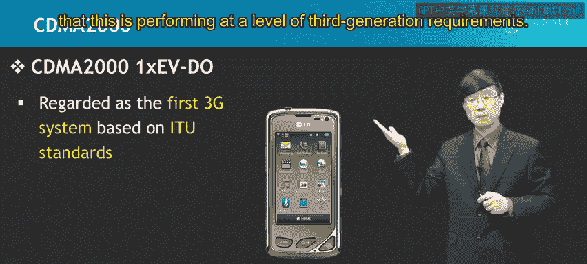

# 48：12_3.1 移动通信演进（第2部分）📡

## 概述
在本节课中，我们将学习第三代移动通信技术（3G）的核心标准，包括UMTS、WCDMA和CDMA 2000。我们将了解这些技术如何从2G演进而来，以及它们带来的关键改进，例如更高的数据速率、服务质量（QoS）控制和向后兼容性。

---

### 从GSM到UMTS的演进 🚀
上一节我们介绍了2G技术，本节中我们来看看第三代移动通信的开端。UMTS，即通用移动通信系统，标志着我们进入了第三代移动通信时代。

UMTS技术是在GSM技术的基础上演进而来的。技术采用演进路径具有显著优势：当用户进入一个支持UMTS的蜂窝通信区域时，设备可以使用UMTS；如果该区域尚未部署UMTS，但覆盖了之前的2G技术（如GSM），设备则可以自动回退并使用GSM网络。这种能力源于新标准是旧标准的演进。

我们称这种特性为**向后兼容性**。当前我们使用的手机也具备这种向后兼容的选项。

---

### UMTS的支撑技术：UTRA 📶
UMTS的无线接入部分由UTRA（UMTS陆地无线接入）技术支撑，它支持多种不同的陆地空中接口。

UTRA支持的多址接入方式包括FDD和TDD。
*   **FDD**：代表频分双工，是FDMA技术的进阶。
*   **TDD**：代表时分双工，是TDMA技术的进阶。

---

### 第三代核心：WCDMA 📲
接下来，我们聚焦于第三代移动蜂窝系统的核心之一——宽带码分多址接入，即WCDMA。

WCDMA是一种使用UTRA FDD模式的第三代移动蜂窝系统。它基于3GPP Release 99标准，数据速率最高可达**2 Mbps**。与之前2G时代每秒数十千比特的数据速率相比，进入3G意味着我们迈入了每秒兆比特级数据连接的新维度。

WCDMA的首个商用网络于2001年在日本开通。它带来了多项重要改进：

以下是WCDMA支持的关键特性：
1.  支持语音和分组数据应用的无缝移动性。
2.  实现了服务质量差异化，以提升服务交付效率。
3.  能够同时支持语音和数据业务。

后两点尤为重要。服务质量差异化意味着，如果某个用户或应用需要更高的数据速率或更好的服务质量，网络能够予以支持。同时支持语音和数据则允许用户在通话期间同时收发数据信息，例如接收短信。

此外，WCDMA能够与现有GSM网络协同工作，这再次体现了其作为GSM技术演进所带来的**向后兼容性**。

---

### 另一条3G路径：CDMA 2000 🔄
除了基于GSM演进的路径，第三代移动通信还有另一条重要分支，即CDMA 2000。

CDMA 2000是另一个第三代移动蜂窝系统，由3GPP2标准化。它是IS-95 CDMA（一种2G技术）的演进版本，采用了码分多址和时分多址技术。之前的“宽带”CDMA（WCDMA）带宽宽于5MHz，而CDMA 2000使用的带宽窄于5MHz，因此直接称为CDMA。该技术最初在北美和韩国使用。

---

### CDMA 2000的演进：1x EV-DO ⚡
在CDMA 2000的基础上，增加了1x EV-DO技术。EV-DO代表“演进数据优化”，旨在为CDMA 2000增加一个优化的数据通信演进技术。

1x EV-DO使移动蜂窝网络的数据速率达到了**2.4 Mbps**。该技术于2002年1月在韩国推出。

深入来看，1x EV-DO被认为是首个基于国际电信联盟标准被正式认可的3G系统。这意味着，为了被正式承认为2G、3G、4G或5G技术，需要通过认证，满足数据速率和特定功能方面的性能要求。在第三代移动通信技术中，CDMA 2000 1x EV-DO是首个获得国际电信联盟认证、确认其性能达到第三代要求的技术。

---

### 关于国际电信联盟（ITU）🌐
这里提到的ITU是国际电信联盟的缩写。它是联合国负责信息通信技术的专门机构。

在ITU内部，有一个电信标准化部门。因此，当你看到第三代、第四代或第五代技术时，常会见到“ITU-T标准化”或“ITU-T批准认证”的术语，这里的“T”就代表电信标准化。

---

## 总结
本节课我们一起学习了第三代移动通信（3G）的关键技术。我们了解了UMTS作为3G的入口及其向后兼容的重要性，探讨了WCDMA如何从GSM演进并带来了兆比特级数据速率、服务质量控制和语音数据并发能力。同时，我们也认识了另一条技术路径CDMA 2000及其演进版本1x EV-DO，并了解了国际电信联盟在技术标准认证中的角色。这些演进为移动通信开启了高速数据应用的新时代。