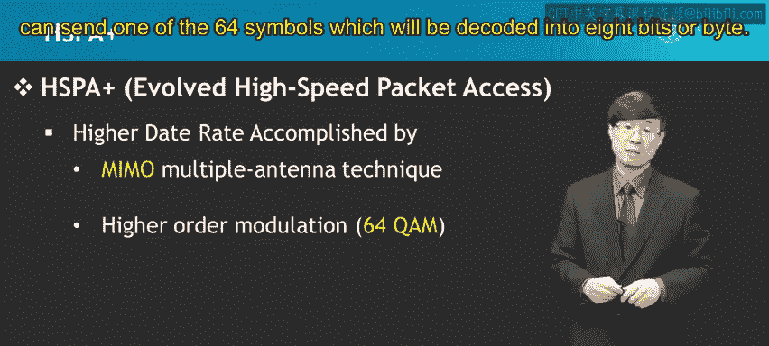

# 延世大学《新兴技术：从智能手机到物联网再到大数据》课程 - P49：13_3.1 移动通信演进（第3部分）📡

在本节课中，我们将继续学习第三代移动通信（3G）的演进技术，重点介绍HSDPA、HSPA+等增强协议，并解释其背后的关键技术原理，如MIMO和高阶调制。

---

上一节我们介绍了3G的初步发展，本节中我们来看看3G的增强型技术。

首先介绍HSDPA，即高速下行链路分组接入。这是一种增强的3G移动通信协议，是UMTS的演进，旨在提供更高的数据速度和容量。它属于HSPA协议家族。HSPA是高速分组接入，其中包含高速下行链路分组接入（HSDPA）和高速上行链路分组接入（HSUPA）。

下行链路是指信号从基站下行到您的移动蜂窝设备。通常，基站位于高塔或建筑物顶部，位置较高且连接到骨干网络，因此无论是位置还是网络连接性，它都是一个更高的实体。从基站下行到移动设备的信号称为下行链路。您的移动蜂窝设备发送到基站的信号则称为上行链路。当然，在某些情况下，基站的位置可能低于移动设备用户。

高速下行链路分组接入于2005年实现商用网络。基于第5版标准，其峰值数据速率达到**14 Mbps**。可以看到，基于3G的这些新技术进步，数据速率已进入每秒数十兆比特的范围。

我们还有EV-DO Revision A，其下行链路峰值数据速率为**3.1 Mbps**，上行链路为**1.8 Mbps**。上下行链路均达到了兆比特每秒的量级。该技术于2006年10月在美国推出。

以下是该技术的一些代表性移动蜂窝手机示例。

一项主要特性是基于低延迟和低比特率通信支持的**VoIP**。VoIP是指通过传统网络发送语音，但您可以选择将语音信号封装在IP数据包中进行传输。这意味着，从第三代移动通信蜂窝网络开始，基于此技术的实现，既支持传统的基于TDMA的语音通信骨干网络，也支持基于IP的网络连接。这些网络技术分别称为传统网络的GRAN和基于IP技术的UTRAN。第三代移动网络在区域中叠加了这两种网络，以同时支持非IP技术和IP技术。现在我们不仅有基于IP的数据，还有基于IP的语音，即您在此看到的VoIP。

进一步深入细节，增强型接入信道MAC（媒体接入控制）减少了连接建立时间。多用户分组技术使得多个用户能够共享同一个时隙。之前我们讨论过通过FDMA划分频率信道，然后在一个子信道中，通过TDMA分配时隙，为用户分配周期性的时隙用于上下行链路。现在我们讨论的是，即使对于其中一个时隙，也存在一种方式可以让多个用户共享。因此，使用同一信道的效率自动提高，因为我们现在实现了资源共享，这非常有益。此外，还包含了用于服务质量控制的**服务质量标志**，这意味着内部使用了标志，以便您可以控制服务质量的分配。

需要指出的是，媒体接入控制（MAC）是一种技术，用于共享相同时隙。它着眼于时间、空间、频率或码等特定资源，并智能地决定如何使用，以避免干扰其他用户，在满足自身通信需求的同时，也满足他人的通信需求。这就是媒体接入控制技术，即MAC。利用该技术，我们可以实现时隙的时间共享。

---

接下来我们看看HSPA+，末尾的“+”号通常意味着它更优。演进的高速分组接入，从其名称中的“演进”一词和“+”号即可看出。

HSPA+全IP网络于2009年首次在香港推出，这意味着现在的移动蜂窝网络完全基于IP。因此，我们可以非常方便地将该基于IP的网络与当地的互联网对接。

HSPA+使用W-CDMA，这是一种基于UMTS的3G技术及其增强功能。HSPA+是HSPA的演进，从名称即可知。

其峰值数据速率达到：从基站到移动蜂窝手机的下行链路为**168 Mbps**，上行链路为**22 Mbps**。这里的演进是明显的。峰值数据速率现在已达到数百兆比特每秒，用于从基站到移动设备的下行链路；而上行链路也达到了舒适的每秒数十兆比特量级，这是从移动设备到基站的速率。

您可能会想，为什么下行链路速率总是大于上行链路？这是因为下行链路信号是从基站发送到您的移动蜂窝设备。基站功率更大，通常位置更高，这意味着它拥有更好的信道将信号发送到移动设备。因此，由于这些优势，可以实现更高的数据速率。而上行链路是从移动蜂窝设备发送到基站的信号，移动设备电池小，不能发射太强的信号（因为靠近用户，需注意辐射问题），并且其位置较低，可能位于建筑物之间或内部。因此，返回基站的信号接收效果不佳。这就是为什么上行链路的数据速率大小总是低于下行链路。

---

是什么实现了这种更高的性能？是**MIMO技术**，即多输入多输出。这里的“多”指的是应用于通信链路的**天线数量**。这意味着我们在接收端和发射端都使用多个天线来协调通信。

为什么使用MIMO？MIMO在发射端和接收端使用**不相关的多个天线**，在占用与单天线系统相同带宽的情况下，提高数据速率。从这句话可以得知，以前的移动蜂窝手机通常只使用一根天线，基站可能有多根天线，但通常只用其中一根与您收发信号。因此，我们之前是一根天线与另一根天线通信，以满足所有先前通信技术的需求。但从现在开始，它使用MIMO技术，通过多个天线实现更高性能。这意味着现在我的移动设备和基站都有多组天线供多个用户共享，并在此进行良好协调，以实现更高的数据速率。

请注意，这个数据速率是**峰值数据速率**，即可以为用户发送的最大数据速率。因此，您的移动设备实际获得支持的速率可能并非精确的峰值速率，该技术可能会在多个用户之间灵活地共享这个峰值速率。

更高的数据速率通过MIMO技术实现，该技术使用了多天线技术。它还使用了**高阶调制——64 QAM**。64 QAM是一种技术，其中我发送的每个符号包含多个比特。它内部记录了64个符号，我选择其中之一来代表在一次传输符号中一起发送的一串比特。通常，当提到64 QAM时，2的6次方等于64。这意味着我有**6个比特**（实际上，一个字节是8比特，但这里6比特映射为一个调制符号）映射到一个调制符号中，每次我可以发送64个符号中的一个，该符号将被解码为6个比特。

此外，还使用了**双小区HSDPA**来将多个小区合并为一个。

---

本节课中我们一起学习了3G增强技术，包括HSDPA和HSPA+协议，了解了其峰值数据速率的显著提升。我们探讨了实现这些提升的关键技术：MIMO通过多天线系统提高频谱效率，64 QAM高阶调制在每个符号中承载更多数据。同时，我们也理解了上下行链路速率差异的原因，并认识了VoIP、MAC等支撑移动通信演进的重要概念。这些技术进步为后续更高速的移动通信标准奠定了基础。