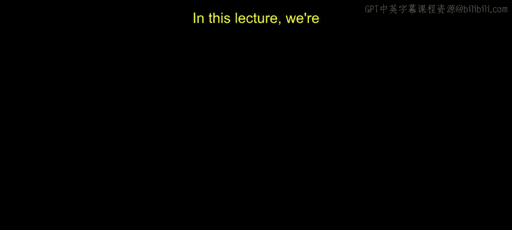
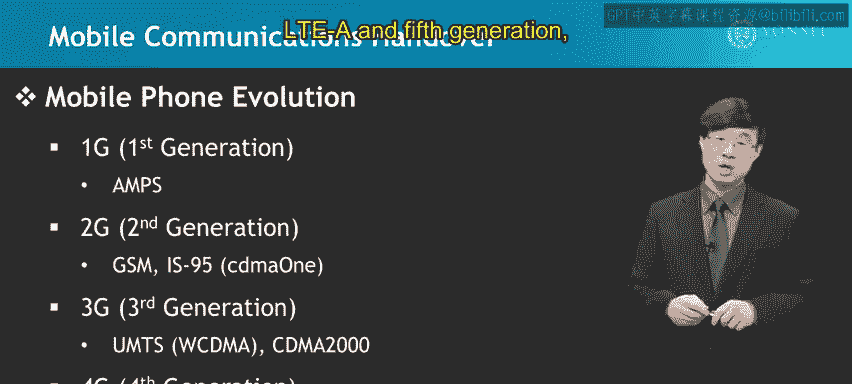
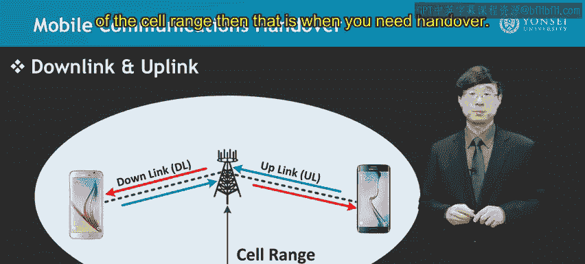
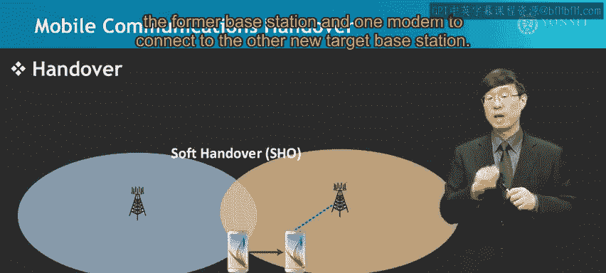
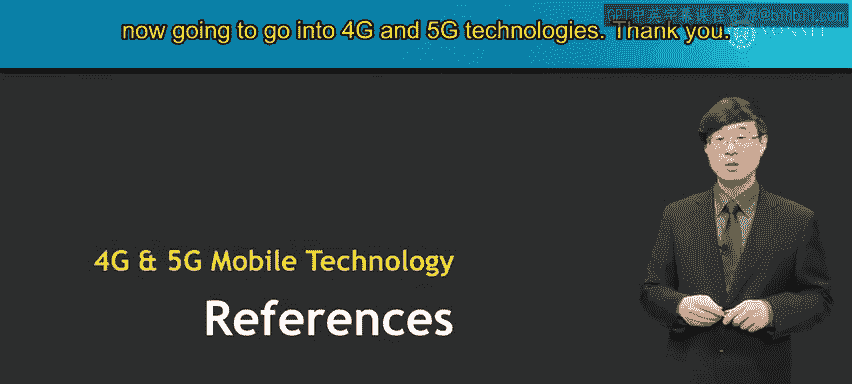

# 51：15_4.1 移动通信切换 📶

在本节课中，我们将重点学习第四代和第五代移动通信技术。但在深入细节之前，我们首先需要了解移动通信中的切换技术。

移动电话的演进历程我们之前已经介绍过。这里简要回顾一下：第一代是AMPS技术。第二代是基于GSM和I-95的技术，其中包括CDMA1。第三代技术包括UMTS，它采用了WCDMA技术，CDMA2000也属于这一代。

接下来是第四代技术，它包括了LTE技术。然而，仅就数据速率和延迟等规格而言，LTE本身不足以被完全认可为第四代技术。但当引入了载波聚合等技术后，LTE-A就完全符合第四代技术的标准了。在本课程中，我们将详细探讨LTE、LTE-A以及第五代5G技术。

首先，我们来了解下行链路和上行链路。下行链路是指信号从基站传输到移动设备。基站通常位于建筑物的顶部，站体本身很高，或者安装在屋顶等能提供广阔区域良好接收的位置。由于基站通常比用户位置更高，因此可以这样理解：下行链路是从基站到移动用户。

而上行链路则是从移动用户的手机、笔记本电脑、平板电脑或其他设备传输到基站。在后续讨论中，我们将参照这个模型来使用下行链路和上行链路的概念。

此外，还有一个重要概念是小区范围。这是指移动设备能够基于信号强度，与基站建立足够质量的上行和下行连接的范围。因此，小区范围也是决定何时需要进行切换的关键因素。当你到达小区范围的边缘时，就需要进行切换。

当用户从蓝色小区移动到橙色小区边缘时，主要有两种切换方式。

第一种是硬切换。硬切换发生在你到达蓝色小区边缘、信号变弱时。此时，你会寻找并连接到另一个小区，并瞬间从原小区切换到新小区的基站。断开旧连接和建立新连接的过程是瞬时完成的，但切换的决定是明确的，因此称之为硬切换。进入新小区后，你就自动连接到新基站，并使用其连接进行语音和各种应用的数据通信。

第二种是软切换，情况略有不同。当你接近蓝色小区边缘并进入橙色小区范围时，在断开与原小区的连接之前，你会先建立与新小区的连接。由于这个原因，这也被称为“先接后断”。因此，在小区边缘的某一时刻，你会同时连接到两个基站。随着你完全进入新基站的覆盖区域，你就使用已建立的新连接，并断开与原基站的旧连接。这被称为软切换。它采用“先接后断”的方式，在切换瞬间保持与两个基站的连接。

由于在切换时需要同时保持与两个基站的连接，这类设备很可能需要双调制解调器：一个用于连接原基站的射频链路，另一个用于连接新目标基站的射频链路。

以上是我所参考的资料。基于这些信息，我们将在接下来的课程中深入探讨4G和5G技术。谢谢。

---

**本节课总结**

本节课我们一起学习了移动通信中的核心概念。我们首先回顾了移动通信技术的代际演进，然后明确了**下行链路**（基站到设备）和**上行链路**（设备到基站）的定义，并引入了**小区范围**的概念。最后，我们详细讲解了两种关键的切换技术：**硬切换**（瞬时切换）和**软切换**（先接后断），为后续深入学习4G和5G技术奠定了基础。