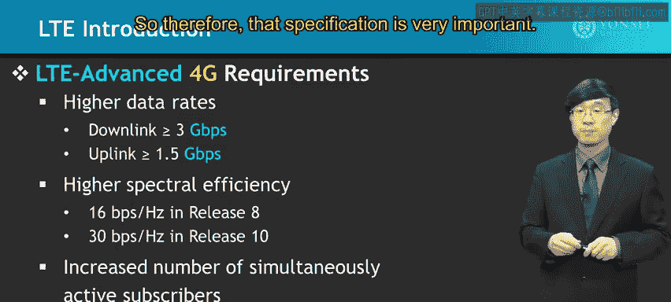
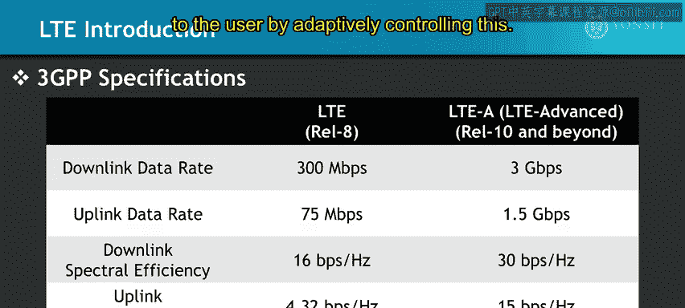
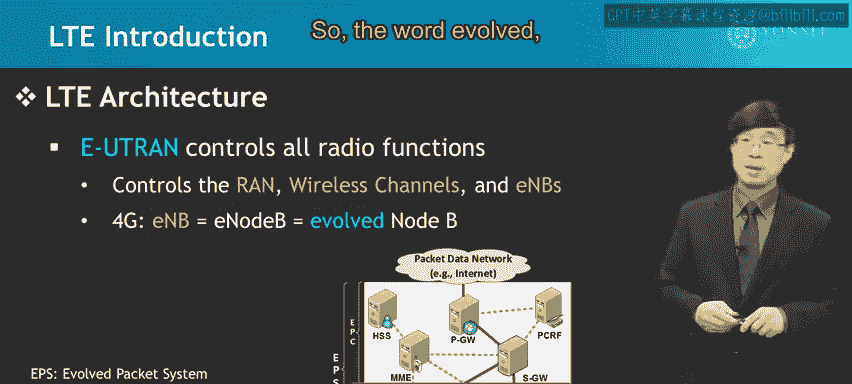

# 52：16_4.2 LTE简介（第1部分）📡

在本节课中，我们将要学习长期演进技术的入门知识，即LTE。我们将从LTE的基本要求开始，并将其与更先进的4G技术进行对比，最后探讨LTE的网络架构。

---

## LTE的基本要求

LTE代表“长期演进”。其设计基于一系列明确的技术要求，主要围绕数据速率、延迟和频谱效率。

以下是LTE的核心要求：

*   **下行链路数据速率目标**：100 Mbps
*   **上行链路数据速率目标**：50 Mbps
*   **低延迟**：小于5毫秒
*   **高频谱效率**
*   **频谱灵活性**：能够根据用户需求，动态且自适应地调整分配给每个用户的带宽。

---

## LTE与LTE-Advanced的对比

上一节我们介绍了LTE的基本要求，本节中我们来看看其更先进的版本——LTE-Advanced。LTE-Advanced通常简称为LTE-A，被认为是真正的第四代移动通信技术。

以下是LTE与LTE-A的关键参数对比：

*   **下行链路数据速率**：
    *   LTE：300 Mbps
    *   LTE-A：3 Gbps
*   **上行链路数据速率**：
    *   LTE：75 Mbps
    *   LTE-A：1.5 Gbps
*   **下行链路频谱效率**：
    *   LTE：约 16 bps/Hz
    *   LTE-A：约 30 bps/Hz
*   **上行链路频谱效率**：
    *   LTE：约 4.32 bps/Hz
    *   LTE-A：约 15 bps/Hz
*   **带宽**：
    *   LTE：支持1.4, 3, 5, 10, 15, 20 MHz等离散频段。
    *   LTE-A：在带宽使用上具有更高的连续灵活性，能更自适应地满足用户需求。

LTE-A在数据速率上实现了数量级的提升，从百兆比特每秒进入吉比特每秒范围，这使其符合4G技术的标准。此外，其支持的**同时活跃用户数**也大幅增加，并且在小区边缘的性能得到显著改善（至少2.4 bps/Hz/小区）。小区边缘是信号最弱、需要进行切换的区域，改善此处的性能对提升整体网络质量至关重要。

---

## LTE的网络架构

了解了性能指标后，我们现在来探讨实现这些功能的网络架构。LTE架构同样被LTE-A所采用（并有所增强）。

LTE网络基于一个分层的系统，主要分为两大部分：演进分组核心网和无线接入网。

以下是LTE网络架构的主要组成部分：

1.  **用户设备**：这是我们直接使用的终端设备，例如：
    *   智能手机、智能手表
    *   智能汽车（如自动驾驶车辆）
    *   平板电脑
    *   笔记本电脑或个人电脑
    *   物联网设备或无人机
    *   智能交通系统中的车载单元和路侧单元设备

2.  **演进分组系统**：这是连接到互联网的整个系统，包含以下两个单元：
    *   **演进分组核心网**：这是网络的核心控制部分，负责管理网络服务、用户设备的互联网连接，并支持在切换过程中的无缝连接，同时致力于最小化数据包延迟和丢失。它包含诸如P-GW、HSS、MME、S-GW和PCRF等功能实体。
    *   **演进通用陆地无线接入网**：这部分负责管理无线接入网络和无线信道。其核心网元是**eNodeB**。

**eNodeB**是4G移动通信中的基站术语，它是“演进型Node B”的缩写。这里有一个命名惯例：每一代移动通信技术都给基站起了独特的名字，以便从名称上就能明确其所属的技术标准和基本功能集。
*   1G：基站
*   2G：基站收发台
*   3G：Node B
*   4G：演进型Node B

---

本节课中我们一起学习了LTE技术的基本要求、其与LTE-Advanced的关键性能对比，以及LTE网络的基本架构。我们了解到LTE-A在数据速率和频谱效率上的巨大提升使其成为真正的4G技术，并且LTE网络通过分层的演进分组核心网和无线接入网来支持高速数据传输和移动性管理。