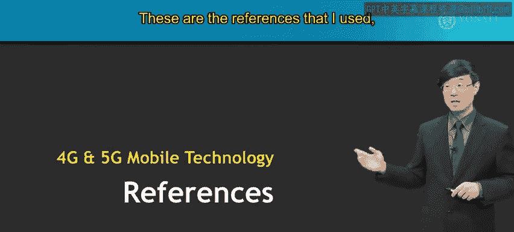

# 延世大学《新兴技术从智能手机到物联网再到大数据》课程 - P53：17_4.2 LTE简介（第2部分） 📡

在本节课中，我们将继续学习LTE网络架构的核心组成部分，即演进分组核心网。我们将详细介绍其中的关键网元，包括分组数据网络网关、服务网关、移动性管理实体、归属用户服务器以及策略与计费规则功能单元。理解这些组件如何协同工作是掌握LTE网络工作原理的基础。

上一节我们介绍了LTE网络的整体架构，本节中我们来看看演进分组核心网内部的具体功能单元。

## 分组数据网络网关

我们首先介绍分组数据网络网关，即PGW。这个单元位于此处。

它是将整个演进分组系统连接到互联网的单元。因此它是一个关键的组成部分。

用户设备的IP地址分配由PGW负责。此外，它是非3GPP切换的移动性锚点。非3GPP切换指的是什么？这里看到的基础架构基于3GPP标准。3GPP是一个标准化组织，最初专注于第三代移动通信技术的标准化，并延续到第四代和第五代移动通信技术。

因为它始于第三代合作伙伴计划，其缩写为3GPP，因此得名。当我们说非3GPP切换时，我们指的是切换到蓝牙、Wi-Fi以及其他不属于3G、4G或5G的3GPP标准的技术。

因此，如果你正在使用Wi-Fi通信并需要切换到LTE，或者你正在使用LTE进行IP语音通话，然后切换到使用Wi-Fi来继续你的IP语音会话或视频聊天，那么这种切换必须由PGW支持。

策略执行和服务质量执行由PGW进行。此外，也支持数据包过滤。需要指出的是，对于PGW，在一些地方你会看到带连字符的PDN-GW或不带连字符的PDN网关。

PDN代表分组数据网络，网关是GW。所以在一些论文、文档、白皮书、规范中，你会看到带连字符的PGW、带连字符的PDN-GW或不带连字符的PDN GW，但你需要知道它们指的都是这个单元。

## 服务网关

接下来是第二个关键单元块，即服务网关。

服务网关负责数据包路由和转发。它是eNode B间切换的移动性锚点。这意味着，在这个服务网关的例子中，你看到连接了两个eNode B。如果用户设备正在进行切换，并且正好处于两个小区的边缘，那么无论是软切换还是硬切换，这个服务网关都将支持切换的锚定，因为这两个eNode B都连接到此服务网关，由它来进行切换支持是合适的。

此外，它收集用于计费的信息。这当然很重要。大多数通信服务提供商以此盈利。因此，计费对他们来说是最关键的事情。

## 移动性管理实体

然后是移动性管理实体，即MME，也就是这里的这个单元。你可以看到它连接到服务网关，并且在背面还连接着HSS。

用户认证由此单元完成。它确认用户是有效用户，并应允许其接入我们的网络。

以下是MME的其他关键功能：

*   **漫游服务**：自然漫游是移动性支持。当你漫游到其他地点，即使这个用户在其通常不会去的不同国家或地区，你也希望能够快速识别该用户并建立和支持连接，这就是我们所说的漫游。漫游当然是移动性管理的关键组成部分。
*   **信令控制**：它控制并处理用户设备与演进分组核心网之间的信令。用户设备是你的终端设备。演进分组核心网是这里的这个单元块。需要注意的是，当我们说信令时，信令是来回发送的控制消息，它们包含各种支持移动设备切换、切换和服务质量的控制信息。

## 归属用户服务器

下一个单元是归属用户服务器。它包含一个支持用户签约信息的数据库。

理解HSS操作及其实际功能的一种方法是与3G网络的处理模块进行比较。一个是归属位置寄存器，另一个是认证中心，这两者都是支持第三代移动通信网络的主要模块。

深入了解这两者将让你了解第四代LTE网络的HSS实际做什么。

首先，3G网络中的HLR存储所有用户签约信息，例如用户ID、手机号码、地址等。然后是3G系统中的AUC，即认证中心，它基于用户身份密钥控制安全信息。换句话说，基于你的用户身份的私钥、公钥在需要时用于信令和数据通信的安全。

以下是其核心安全功能：

*   **双向认证**：这意味着它是相互的。当网络准备允许一个用户设备连接时，首先，网络会认证该用户是有效用户。其次，当用户连接到一个网络时，它会检查该网络是否是有效网络，是否是我应该使用的正确网络。因为在许多地区，我们有不止一家移动服务提供商。因此，你想连接到正确的网络，这就是我们所说的“双向”——网络检查用户设备，用户设备检查网络。只有当双方都认可彼此时，双向认证才完成，用户和网络连接在一起。
*   **无线链路加密与完整性保护**：由AUC执行。

HLR和AUC这两个单元的功能，在LTE网络中由HSS共同完成。通过这种方式，你可以理解3G网络中发生了什么以及4G LTE网络中正在发生什么。

## 策略与计费规则功能单元

还有另一个单元，就是这里的这个，即PCRF，策略与计费规则功能单元。

服务质量和计费策略控制由此单元执行。再次强调，移动服务运营商的存在是为了盈利，为了赚钱。用户会预先注册服务计划，并可能基于保证使用时长享受折扣，按月付费。

这就是我们所说的基于用户的服务计划。根据你的服务计划，它将决定服务质量的类型，并跟踪你的使用情况。因此，如果你超出了服务计划限制需要支付更多费用，那么基于PCRF的跟踪功能，将进行相应的定价和计费。

本节课中我们一起学习了LTE演进分组核心网的五个关键组件：PGW负责互联网连接和IP分配，SGW负责数据路由和切换锚定，MME负责用户认证和信令管理，HSS作为用户信息和安全中心，PCRF则管理服务质量和计费策略。这些组件共同构成了LTE网络高效、安全运行的基础。

