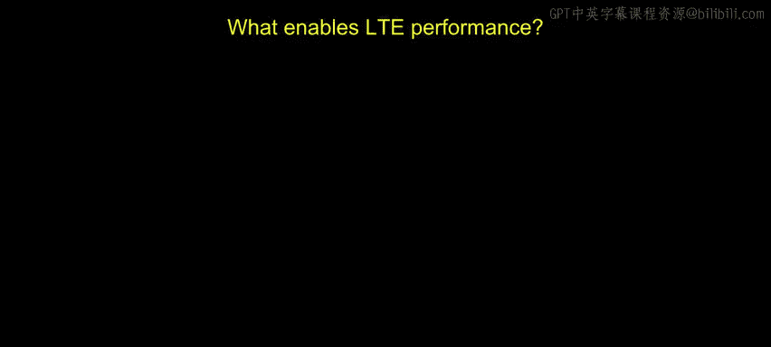
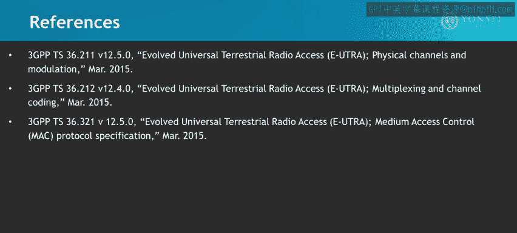

# 课程名称：延世大学《新兴技术：从智能手机到物联网再到大数据》 - P54：18_4.3 LTE组件 🛠️

## 概述
在本节课中，我们将学习构成LTE高性能基础的关键技术组件。我们将深入探讨OFDM、OFDMA、MIMO、切换与数据包转发等核心概念，了解它们如何协同工作以实现高速、可靠的移动通信。

---

## OFDM：正交频分复用 📡

上一节我们介绍了LTE的整体架构，本节中我们来看看其物理层的基础技术：OFDM。

OFDM，即正交频分复用，是一种使用紧密排列的正交子载波信号来传输数据的技术。这些信号以正交形式排列，如下图所示，它们相互重叠。

理论上，重叠会产生干扰。然而，这项技术的美妙之处在于，在某个子载波信号的峰值点，所有其他重叠的子载波信号恰好处于零点。这种正交关系意味着当一个信号处于峰值时，与其重叠的其他信号正处于零点。

因此，这些信号之间的相关性极低，具有独立性。这使得我们可以从这些密集重叠的子载波频率中提取信息。

OFDM的优势包括：
以下是OFDM技术的主要优势：
*   **抗干扰能力强**：对窄带干扰和频率选择性衰落等恶劣信道条件具有强韧性。这对于维持通信链路至关重要。
*   **高频谱效率**：由于使用了密集排列的正交重叠子载波，频谱利用率非常高。
*   **信道均衡简单**：得益于其正交特性，信道均衡过程得以简化。

---

## OFDMA：正交频分多址接入 📊

上一节我们介绍了OFDM，本节中我们来看看它的演进版本：OFDMA。

OFDMA，即正交频分多址接入，是OFDM的进阶技术，提供了更高的灵活性。它将子载波资源块动态分配给多个用户。

在下图中，纵轴代表频率，被划分为多个子信道；横轴代表时间，被划分为时隙。用户1、2、3被分配了不同颜色的资源块。

用户1使用分配给它的蓝色块，用户2使用橙色块，用户3同理。这些资源块分散在整个频域和时间域中，是动态分配的。

OFDMA的优势包括：
以下是OFDMA技术的主要优势：
*   **自适应载波分配**：可以根据用户需求动态分配更多或更少的资源。
*   **高频谱效率**：任何空闲的时频资源块都可以被分配给需要的用户使用，避免了资源浪费。
*   **低子载波间干扰**：基于OFDM/OFDMA技术，子载波间的干扰很小。

---

## MIMO技术与预编码 📶

除了高效的复用技术，LTE还使用MIMO技术来提升数据速率。

MIMO，即多输入多输出技术。“多输入”指发射端使用多个间距足够、互不相关的天线，将多个信号发送到无线信道中。“多输出”指接收端同样使用多个间距足够的天线，接收信道的输出信号。

其核心思想是，在相同的时间和频段内，通过预编码技术，从不同的天线发送不同的信息流。MIMO技术本质上是多次利用信道，利用了多天线在信道上的不相关特性。

MIMO的优势包括：
以下是MIMO技术的主要优势：
*   **提升可靠性**：增强了系统操作的可靠性。
*   **提高频谱效率**：通过在相同时间频率资源上发送不同数据，复用信道。
*   **增加数据速率**：这是其最直接的效果。

**预编码**的作用是将调制符号映射到不同的天线上，以便在MIMO信道上高效地发送它们。

---

## 切换与数据包转发 🔄

在移动通信中，当用户设备从一个基站覆盖区移动到另一个时，需要无缝切换连接。

在下图示例中，顶部的源基站决定发起切换。触发切换的条件可能包括：源基站信号强度低于某个阈值（橙色虚线），或者目标基站信号强度上升到某个水平（红色虚线），或者两者结合。

切换和数据包转发过程非常关键，它能防止切换期间的数据丢失。这个过程会缓冲并转发未成功交付的数据包给用户设备。

以下是切换与数据包转发的步骤：
1.  **决定并转发**：当源基站决定切换时，它会停止向用户设备发送新数据包，并将未送达的数据包缓存并转发给目标基站。
2.  **目标基站交付**：目标基站接收到这些数据包后，将其发送给用户设备。

需要强调的是，这个过程**不会发生数据包丢失**。所有在切换前未送达的数据包，都会通过目标基站安全可靠地送达用户设备。

然而，这并不意味着所有数据包都“有用”。这就引出了“时延界限违规”的概念。某些应用要求数据包必须在特定时间窗口内到达。如果数据包因延迟超过这个窗口才到达，即使它完整无误，也可能被丢弃，因为它已经失去了时效性。

---

## 时延界限违规示例：MBMS服务 🎥

上一节我们提到了时延界限违规，本节我们通过一个具体例子来理解它。

MBMS，即多媒体广播多播服务，利用了LTE高效的点对多点分发特性。**广播**指向特定范围内的所有用户发送；**多播**指向基于订阅等条件筛选的特定用户组发送。

许多MBMS服务都受到数据包时延界限违规的影响。以视频广播为例：

假设一个低质量视频流为每秒20帧。这意味着每帧图像的持续时间是50毫秒。接收端需要在这50毫秒内收集、解码并重建该帧图像。

如果某个数据包延迟超过50毫秒才到达，那么即使它没有错误，对于重建当前这帧图像也已经无用，因为系统已经开始处理下一帧（下一个50毫秒窗口）的数据了。因此，该数据包会被丢弃。

对于这个例子，时延界限就是50毫秒。实际传输和处理数据包的允许延迟必须小于50毫秒。

---

## 总结
本节课中，我们一起学习了LTE实现高性能的几大核心技术组件。我们了解了**OFDM**如何利用正交子载波高效抗干扰，**OFDMA**如何动态分配资源提升频谱效率，**MIMO**如何通过多天线提升数据速率和可靠性，以及**切换与数据包转发**机制如何保证移动中的连接无缝和低丢包率。最后，我们通过MBMS服务的例子，理解了**时延界限**对实时应用的重要性。这些技术共同构成了现代高速移动通信的基石。