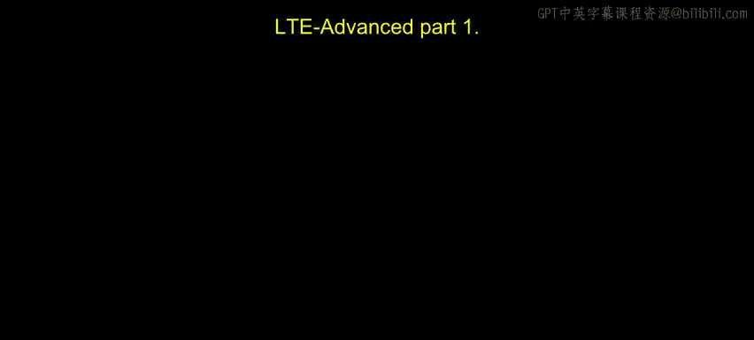
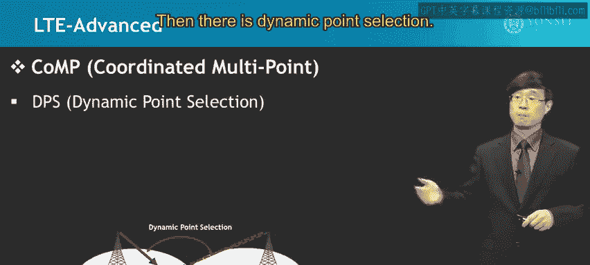
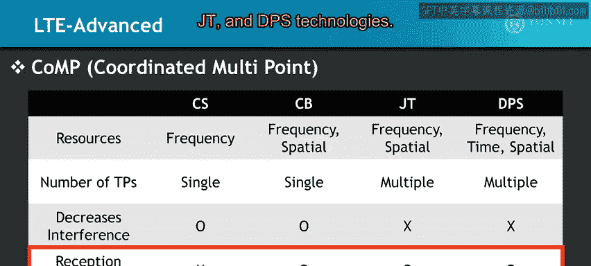
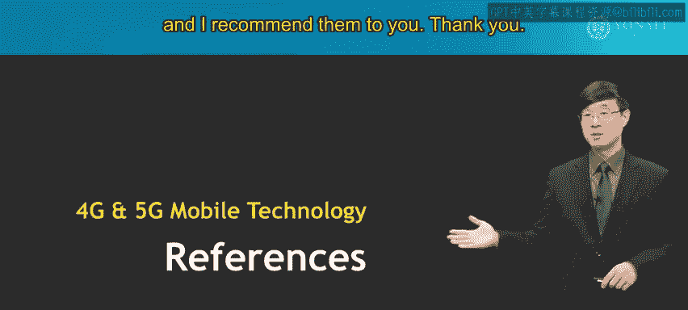

# 延世大学《新兴技术：从智能手机到物联网再到大数据》课程 - P55：19_4.4 LTE-Advanced（第1部分）📡

在本节课中，我们将学习LTE-Advanced技术中的几个核心增强特性，包括小区间干扰协调、动态子载波分配以及多点协作技术。这些技术旨在提升网络性能，特别是在小区边缘等信号较弱的区域。

上一节我们介绍了LTE的基本原理，本节中我们来看看LTE-Advanced如何通过更智能的资源管理来提升性能。首先，我们从ICIC和FFR开始。ICIC代表小区间干扰协调，FFR代表部分频率复用。

ICIC通过FFR来缓解小区边缘因小区间干扰导致的数据速率下降问题。这句话可能有些难以理解，我们可以通过一个示意图来使其更清晰。

请看这里的图示。当你处于小区边缘时，这里的性能是最弱的。在蜂窝结构的中心，即图中的绿色区域，信号电平低于蓝色、红色或橙色区域。这意味着在每个小区的中心附近使用了较低的发射功率，因为这里靠近基站，信噪比良好，因此即使使用较弱的功率也能获得高质量的数据服务。

然而，当需要在小区边缘支持高质量数据通信时，蓝色、红色和橙色区域的功率电平就高于绿色区域。这意味着在小区边缘使用了更强的功率。移动通信在小区边缘确实非常困难，这也是为什么我和实验室的工程师们将切换作为重点研究方向，因为如果能在此过程中提供高质量服务，就能在任何时间、任何地点提供优质服务。

让我们关注箭头所指的部分，那里是三个小区交界的角落。在箭头末端，你可以看到一个橙色区域、一个蓝色区域和一个红色区域。这意味着它们使用了不同的频率。这就是FFR发挥作用的地方。

部分频率复用通过分离频段并高效分配频段，来防止来自相邻基站的信号干扰。在角落边缘的位置，蓝色、橙色和红色区域彼此相邻。从图中可以看出，这些区域虽然发射功率较强，但它们位于不同的频段上。它们在各自频率轴上的位置不同，这意味着它们使用了强信号，但由于频率不同，彼此不会产生干扰。这就是FFR的含义。将这一点与整体协调结合起来，就是小区间干扰协调。

接下来，我们介绍DSA，即动态子载波分配。这是一种在静态分配基础上改进的资源分配方案，它能根据信道状态条件动态分配子载波。

其原理是：观察频谱中哪些信道较弱或存在盲点，并利用这些信息为其他区域的用户提供服务。由于某个设备处于信号盲点，无法接收任何信息，因此可以集中信号为该区域的另一个用户服务，从而获得更大的通信链路增益。

例如，用户一的频谱响应如蓝线所示，它在某个频点存在频谱盲点。用户二的频谱响应如红色虚线所示，它在另一个频点存在盲点。动态子载波分配的做法是：既然我们知道用户一和用户二的频谱盲点位置，就可以将用户一的通信资源集中分配在用户二的盲点频段上。这样，即使用户一接收到强信号，用户二因为处于其自身的频谱盲点，也无法接收到该信号，从而不会将其视为强干扰。这就是DSA技术的核心思想。

能够实现这一点，是因为LTE-Advanced技术能够自适应地将频段分配给特定位置。由于频率选择性衰落，子载波对不同用户的影响不同，这导致了不同用户的频谱中存在不同的盲点。因此，DSA通过跟踪每个用户的整体频谱盲点，并利用其内置的自适应控制分配机制，可以从多方面改善用户的服务质量。

下面，我们来看CoMP，即协作多点技术。这项技术旨在提高高速数据率的覆盖范围、小区边缘吞吐量以及系统吞吐量。

CoMP技术中，“多点”可能带连字符也可能不带，在各种文档中你可能会看到两种写法，但含义相同。其基本思想是多个小区协同支持一个基站，或者说多个基站协调地指向同一个设备进行通信。这样，多个基站可以同时与一个用户设备通信，通过减少小区内干扰来提高吞吐量。

实现CoMP有几种主要方式，以下是四种主要方法：

*   **协调调度**：这种方式在小区边缘为用户分配不同的子载波，以避免小区间干扰。图中显示，对于处于小区边缘的设备，我们同时使用频率1和频率2来支持它。这意味着该设备需要能够同时接收两个频率的信号，这可能要求设备配备多个调制解调器。
*   **协调波束赋形**：这种方式利用天线阵列进行波束赋形，将信号从全向传播转变为定向波束。通过为小区边缘的用户分配不同的波束模式，可以避免干扰并提高接收性能。图中展示了两种不同的波束模式分别支持不同的边缘设备。
*   **联合传输**：这种方式中，多个基站协调它们的信号，使得用户设备能同时从多个基站接收数据，从而提高接收性能和数据速率。
*   **动态节点选择**：这种方式选择信道质量更好的传输节点来改善接收性能。传输节点在不同文档中可能被称为TP或TX点，它在LTE-Advanced的CoMP技术中频繁使用。

为了更清晰地比较这四种技术，我们可以从几个维度来看：

*   **资源利用**：CS使用频率资源；CB使用频率和空间分集；JT同样使用频率和空间；DPS则协调使用空间、时间和频率资源。
*   **传输节点数量**：CS和CB使用单个传输节点；JT和DPS使用多个传输节点。
*   **干扰降低效果**：CS和CB能有效降低干扰；JT和DPS在这方面的效果相对不那么显著。
*   **接收性能**：CS的性能相对较低；CB、JT和DPS技术能提供更高的接收性能。

这些是我使用的参考文献，也推荐给你。谢谢。

本节课中我们一起学习了LTE-Advanced的第一部分内容，重点包括通过ICIC和FFR进行小区间干扰协调、利用DSA进行动态资源分配，以及通过CoMP技术提升网络性能的四种主要方法。这些技术共同构成了LTE-Advanced提升数据速率、覆盖范围和用户体验的核心机制。