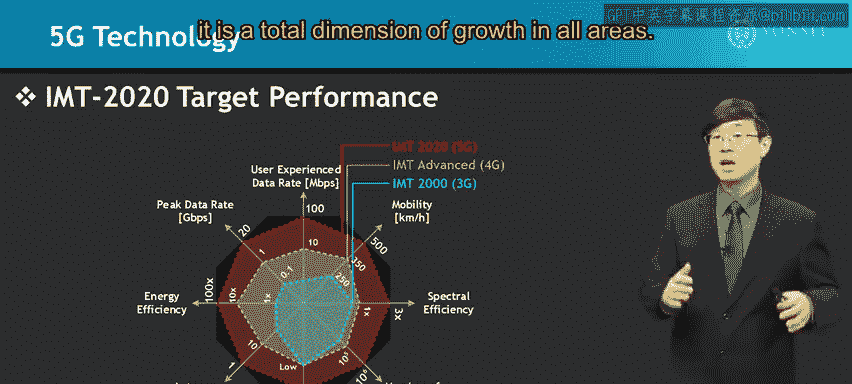
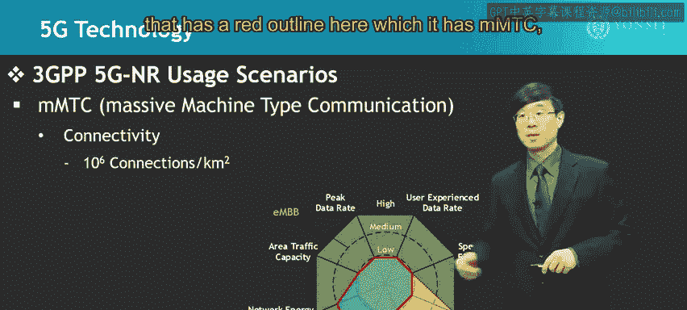

# 57：21_4.6 5G技术 🚀

## 概述

在本节课中，我们将要学习第五代移动通信技术（5G）的核心目标、技术标准、关键性能指标及其三大应用场景。我们将了解5G如何超越前代技术，以满足未来云服务、沉浸式体验和海量连接的需求。

---

## 5G技术的服务目标与技术基础

5G技术建立在“万物上云”的整体服务目标之上。其驱动力来源于远程呈现、沉浸式体验和海量连接等应用需求。

为了支持这些需求，5G需要整合一系列核心技术，包括：
*   **云服务**
*   **高速互联网**
*   **无线技术**
*   **高清闭路电视技术**
*   **个人广播**
*   **基于位置的服务（LBS）**
*   **无线回传技术**（用于替代有线骨干网络）

5G技术的目标正是为了实现上述可能性。

---

## 5G技术标准与组织

上一节我们介绍了5G的目标，本节中我们来看看支撑这些目标的技术标准由谁制定。

5G技术主要参考两大标准体系：国际电信联盟无线电通信部门（ITU-R）的 **IMT-2020**，以及第三代合作伙伴计划（3GPP）的 **5G NR（新空口）**。

5G旨在支持高质量多媒体、自动驾驶汽车、增强现实、海量物联网网络和基于云的服务。为了实现这些，5G需要提供比LTE（4G）更高的性能，这正是IMT-2020和5G NR标准存在的意义。

以下是制定这些标准的主要组织：

*   **ITU-R（国际电信联盟无线电通信部门）**：隶属于国际电信联盟（ITU），负责制定全球无线电通信标准和法规。
*   **3GPP（第三代合作伙伴计划）**：这是一个由全球多家行业代表公司组成的联盟，旨在共同制定全球通用的移动通信标准。该组织最初为制定3G标准而成立，并延续至今，制定了4G和5G标准。其标准涵盖了无线接入网、服务与系统、核心网以及终端设备等所有方面。

---

## IMT-2020 关键性能要求

了解了标准制定组织后，我们来看看IMT-2020标准对5G提出了哪些具体的性能要求。与LTE相比，5G需要在多个维度实现显著提升：

*   **更高的数据速率**：峰值数据速率需达到 **20 Gbps**，用户体验数据速率（如下行链路）需达到 **100 Mbps**。
*   **更低的延迟**：端到端延迟需低于 **5毫秒**，其中空口延迟需低于 **1毫秒**。
*   **更高的连接密度**：需支持每平方公里 **100万台设备** 的连接。
*   **更高的移动性**：需支持高达 **500公里/小时** 的移动速度，以满足高速铁路和无人机等场景需求。

---

## 5G与前代技术的性能对比

为了直观理解5G的飞跃，我们可以将其与3G（IMT-2000）和4G（IMT-Advanced，即LTE-A）进行对比。

下图展示了三代技术的性能范围（想象一个雷达图，每个轴代表一项性能指标）：
*   **3G（蓝色区域）**：代表了最初的移动宽带能力。
*   **4G（天蓝色区域）**：在移动性、用户体验数据速率、峰值数据速率、能效和延迟等方面相比3G有显著进步。
*   **5G（红色区域，即IMT-2020）**：其性能范围远超3G和4G。在移动性、频谱效率、连接设备数、可靠性、延迟、能效、峰值数据速率和用户体验数据速率等所有维度上，5G都实现了全面的、跨越式的增长。

---

## 5G NR的三大应用场景

基于3GPP标准，5G NR定义了三种主要的应用场景，以满足不同的需求。

以下是这三种场景的详细介绍：

*   **增强型移动宽带（eMBB）**
    *   **目标**：提供极高的用户密度和极高的数据速率，峰值可达20 Gbps，即使在小区边缘也能保证100 Mbps的速率。
    *   **应用示例**：移动云计算、智能手机/智能手表等智能设备、超高清视频流。

*   **超可靠低延迟通信（URLLC）**
    *   **目标**：专注于实现**1毫秒或更低**的延迟，以及高达 **10⁻⁹**（即99.9999999%）的可靠性。
    *   **应用示例**：自动驾驶汽车、工业自动化。在这些场景中，微小的控制失误或网络中断都可能导致严重后果，因此需要极高的可靠性和近乎零的延迟。

*   **海量机器类通信（mMTC）**
    *   **目标**：专注于支持海量连接（每平方公里高达**100万台设备**）和超长电池寿命（可达**10年**）。
    *   **应用示例**：智能家居、智慧城市、远程医疗、可穿戴设备。这些设备通常数据速率要求不高，但数量巨大，且需要极低的功耗以维持长时间运行。

---

## 三大场景性能对比

让我们通过一个表格来系统对比这三大场景的核心性能要求差异：

| 性能指标 | eMBB（增强移动宽带） | mMTC（海量机器通信） | URLLC（超可靠低延迟） |
| :--- | :--- | :--- | :--- |
| **数据速率** | **极高**（数十Gbps量级） | **极低**（~100 kbps量级） | **中等**（50 kbps - 10 Mbps） |
| **用户体验速率** | **明确要求**（下行100 Mbps） | 未明确定义 | 未明确定义 |
| **频谱效率** | **要求最高** | 未明确定义 | 未明确定义 |
| **区域流量容量** | **高**（10 Mbps/平方米） | 未明确定义 | 未明确定义 |
| **网络能效** | 有定义但不详细 | **重点**（电池寿命达10-15年） | 未明确定义 |
| **移动中断时间** | **0毫秒**（目标） | - | **0毫秒**（目标） |
| **延迟** | ~4毫秒 | - | **极低**（~0.5毫秒） |
| **连接密度** | 有定义但非刚性要求 | **极高**（100万设备/平方公里） | 有定义但非刚性要求 |
| **可靠性** | - | - | **极高**（错误率10⁻⁹） |

> **注意**：此表格为简化对比，具体细节请参考3GPP官方标准文档。

---

## 总结

本节课中我们一起学习了5G移动通信技术。我们了解到5G以“万物上云”为愿景，旨在通过IMT-2020和5G NR等标准，在数据速率、延迟、连接密度和移动性上实现革命性提升。5G NR通过三大场景——**eMBB**（追求极致速率）、**URLLC**（追求超高可靠与超低延迟）和**mMTC**（追求海量连接与超低功耗）——来满足未来多样化应用的需求，为从增强现实到自动驾驶，从智慧城市到工业互联网的广阔领域奠定基础。

在接下来的课程中，我们将深入探讨5G的网络架构。