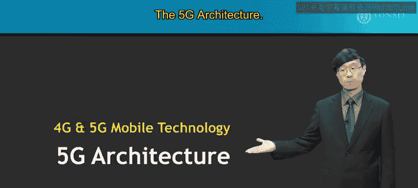
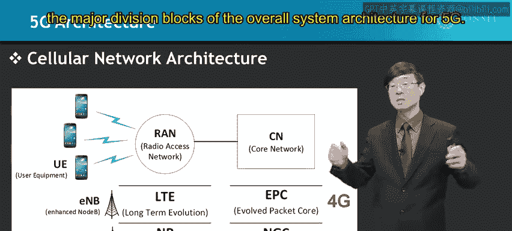
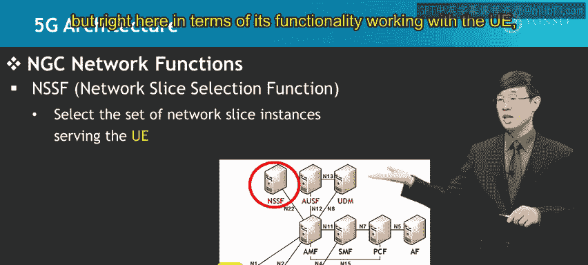
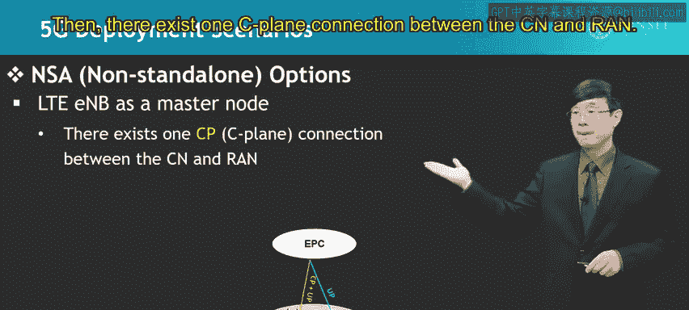
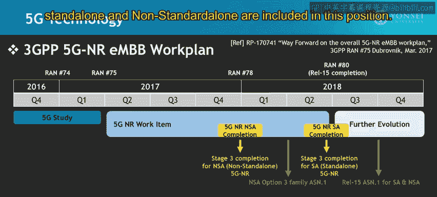

# 58：5G架构 🏗️

在本节课中，我们将学习第五代移动通信技术（5G）的网络架构。我们将从整体架构划分开始，详细解析其核心网功能，并探讨非独立组网这一重要部署场景及其性能要求。

## 整体架构划分 📐

上一节我们介绍了移动通信网络的演进，本节中我们来看看5G的具体架构。首先，观察蜂窝网络架构，可以将其整体划分为三个主要单元：

*   **用户设备**：即UE。
*   **无线接入网**：即RAN。
*   **核心网**：即Core Network。

我们可以将其与4G架构进行映射。在4G中，无线接入网中有**eNodeB**，其LTE组件构成了4G网络的接入部分。核心网部分则是**EPC**。UE、eNodeB和EPC共同构成了4G技术的**EPS**。

在5G中，基站被称为**gNodeB**。无线接入网部分被称为**新空口**，在3GPP标准中常写作5G-NR。对应的核心网部分则被称为**下一代核心网**，即**NGC**。这就是5G与4G系统架构的主要划分。

## 核心网功能详解 ⚙️

了解了整体架构后，我们进一步深入核心网。NGC包含多个关键功能块，以下是其主要功能单元：

*   **AMF**：负责接入和移动性管理功能，支持注册、连接管理以及移动性管理，同时负责接入认证和授权。
*   **SMF**：负责会话管理功能，管理数据会话（即数据包流），并支持IP地址的分配与管理。它还负责为用户面数据传输选择和控制UPF。
*   **UPF**：即用户面功能，负责数据包的路由和转发。它是**无线接入技术内**和**RAT间**移动性的锚点，是支持基于不同无线技术切换的中心。
*   **PCF**：即策略控制功能，为控制面功能（如AMF和SMF）提供策略规则。
*   **AF**：即应用功能，它与核心网交互以提供各种服务。
*   **UDM**：即用户数据管理，存储和管理用户设备的签约数据，并基于签约数据支持接入授权。
*   **AUSF**：即认证服务器功能，它与UE协作，存储UE的认证数据。
*   **NSSF**：即网络切片选择功能。它与UE协作，选择服务于该UE的一组**网络切片实例**。

## 非独立组网部署场景 🔄

上一节我们介绍了核心网的功能组件，本节中我们来看看5G的一个重要部署选项。**非独立组网**是5G的代表性部署场景之一，通常被认为是5G初期部署的首选方案。原因是它是“非独立”的，意味着它将与现有的4G网络协同工作。

如果你已经拥有一个4G网络，并计划演进到5G，那么NSA选项是一个中间步骤，可以利用已有的4G LTE网络提供额外的控制与功能。以下是几种主要的NSA架构选项示意图及说明：

图中展示了三种连接方式：
1.  NR gNodeB作为主节点，直接连接到NGC。
2.  数据通过NR gNodeB和/或连接到NGC的eNodeB传输。
3.  数据通过NR gNodeB经由NGC传输。

可以看到，LTE eNodeB通过Xn接口与NR gNodeB连接，这正是“非独立”的含义。让我们深入一些细节：

*   在选项2和3中，当NR gNodeB作为主节点时，在核心网与无线接入网之间存在一条**控制面连接**。这里的“核心网”和“RAN”是通用术语，因为NSA选项会与4G LTE网络共存。
*   用户面数据可以直接通过核心网路由到RAN。或者，在同一承载上流动的用户面数据可以在RAN处进行分流。
*   另一种选项是**LTE eNodeB作为主节点**。此时，数据流通过eNodeB和NR gNodeB在**EPC**处进行聚合，EPC即4G网络的核心网。因此，数据通过LTE eNodeB和/或NR gNodeB经由EPC传输，EPC扮演着重要角色，因为LTE eNodeB是主节点。
*   同样，在核心网与RAN之间存在一条控制面连接。用户面数据可以在承载基础上直接通过核心网路由到RAN，或者在同一承载内的数据流可以在无线接入网处进行分流。

## 性能要求与标准化进程 📈

在探讨了部署场景后，我们需要了解5G的性能目标。以**增强移动宽带**用例为例，它有很高的数据速率要求。具体性能指标包括：

*   **用户体验数据速率**：上行链路需达到**50 Mbps**，下行链路需达到**100 Mbps**。
*   **整体延迟要求**：设定为**4毫秒**。

关于5G-NR eMBB的标准化工作进程，时间范围从2016年持续到2018年。以下是相关标准文档的发布节点：

*   **Release 15**的完成目标定在2018年。
*   对5G移动通信的研究在此基础上展开。
*   NR工作项目由参与3GPP的多个机构合作共同设定和设计。
*   进一步的演进在2018年第三和第四季度进行。

在主要的时间节点上：
*   5G新空口**非独立组网**的完成基于Stage 3，目标定在**2018年3月**。
*   5G新空口**独立组网**的完成目标定在**2018年9月**。
*   Release 15中同时包含了SA和NSA选项。

## 总结 🎯

本节课中，我们一起学习了5G的网络架构。我们从整体上将5G网络划分为用户设备、无线接入网和核心网三部分，并详细介绍了下一代核心网中各个功能单元的作用，如AMF、SMF、UPF等。我们还重点探讨了非独立组网这一初期部署方案，了解了其与4G网络协同工作的几种模式。最后，我们回顾了5G eMBB场景的关键性能指标以及标准化的主要进程时间点。理解这些基础架构和概念，是进一步探索5G网络切片、超可靠低延迟通信等高级特性的基石。