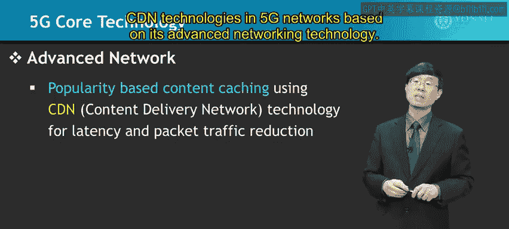

# 延世大学《新兴技术从智能手机到物联网再到大数据》课程 - P59：23_4.8 5G核心技术（第1部分）🚀

在本节课中，我们将学习5G网络的核心使能技术。这些技术是构建下一代移动通信网络的基础，主要包括先进的网络架构、网络功能虚拟化以及软件定义网络等。我们将逐一解析这些概念，并了解它们如何共同作用以实现5G网络的高性能。

## 先进网络架构

上一节我们概述了5G的核心技术，本节中我们来看看其先进的网络架构。5G的关键使能技术基于下图所示的内容，我们将在本次讲座中详细讨论。

首先，是先进的网络。如图所示，这是一个EPC（演进分组核心网）云化的例子。它连接到一个支持NFV（网络功能虚拟化）的节点，该节点内部包含了一些功能。

扁平化和分布式网络架构是先进网络的特征之一。这是什么意思呢？在之前讨论4G LTE和LT网络时，网络中存在具有特定功能的单元块，例如HSS（归属用户服务器）、MME（移动性管理实体）、SGW（服务网关）、PGW（PDN网关）和PCRF（策略和计费规则功能单元）。这些单元根据规范设计，具有非常具体的功能，并且必须是网络中的物理设备，整个网络才能运行。因此，整个网络由执行特定操作的特定单元构成。

扁平化和分布式网络是指将这些功能以软件虚拟功能的形式分布在网络中。这样，网络中就没有了特定的功能块，而是网络中的所有单元都内部包含了一些这些功能，可以按需使用。这意味着没有单个单元拥有你必须依赖的单一功能。单个设备的功能在某种程度上被平均化了，因此它们是分布式的。所以我们使用“扁平化和分布式”这个术语来描述5G核心网的先进网络。

集成和分布式的网络功能。基于某些设备，它们的功能通过虚拟功能集成在其中，我们稍后会详细讨论。

## 灵活的网络架构与关键技术

上一节我们介绍了扁平化分布式架构的概念，本节中我们来看看实现这种架构的两种关键技术：SDN和NFV。

在灵活的网络架构中，可编程的网络功能基于SDN（软件定义网络）技术和NFV（网络功能虚拟化）技术。NFV的一个示例如下列出的虚拟化网络功能，这些功能可能包括深度包检测、优化器、Web网关、防火墙、NAT以及各种其他IP功能，此外还需要提供和支持移动通信网络功能。但不同于拥有MME、服务网关、PDN网关等具有单一功能的独立模块，我们将使用网络功能虚拟化。

网络功能虚拟化将复杂的基于硬件的网络节点功能虚拟化为软件构建块。这些构建块可以组合和链接。换句话说，如果我需要这个功能，然后那个功能，再下一个功能，我可以将它们组合在一起，形成一条服务链。这些个体基于我们所谓的虚拟化功能。因此，不再是拥有一个执行独特任务的独立模块，为了获得该服务，你需要访问那个模块，然后该设备会引导你进行下一步；在这里，我们收集所需的功能，然后将其置入特定数据流的功能中。

NFV技术通过使用称为VNF（虚拟化网络功能）的灵活软件块，消除了对复杂的基于硬件的网络节点的依赖。通过使用NFV技术，你可以提高灵活性、功能性和效率。具体如何实现呢？再次强调，你可以通过软件功能收集你所需的东西，然后创建一条链来支持你在网络内的数据流，最后执行它。因此，网络是扁平且分布式的：你收集所需，将其组合，然后执行。这样你就不需要经过特定的转折点去某个地方，然后再去另一个地方获取功能；你收集它，链接它，然后使用它，从而获得灵活性、功能性和效率这些特性。

SDN，即软件定义网络。SDN解耦了网络控制和数据转发路径及功能。在以前不使用SDN的传统网络中，控制转发路径和数据路径是相同的，因此灵活性不高。但在5G网络中使用SDN技术，它将控制面和数据面分离开来。因此，你可以更灵活地控制网络。这就是为什么现在使用SDN技术可以实现分布式管理，通过最短数据路径传输而无需穿越核心网络。

网络控制可以直接编程，底层基础设施被抽象化，供应用程序和网络服务使用。正是通过独立控制和访问控制流与数据流，你获得了极大的灵活性。因此，你有了更多选项来优化控制网络的方式以及发送数据的方式。

## 先进网络特性详解

上一节我们了解了SDN和NFV，本节我们进一步探讨先进网络的其他特性。

先进网络再次体现了扁平化和分布式网络架构。它利用分布式管理，提供不穿越核心网络的最短路径。同样，这是如何通过NFV和SDN技术实现的呢？

上下文感知的资源分配。考虑到实时流量、服务类型和设备特性，提供了上下文感知的资源分配。那么，这个上下文来自哪里？我又需要在何处重新平衡整体资源分配方案，以使我的网络整体上达到最优效率和高利用率？

利用CDN（内容分发网络）技术的其他特性。内容分发网络是基于算法预测未来需求的网络。预测到的流量会被提前推送到靠近用户的位置，这样当用户需要时，可以非常快速地交付，同时由于内容被移动到更近的位置并在本地域内共享，整体网络利用率也得以降低。这项技术被广泛应用于各种广播和多媒体服务中，因此CDN技术非常流行。我们将引入这种预测和CDN技术，以支持更快的服务并降低网络的整体利用率，使网络功能更加高效。

在基于其先进网络技术的5G网络中，通过CDN技术实现这一点。

当然，一个例子如图所示：为了更快地支持用户设备（UE），分组数据网络会查看需要什么，特别是对于像URLLC（超可靠低延迟通信）这样的低延迟需求，内容被更靠近实际用户。为了实现这一点，需要一个预测算法来决定需要将哪些内容推送到更靠近用户的位置。基于流行度的内容缓存可能就是这种参考算法。

你将如何执行这种基于流行度的算法呢？有以下几种方案，它们都基于CDN技术。

以下是基于CDN技术的几种常见内容缓存与预测方案：

*   **基于流行度的缓存**：系统跟踪内容的访问频率（如点击率、播放量），并将最流行的内容缓存在网络边缘。
*   **预测性预取**：利用机器学习算法分析用户行为模式和历史数据，预测用户可能请求的内容，并提前缓存。
*   **协作式缓存**：网络边缘节点之间共享缓存信息和内容，提高命中率并减少回源流量。

## 总结

本节课中，我们一起学习了5G核心网络技术的第一部分。我们重点探讨了先进的扁平化分布式网络架构，并深入分析了实现该架构的两大关键技术：**网络功能虚拟化（NFV）** 和 **软件定义网络（SDN）**。NFV通过将网络功能软件化（`VNF`）来提高灵活性和效率，而SDN通过分离控制面与数据面（`control plane / data plane`）实现网络的集中可编程控制。此外，我们还了解了**上下文感知的资源分配**和**内容分发网络（CDN）** 技术如何进一步优化5G网络性能，通过预测和边缘缓存实现低延迟与高带宽服务。这些技术共同构成了5G网络高效、灵活和智能的基石。