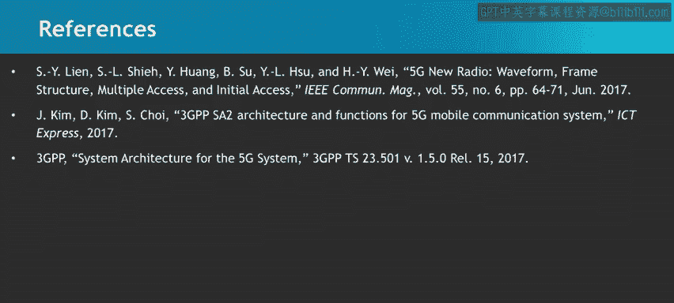

# 延世大学《新兴技术从智能手机到物联网再到大数据》课程 - P60：24_4.8 5G核心技术（第2部分）🚀

在本节课中，我们将继续学习5G的核心技术，重点探讨**网络切片**这一关键概念。我们将了解网络切片如何将一个物理网络划分为多个虚拟的逻辑网络，以满足不同应用场景的特定需求。

## 网络切片概述 🧩

上一节我们介绍了5G的一些基础技术，本节中我们来看看**网络切片**。网络切片是一项非常重要的技术，它将5G物理网络划分为多个虚拟化的、逻辑上隔离的网络。

这项技术影响移动设备、接入网、传输网和核心网。用户实际上在使用一个网络，但在逻辑上，这个网络被划分为独立的子层。这样，针对不同的应用，可以提供特定的功能集，并在需要的地方提供支持。

如何实现这一点？这就是网络切片的核心。它是一个大的5G网络，但通过逻辑控制、精确的调度和资源分配，使其感觉像是多个独立的小网络组合在一起。这就是“虚拟化”的含义：实际上是一个网络，但逻辑上像是多个独立的网络，它们共享同一个物理网络。

## 网络切片的工作原理 ⚙️

网络切片专用于具有不同特征和服务质量要求的各类服务。

以下是网络切片支持的主要服务类型：

*   **超高清视频广播与组播服务**：这类服务对传输时间有严格规定，可能因每秒帧数而产生延迟限制问题。
*   **智能手机服务切片**：这是5G网络中的主要组成部分，因为智能手机是众多应用的工具。
*   **海量物联网切片**：用于传感器网络，采用更简化、轻量级的5G核心网，无需复杂的移动性管理。
*   **关键任务物联网切片**：用于支持车对车通信、车对基础设施通信，以支持自动驾驶汽车和智能交通系统。

## 网络切片架构详解 🏗️

让我们深入了解其架构细节。网络切片涉及用户面、控制面、数字单元和移动视频优化等功能。

在边缘云中，部署了虚拟化的数字单元、5G核心网的用户面以及缓存服务器。在核心云中，则部署了虚拟化的5G核心网控制面和移动视频优化服务器。通过这种方式划分并提供功能。

对于智能手机切片，5G核心网的用户面、控制面以及具有完整移动性特征的IMS服务器都在核心云中虚拟化。

对于海量物联网切片，在核心云中部署的是没有移动性管理的简化版轻量级5G核心网。物联网设备通常移动性不强，也不需要很高的数据速率，但数量庞大是其主要挑战。5G标准中，mMTC的目标之一就是在每平方公里范围内支持百万级连接。

对于关键任务物联网切片，5G核心网用户面及通过V2X（车联万物）连接的服务器都部署在边缘云中，以最小化传输延迟。V2X中的“X”可以是车辆、基础设施或行人。

## V2X服务与网络切片 🚗

现在，我们进一步了解V2X服务的网络切片。请看这个网络图：底部有终端1和终端2（位于汽车中），中间是V2X通信服务提供商，上层则连接着驾驶功能、地图功能和多媒体娱乐系统。

图中红色圆圈内顶部是网络切片实例，分别为驾驶功能、地图功能和视频/多媒体功能提供服务，这些功能连接到汽车上的终端1（车载单元或智能控制器）。这就是通过网络切片提供V2X服务连接的方式。

V2X服务的特性包括娱乐和驾驶辅助。娱乐功能对数据吞吐量要求高，以确保多媒体视频服务或车内乘客的游戏体验质量。驾驶辅助功能则对延迟和可靠性有极高要求，例如导航系统或智能交通系统。

## 超可靠低延迟通信与自动驾驶 🛣️

进一步深入到自动驾驶控制，为了实现高效和舒适的完全自动驾驶，需要ULLC服务的支持。

ULLC提供**超高可靠性和超低延迟**。由于其严格的性能要求，ULLC可以实现高密度编队行驶和协同交叉路口控制。

高密度编队行驶是指多辆汽车或卡车以极近的距离行驶，但像一列车队一样被协同控制。它们会一起加速、减速和刹车，协调地进行左右转弯，看起来像一列火车。这提高了道路的整体利用率，因为它们像拖车或火车一样紧密行驶，而不是相隔数百码的安全距离。

协同交叉路口控制则针对变道、交通灯、左右转弯和交叉口等事故多发区域。通过协同控制，可以大幅提升交叉路口区域的安全性和使用效率。这些正是我们希望通过基于V2X服务的网络切片来实现的目标。

## 课程总结 📚

本节课中，我们一起学习了5G的核心技术——网络切片。我们了解到网络切片如何通过逻辑划分将一个物理5G网络虚拟化为多个独立的子网络，以满足超高清视频、智能手机、海量物联网和关键任务物联网等不同服务的特定需求。特别是，我们深入探讨了网络切片在V2X服务和自动驾驶场景中的应用，例如通过ULLC实现高密度编队行驶和协同交叉路口控制，从而提升道路利用率和交通安全性。

这些是我使用的参考文献，推荐给你。谢谢。

