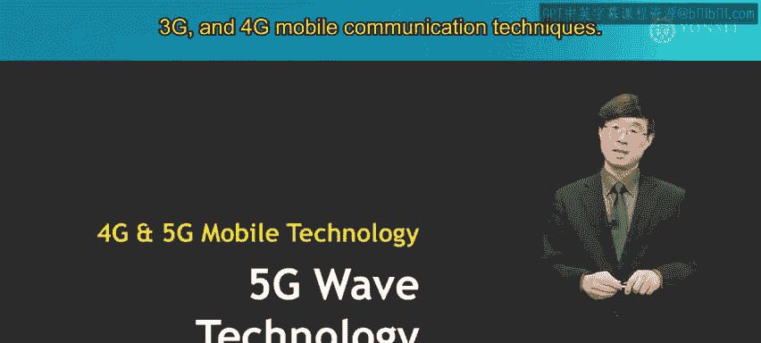
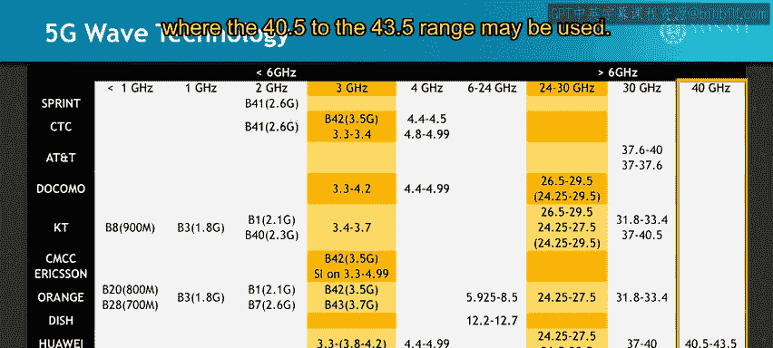
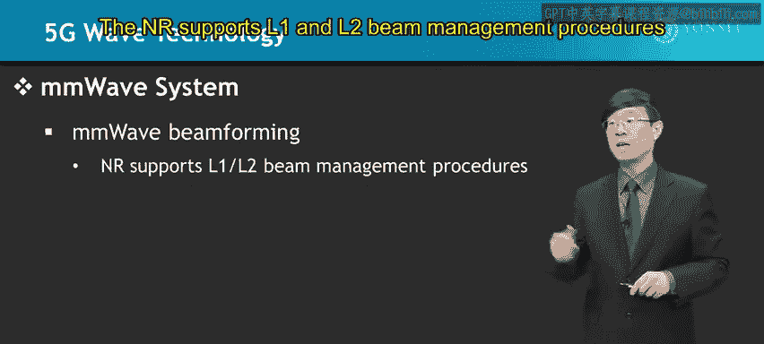
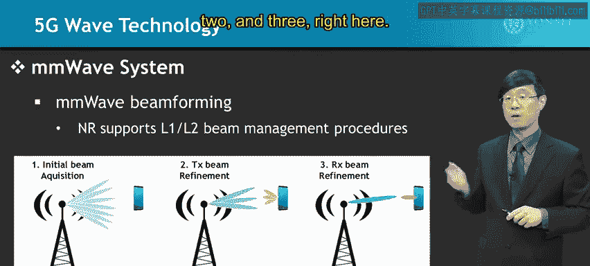
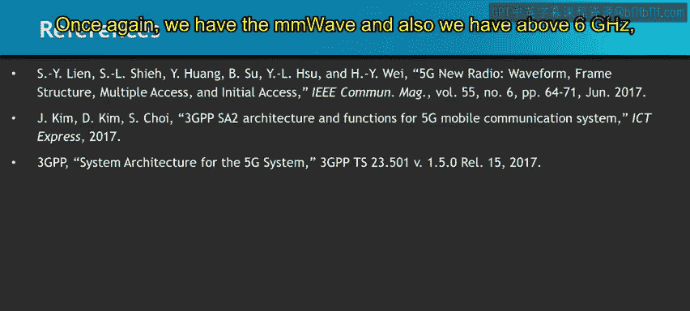
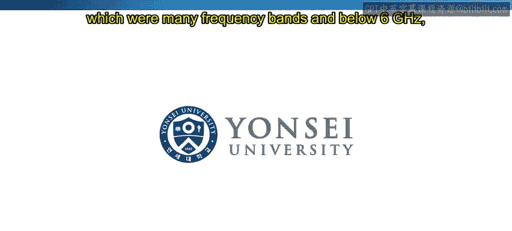

# 延世大学《新兴技术从智能手机到物联网再到大数据》课程 - P61：25_4.9 5G毫米波技术（第1部分）📡

在本节课中，我们将要学习5G移动通信技术中的一个核心组成部分——毫米波技术。我们将探讨其使用的频段范围、技术特点以及实现高速数据传输所面临的关键挑战和解决方案。

## 概述 📋

5G毫米波技术是本次讲座的主题。我们将深入探讨这一领域，因为当5G使用毫米波频段时，其技术与之前的2G、3G和4G移动通信技术存在显著差异。因此，我们需要对其进行更详细的研究。

## 5G频谱划分 📊

首先，我们从下面的频谱划分表开始。5G频谱主要分为两个大范围：**6 GHz以下**和**6 GHz以上**。

以下是具体的频段划分及其应用焦点：

*   **6 GHz以下频段**：
    *   **1 GHz以下**：例如800 MHz、700 MHz、900 MHz。
    *   **1 GHz范围**：例如1.8 GHz，是许多公司未来技术和5G服务的关注点。
    *   **2 GHz范围**：例如2.1 GHz、2.3 GHz和2.6 GHz，是服务实施的重点。
    *   **3 GHz范围**：活动主要集中在3.3 GHz至3.7 GHz左右。
    *   **4 GHz范围**：关注范围大约在4.4 GHz至4.99 GHz。

*   **6 GHz以上频段**：
    *   **6 GHz至24 GHz**：关注频段包括5.9 GHz至8.5 GHz，以及12.2 GHz至12.7 GHz。
    *   **24 GHz至30 GHz**：这是投入大量关注的核心区域，从24 GHz到29 GHz的范围将被高度使用。
    *   **30 GHz范围**：从31 GHz一直到40 GHz是关注范围，各种应用和服务提供商正考虑将其用于其应用。
    *   **40 GHz范围**：40.5 GHz至43.5 GHz范围也可能被使用。

从表中可以明显看出，在黄色高亮列中，**3 GHz**和**24至30 GHz**是主要的关注范围。

## 毫米波技术的特点与挑战 ⚡

上一节我们介绍了5G的频谱划分，本节中我们来看看毫米波技术的核心特点及其带来的独特挑战。

在5G波技术中，**毫米波系统**是首要关注点。与LTE频段相比，**6 GHz以上**的毫米波频段是主要焦点，因为它能提供巨大的带宽，从而实现极高的数据速率。

例如，在28 GHz频段，利用多小区500 MHz带宽传输技术，可以支持高达**2.2 Gbps**的数据速率。实现这一目标的支持技术包括28 GHz极化交错阵列，以及60 GHz 360度覆盖、16链CMOS RFIC技术。

5G的一项关键技术就是毫米波，其中**毫米波信号的形成和利用**至关重要。需要提供**多个波束**，以确保对整个小区有足够的覆盖。

这是因为当频率超过10 GHz时，电磁波开始表现得像光。光无法穿透固体物体，在固体物体的另一侧会产生阴影。同样，远超过10 GHz的毫米波也具有相同特性。因此，**阴影效应**会频繁发生。

为了获得全面支持以避免阴影效应，可能需要多个基站向特定用户发送定向信号。这样，如果一个信号因阴影效应而丢失，另一个信号可以支持它，以提供连续的数据速率。

这种特性被称为**视距传输**。这意味着需要在基站和移动设备之间有一条**直接的、没有任何障碍物阻挡或产生阴影的路径**。这就是我们所说的**LOS**，这在许多情况下是无法提供的，因此我们需要多个设备和多个波束来确保整个小区区域的充分覆盖。

## 波束管理流程 🔄

由于需要多个波束来克服毫米波的传播限制，有效的波束管理流程必不可少。这些流程用于为每个设备获取并维持最佳波束。

NR（新空口）支持**L1（层1）和L2（层2）的波束管理流程**。

以下是其基本操作流程：

1.  **初始波束获取**：基站从不同角度辐射不同的波束模式。
2.  **移动设备响应**：移动设备在第二阶段发送回复信号。
3.  **最佳波束确定**：在第三阶段，找到最佳的发射和接收波束模式并最终使用。

简单来说，流程就是：基站扫描 -> 设备回复 -> 混合匹配以优化波束模式 -> 在三个阶段中使用最佳波束。

## 总结 🎯

本节课中，我们一起学习了5G毫米波技术的基础知识。我们首先了解了5G频谱在6 GHz以下和以上的关键划分，特别是3 GHz和24-30 GHz的核心地位。接着，我们深入探讨了毫米波技术能够实现超高数据速率的核心优势，同时也分析了其面临的**视距传输限制**和**阴影效应**挑战。最后，我们介绍了为应对这些挑战而设计的**多波束技术**和**波束管理流程**，它们通过动态寻找和维持最佳通信链路，确保了5G毫米波网络的可靠覆盖和高速连接。理解这些基本原理是掌握更复杂5G技术的关键第一步。