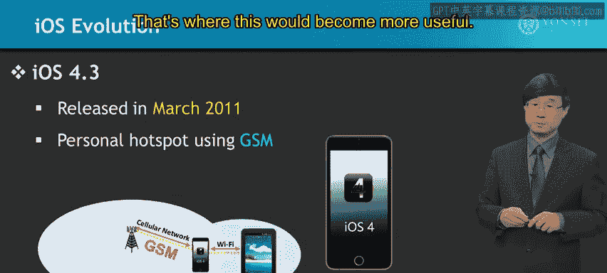
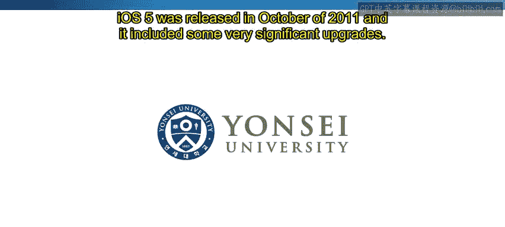

# 延世大学《新兴技术从智能手机到物联网再到大数据》课程 - P63：27_5.1 iOS演进（第1部分）📱

在本节课中，我们将学习智能手机操作系统。我们将重点关注Android和iOS，因为这两者主导了智能手机操作系统市场。我们将探讨iOS和Android的演进历程与架构，但首先从iOS开始。原因是第一款智能手机iPhone使用了iOS，这也是首个投入实际应用的智能手机操作系统。

## iOS演进历程

上一节我们介绍了本模块的学习目标，本节中我们来看看iOS的演进历史。

史蒂夫·乔布斯于2007年1月9日发布了iPhone。iPhone和iPad开启了智能设备、移动应用和移动计算的新时代。这是电子和IT行业的一场革命。

### iOS 1

iOS 1于2007年6月发布。这是第一代iPhone的操作系统。它包含以下特性：

以下是iOS 1的核心特性列表：
*   核心iOS用户界面支持电容式触摸屏。
*   支持**捏合缩放**功能，用户可以通过手势放大屏幕内容。
*   支持**惯性滚动**，即手指滑动后内容会根据动量继续滚动。
*   包含移动Safari网页浏览器。
*   包含可视语音信箱。
*   使用Google Maps作为位置参考，为未来的基于位置的服务提供支持。GPS模块可提供经纬度信息，使用户位置能在Google地图上精确定位。

### iOS 1.1 与 1.1.3

iOS 1.1于2007年9月发布。它增加了对iPod touch的兼容性，并可以连接iTunes的WiFi音乐商店。

iOS 1.1.3于2008年1月发布。以下是其主要更新：
*   主屏幕上可添加网页剪辑。
*   包含图标排列功能。
*   可使用多点触控键盘。
*   改进了定位能力。通过结合移动通信基站和WiFi接入点提供的信息（在可能的情况下还包括GPS信息）来确定用户的近似位置。

### iOS 2

iOS 2于2008年7月发布，App Store正式上线。这是移动应用分发领域的一场真正革命。

以下是iOS 2带来的关键变化：
*   改进了应用浏览和安装体验。
*   iOS软件开发工具包（SDK）的发布，使开发者能够设计功能更丰富、外观更佳的应用。
*   SDK使开发者能够开发应用并将其上架到App Store。这一切共同构成了移动应用可用性与开发方式的真正革命。
*   iOS 2还包含了全局搜索、Microsoft Exchange支持以及移动版.Me服务。

iOS 2.1于2008年9月发布，进行了电池寿命和速度修复，延长了续航并减少了操作响应时间。它还增加了iTunes Genius播放列表功能，并修复了掉话问题。

iOS 2.2于2008年11月发布，包含了Google街景视图，并支持播客下载。

### iOS 3

iOS 3于2009年6月发布。

以下是iOS 3引入的重要功能：
*   增加了**剪切、复制和粘贴**功能，并引入了适用于触摸操作的新文本选择方式。
*   第三方应用支持推送通知。
*   支持语音控制。
*   多媒体消息服务（MMS）功能可用。
*   支持USB和蓝牙网络共享。
*   新增横屏键盘和“查找我的iPhone”功能。

iOS 3.2于2010年4月发布，增加了对iPad分辨率的支持，包含了适用于iPad的通用应用视图，支持基于Apple数据的定位和蓝牙键盘，并引入了iBooks。

### iOS 4

iOS 4于2010年6月发布，**多任务处理**功能成为可能。

多任务处理主要指快速应用切换和保存状态功能，这实现了高效的多任务。它允许应用保存当前状态，以便在多任务切换后返回时能轻松恢复。

需要注意的一点是，iPhone上的应用被设计为节能的。此外，智能手机芯片组中的CPU和GPU处理能力有限，内存资源也有限，电池电量也有限。因此，iPhone上的许多应用通常都有一个计时机制：如果你在一定时间内没有使用它，它实际上会关闭。正因如此，尽管iOS 4提供了多任务功能，但如果你没有足够快地返回某个应用，它可能会被终止。这并非操作系统导致的终止，而是应用自身为了节能和高效处理而设计的。

iOS 4还增加了对Retina显示屏的支持。

在接下来的课程中，我们将讨论iOS架构，包括操作系统层、内核和设备驱动特性。那节课将提供关于iOS的更多细节，并讲解这些功能是如何连接的。

在此之前，我们将继续基于这个演进趋势回顾主要特性。

iOS 4还包括使用WiFi的FaceTime视频聊天，这是一个非常流行的应用。此外，主屏幕文件夹功能可用，你可以将一个应用图标拖放到另一个应用图标上，然后会自动形成一个应用文件夹。

### iOS 4.2.5 与 4.3

iOS 4.2.5于2011年2月发布，它包含了使用CDMA技术的个人热点功能。这意味着你可以用iPhone创建一个热点：你的iPhone通过移动通信网络连接到3G CDMA技术的基站，然后使用WiFi扩展你的网络并自身充当热点。

iOS 4.3于2011年3月发布，增加了使用GSM移动通信技术的个人热点功能。可以看到的一个特点是，CDMA技术是第三代移动通信技术，与GSM相比支持更高的数据速率。尽管GSM本身很有价值，原因是虽然GSM作为第二代移动通信技术支持的数据速率低得多，但由于GSM覆盖几乎无处不在，即使数据速率较低，一些数据服务仍然非常有用。而前面提到的CDMA热点提供了更高的数据速率，然而在某些情况下，可能只有GSM可用而没有CDMA覆盖，这时GSM热点功能就更有用了。

## 总结

本节课中，我们一起学习了iOS操作系统从2007年首次发布到iOS 4.3版本的演进历程。我们看到了iOS如何从支持基本触控交互，逐步引入App Store、多任务处理、Retina显示屏等关键功能，并扩展了对不同网络技术（如CDMA和GSM）个人热点的支持。这些演进共同塑造了现代智能手机体验的基础。下一节，我们将深入探讨iOS的系统架构。