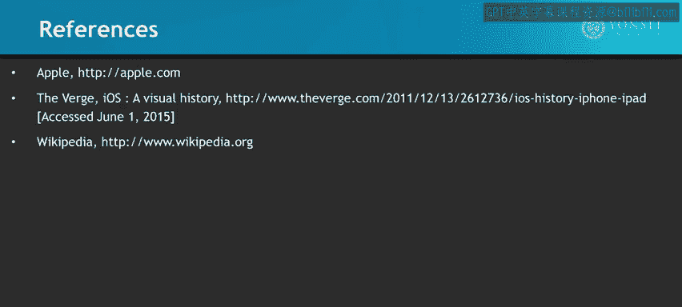

# 64：28_5.1 iOS演进（第2部分）📱

在本节课中，我们将继续学习iOS操作系统的演进历程，重点介绍从iOS 5到iOS 11版本的主要功能升级。我们将了解每个版本引入的关键特性，例如iCloud、Siri、Apple Pay等，并探讨它们如何塑造了现代智能手机的体验。

上一节我们回顾了iOS的早期版本，本节中我们来看看iOS 5及其后续版本带来的重大革新。

## iOS 5 (2011年10月发布)

iOS 5包含了一些非常重要的升级。

以下是iOS 5的主要新特性：

*   **iCloud**：首次引入，提供了文件备份和多设备同步功能。这意味着你的iPhone和iPad可以通过iCloud同步所有应用程序和数据。
*   **Siri**：增加了基于语音控制的虚拟助手Siri。它取代了早期iOS版本中原始的“语音控制”应用。
*   **iMessage**：增加了iMessage功能。由于提供了免费的多媒体信息交换，它变得非常流行。
*   **无需电脑激活**：取消了必须连接电脑激活的要求。这意味着iOS 5设备在激活时，无需通过USB线缆物理连接到电脑，设备可以独立完成激活。

## iOS 6 (2012年9月发布)

iOS 6包含了苹果自家的地图应用。

以下是iOS 6的主要新特性：

*   **苹果地图**：此时开始不再使用谷歌地图。
*   **蜂窝网络FaceTime**：通过移动蜂窝网络进行FaceTime视频通话成为可能。
*   **改进的Apple ID集成**：增强了Apple ID的集成功能。
*   **Passbook**：引入了Passbook，这是一个移动支付和会员卡管理机制。其服务范围包括票据、优惠券和登机牌。
*   **Siri增强**：Siri得到增强，可以查询体育比分、赛程和球员数据。同时整合了Yelp的餐厅评论和OpenTable的预订功能。
*   **Siri汽车控制**：增加了Siri汽车控制功能，但这属于未来发展方向，当时并未实际控制产品。

## iOS 7 (2013年9月发布)

iOS 7包含了Touch ID功能。

以下是iOS 7的主要新特性：

*   **Touch ID**：引入了指纹生物识别传感器，用于解锁手机。
*   **App Store无密码购买**：支持在App Store进行免密码购买。
*   **AirDrop**：增加了AirDrop功能，支持临时共享图像、视频和文件。其特点是能以原始分辨率发送媒体文件，因此变得非常流行。
*   **FaceTime音频**：苹果用户之间可以通过Wi-Fi、3G或LTE进行纯音频版本的FaceTime通话。

## iOS 8 (2014年9月发布)

iOS 8包含了“连续性”功能。

以下是iOS 8的主要新特性：

*   **连续性**：与苹果新的Mac OS X 10.10 Yosemite系统协同工作，增强了iPhone、iPad和Mac电脑之间的交互性。你可以从Mac上发送和接收短信，甚至接听电话，使Mac更像一部iPhone。
*   **第三方键盘支持**：iOS 8开始支持第三方键盘。
*   **HealthKit与HomeKit**：HealthKit成为第三方健身追踪器数据的中心。HomeKit用于家庭自动化，但这属于未来发展方向。当通过HomeKit操作系统支持实现家庭自动化时，iPhone将作为整个家庭的遥控器。

## iOS 9 (2015年9月发布)

iOS 9包含了3D Touch功能。

以下是iOS 9的主要新特性：

*   **3D Touch**：在iPhone 6s、6s Plus、7和7 Plus中引入。按压或按住iPhone屏幕会触发压力感应功能，从而打开菜单或执行操作。
*   **新闻与聚焦搜索增强**：能够根据用户体验提供额外信息。
*   **钱包与“转移到iOS”**：钱包应用取代了Passbook应用，并通过支持Discover信用卡和借记卡、商店奖励计划等增强了Apple Pay的功能。这对Discover信用卡和iOS 9钱包功能是双赢。“转移到iOS”功能使得从Android设备迁移到iOS设备变得更加容易。

## iOS 10 (2016年9月发布)

iOS 10允许隐藏主屏幕上的内置应用图标。

以下是iOS 10的主要新特性：

*   **锁屏功能增强**：在锁屏状态下，向左滑动可以打开相机，向右滑动可以打开“今天”视图，按下主屏幕按钮可以解锁设备。
*   **家庭应用**：新增“家庭”应用，用于安全管理和控制支持HomeKit的配件。

## iOS 11 (2017年9月发布)

iOS 11为iPad带来了“文件”应用和程序坞等主要功能。

以下是iOS 11的主要新特性：

*   **文件与程序坞**：“文件”是iOS设备的文件管理器，包含云存储功能。“程序坞”是快速打开和切换应用的控制中心。
*   **iPad多任务处理**：支持同时使用两个应用，提供了“侧拉”和“分屏浏览”模式。
*   **拖放功能**：可以使用拖放手势将文本、照片和文件从一个应用移动到另一个应用。
*   **Apple Pencil功能**：支持即时标记、即时笔记、内联绘图以及扫描和签名。
*   **ARKit**：ARKit代表增强现实工具包，是iOS设备的增强现实平台。
*   **控制中心自定义**：增加了控制中心自定义功能。

本节课中我们一起学习了从iOS 5到iOS 11每个版本的核心升级。这些参考资料是我所使用的，接下来我们将进入iOS架构部分，展示所有这些功能是如何在一个处理内核之上被编程和运行的，这将是下一讲的内容。

谢谢。😊

