# 65：iOS架构详解 📱

在本节课中，我们将要学习iPhone和iPad的iOS系统架构。我们将从整体上了解iOS的架构，包括其软件开发工具包，并深入探讨构成该架构的四个主要层次及其核心功能。

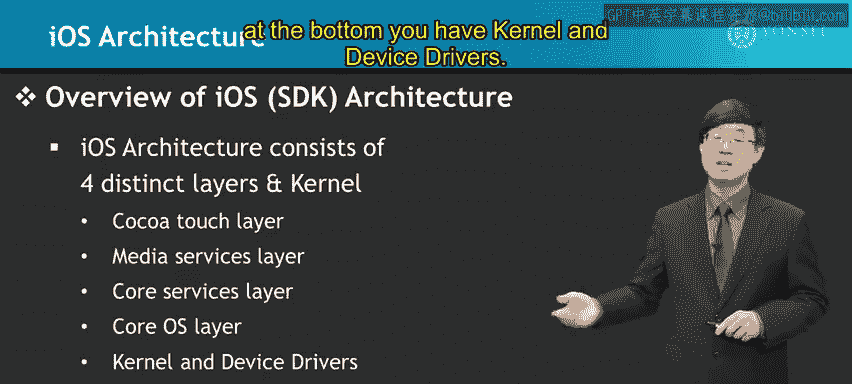

iOS的整体架构，包括软件开发工具包，由四个不同的层次和一个内核构成。这四个层次分别是顶层的Cocoa Touch层、媒体服务层、核心服务层以及核心操作系统层。iOS架构就建立在这四层之上，最底层则是内核和设备驱动程序。

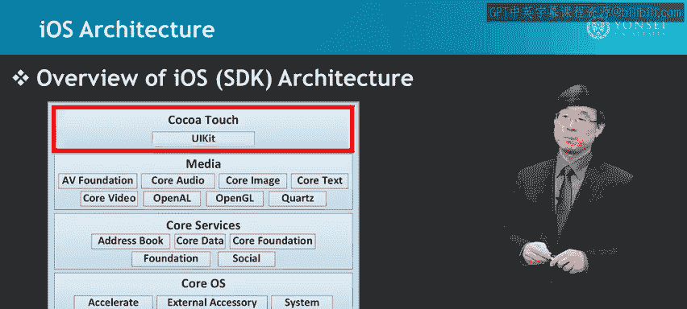

## 整体架构视图 🏗️

观察其架构，它呈现为分层结构。每一层都包含实现特定功能的子组件。

## Cocoa Touch层 👆

iOS架构的最顶层是Cocoa Touch层，它包含了用户界面工具包框架。

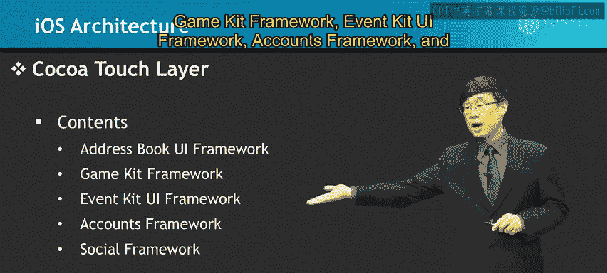

Cocoa Touch层定义了基本的应用程序基础设施，并提供了诸如多任务处理和基于触摸的输入等核心功能。它提供了许多高级特性，例如自动布局、手势识别器、文档支持和打印功能。这一层主要使用Objective-C语言编写。

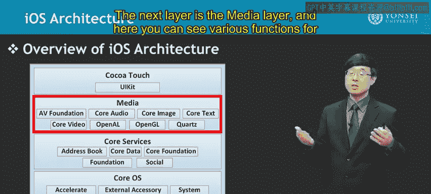

以下是Cocoa Touch层包含的一些主要内容：
*   **UI Kit框架**：用户界面核心框架。
*   **Map Kit框架**：地图功能支持。
*   **推送通知服务**：接收服务器推送消息。
*   **Message UI框架**：集成邮件和短信界面。
*   **Address Book UI框架**：访问和显示通讯录。
*   **Game Kit框架**：游戏中心功能。
*   **Event Kit UI框架**：日历和事件界面。
*   **Accounts框架**：统一账户管理。
*   **Social框架**：社交媒体集成。

## 媒体层 🎨

接下来的一层是媒体层，它包含了图形、音频和视频支持的各种功能。

媒体层为iOS提供了支持音频、视频、动画和图形所需的所有功能。

以下是媒体层包含的主要内容：
*   **Core Video框架**：视频处理。
*   **Core Text框架**：文本布局和渲染。
*   **Image I/O框架**：图像读写。
*   **Assets Library框架**：访问用户照片和视频。
*   **Core Graphics框架**：2D图形绘制。
*   **Core Image框架**：图像处理和滤镜。
*   **Quartz Core框架**：动画和图层渲染。
*   **GL Kit框架**：简化OpenGL ES使用的工具包。
*   **OpenGL ES框架**：用于嵌入式系统的图形库。
*   **Newsstand Kit框架**：报刊杂志应用支持。
*   **iOS音频支持**和**AV Foundation框架**：音频视频录制与播放。
*   **Core Audio框架**和**OpenAL库**：底层音频处理。
*   **Media Player框架**和**Core Media框架**：媒体播放与控制。

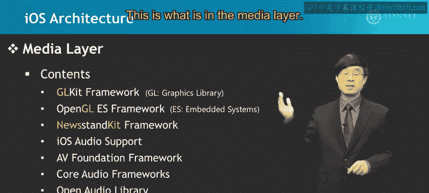

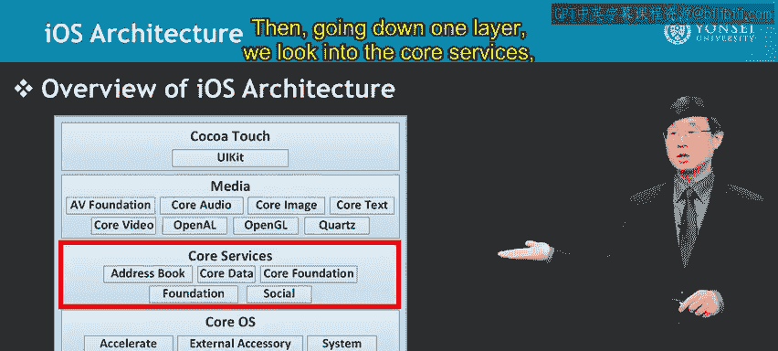

## 核心服务层 ⚙️

上一节我们介绍了处理多媒体功能的媒体层，现在让我们向下深入一层，看看核心服务层。

核心服务层包含了为原生iOS应用程序管理基础系统服务的功能，例如提供块对象、Grand Central Dispatch、应用内购买和iCloud存储等关键特性。

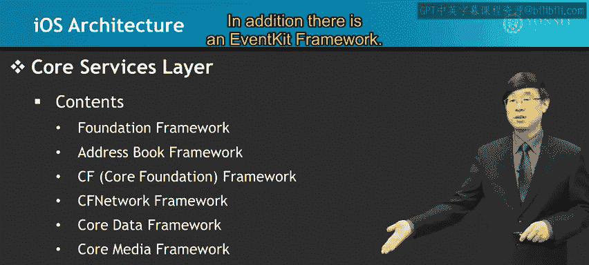

以下是核心服务层包含的主要内容：
*   **Foundation框架**：提供Objective-C的基础类。
*   **Address Book框架**：访问联系人数据库。
*   **Core Foundation框架**：提供C语言的基础服务。
*   **CFNetwork框架**：网络通信。
*   **Core Data框架**：对象图管理和持久化。
*   **Core Media框架**：底层媒体管道。
*   **Core Telephony框架**：电话功能集成。
*   **Event Kit框架**：访问日历和提醒事件。

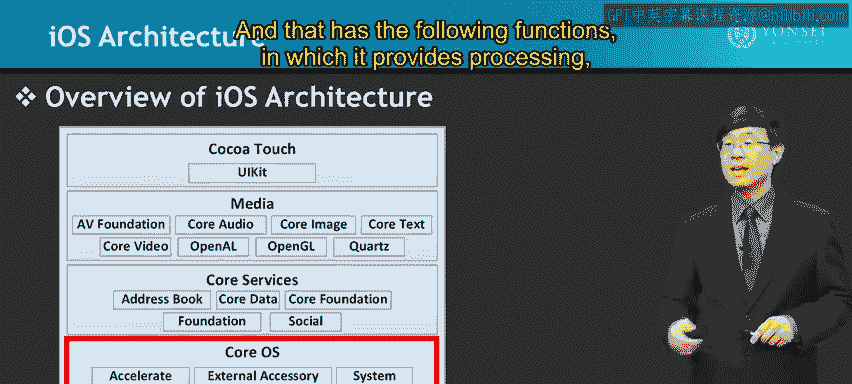

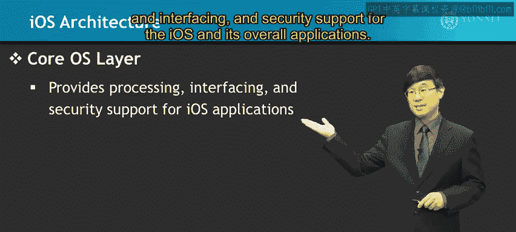

## 核心操作系统层与内核 🔧

iOS架构的最底层是核心操作系统层，它为iOS及其所有应用程序提供处理、接口和安全支持。

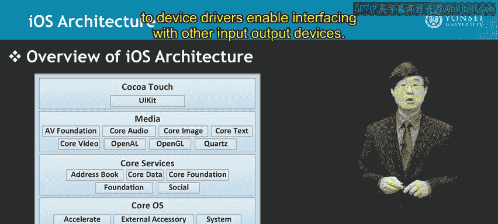

核心操作系统层封装了内核环境和低级别的Unix接口。

以下是该层包含的主要内容：
*   **Accelerate框架**：优化数学和图像计算。
*   **External Accessory框架**：与外部硬件配件通信。
*   **Security框架**：加密和安全服务。
*   **System**：系统级接口。

## 内核与设备驱动程序 🖥️

在内核和设备驱动程序层，iOS运行于内核之上。内核负责操作系统线程的处理，而设备驱动程序则实现了与其他输入输出设备的接口。

这是iOS架构的最底层，有时在描述iOS架构时，会将此层单独列出，不包含在四层架构之内。它由内核和设备驱动程序构成，其内核环境建立在Mach 3.0微内核技术之上。这意味着内核包含了一套完整的处理固件，它与CPU、芯片组和GPU交互，从而提供处理能力。微内核技术意味着内核被精简，使其更紧凑、更快速。内核和设备驱动程序层还提供了高性能的网络设施，这是因为它包含了设备驱动能力。它支持多种集成的文件系统，内容上包括BSD文件系统、Mach微内核技术和网络功能。

## 总结 📝

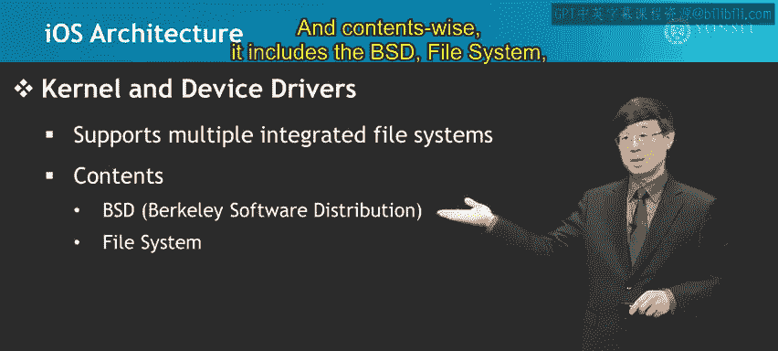

本节课中，我们一起学习了iOS的系统架构。我们了解到，iOS架构主要由四个层次构成：**Cocoa Touch层**负责用户界面和高级应用服务；**媒体层**处理所有图形、音频和视频功能；**核心服务层**提供基础的系统服务；**核心操作系统层**则负责底层的处理、接口和安全。所有这些都运行在基于Mach微内核技术的**内核与设备驱动程序层**之上。每一层都具有独特的功能，共同推动了iOS系统演进至当前形态。

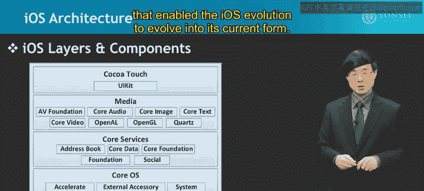

在下一讲中，我们将讨论Android系统架构。

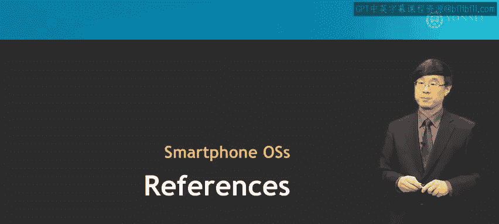

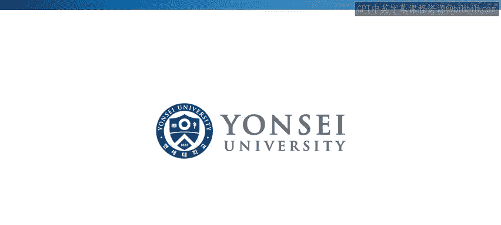

---
*（课程中使用的参考文献，推荐给学习者。）*