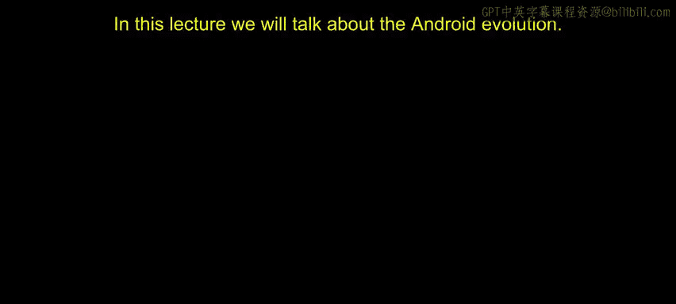
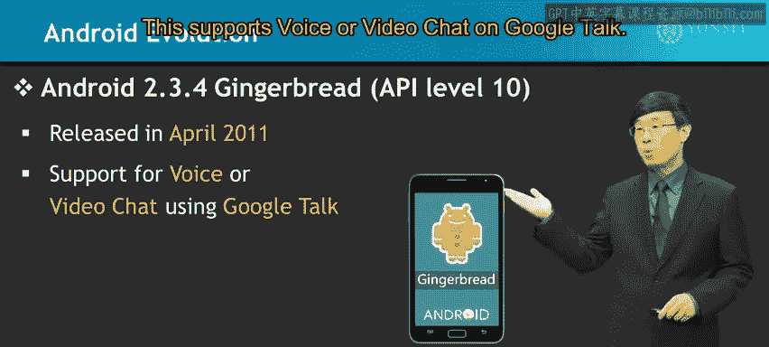
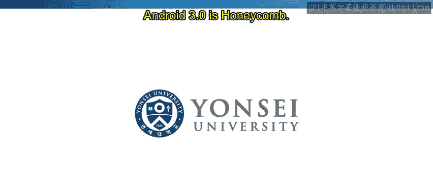

# 延世大学《新兴技术从智能手机到物联网再到大数据》 - P66：30_5.3 Android演进（第1部分）📱

在本节课中，我们将探讨Android操作系统的演进历程。Android是全球使用最广泛的智能手机操作系统，了解其发展历史有助于我们理解现代移动技术的基石。我们将从最初的测试版本开始，逐一介绍其早期的重要版本和关键特性。

## Android的起源与Alpha版本

Android的演进始于2007年11月发布的Android Beta测试版本，这标志着Android移动操作系统的开端。2008年9月，第一个商业化的Android操作系统——Android 1.0（Alpha版本）正式发布。

Android版本与API级别相关联。**API级别**是应用程序编程接口的等级，它作为一个通用指标，用于显示程序员能与设备内置功能进行交互的程度。更高的API级别意味着更丰富的功能控制特性。

Android 1.0对应API级别1，它引入了多项基础功能。

以下是Android 1.0（Alpha版本）包含的主要特性：

*   **系统功能**：支持将文件夹分组到单个文件夹图标中；支持访问网页电子邮件服务器。
*   **连接与同步**：包含Wi-Fi和蓝牙支持；支持Google同步，以及Gmail、通讯录和日历的无线同步。
*   **内置应用**：包含日历、地图、街景视图、Talk、语音拨号器和壁纸等基础应用。
*   **附加应用**：包含电话拨号器、主屏幕启动器、图片库、闹钟和计算器。

## 从Beta到Cupcake

上一节我们介绍了Android的起源，本节中我们来看看其早期的正式更新。Android 1.1（Beta版本）于2009年2月发布，对应API级别2。它与之前提到的测试版不同，首次在HTC Dream智能手机上发布，并新增了保存消息附件的功能。

接下来是Android 1.5，代号“Cupcake”，于2009年4月发布，对应API级别3。从Android 1.5开始，Android版本开始按字母顺序使用甜点作为代号（Alpha和Beta之后，C代表Cupcake）。

以下是Android 1.5 Cupcake引入的关键新特性：

*   **用户界面**：在浏览器中添加了复制粘贴功能；在联系人中支持添加用户图片；实现了带动画的屏幕过渡效果。
*   **蓝牙增强**：支持与蓝牙A2DP和AVRCP配置文件自动配对并支持立体声。
    *   **A2DP**（高级音频分发配置文件）：定义了多媒体音频如何通过蓝牙从一台设备流式传输到另一台设备（例如从手机到无线耳机或车载音响）。
    *   **AVRCP**（音频视频远程控制配置文件）：使得单个遥控器可以控制所有本地音视频设备，常与A2DP配合使用。
*   **输入法**：支持使用第三方虚拟键盘；添加了文本预测和用户自定义词典功能。
*   **小组件**：引入了**小组件**，这是一种可以嵌入到其他应用（如主屏幕）中的微型应用程序。小组件可以接收定期更新，用于主屏幕定制，点击即可直接访问应用，非常方便。当时的代表性小组件包括天气、时钟和体育比分追踪器。

## Donut与Eclair的进步

在Cupcake奠定了许多基础功能后，Android 1.6 “Donut” 于2009年9月发布，将API级别提升至4。

Donut版本带来了以下重要更新：

*   **语音功能**：集成了文本转语音引擎和多语言语音合成引擎，使得Android应用可以朗读文本，这在用户无法查看屏幕时非常有用。
*   **多媒体**：增强了图库、相机和摄像编码器的集成度，使相机访问速度更快；支持多张照片选择删除。
*   **网络支持**：添加了对CDMA EV-DO和802.1x的支持。
    *   CDMA EV-DO是一种增强型3G移动通信技术，支持高数据速率。
    *   802.1x增强了Wi-Fi技术。
*   **VPN支持**：添加了虚拟专用网络支持。VPN是在公共网络中建立的虚拟点对点专用连接，通常使用虚拟隧道协议和流量加密技术。这意味着在多人共享的公共网络中，你可以在两台计算机、或计算机与服务器之间创建安全的私有连接。
*   **屏幕支持**：增加了对宽视频图形阵列屏幕的支持，在保持480像素高度的同时提供了更宽的屏幕，支持多种宽高比模式。

紧接着，Android 2.0 “Eclair” 于2009年10月发布，对应API级别5。

Eclair版本包含了以下显著改进：

*   **账户与同步**：支持单设备多用户账户，并支持电子邮件和联系人的同步。
*   **蓝牙**：支持蓝牙2.1。
*   **信息与相机**：支持在所有已保存的短信和彩信中搜索；新增多项相机功能，包括闪光灯支持、数码变焦、场景模式、白平衡、色彩效果和微距对焦。
*   **地图与键盘**：增强了Google地图；改进了虚拟键盘，通过词典建议（包含用户常用词和联系人姓名）提高了打字速度。
*   **交互与界面**：引入了运动事件类，可追踪多点触控事件；支持动态壁纸，使主屏幕背景可以动画显示。
*   **企业支持**：增加了对Microsoft Exchange电子邮件的支持。

## Froyo与Gingerbread的时代

Android 2.2至2.2.3版本代号“Froyo”，于2010年5月发布，达到API级别8。

Froyo版本的主要更新如下：

*   **云消息**：添加了Android C2DM（云到设备消息传递）支持，使第三方开发者能够实现推送通知功能。
*   **网络与分享**：支持Adobe Flash；新增USB网络共享和Wi-Fi热点功能。
*   **输入法**：支持多键盘语言并支持词典快速切换。

最后，我们来看Android 2.3至2.3.2版本，代号“Gingerbread”。它于2010年12月发布，对应API级别9。

Gingerbread是一个重要的版本，引入了多项影响深远的功能：

*   **相机**：增加了前置和后置摄像头支持，这意味着自拍成为可能。
*   **键盘与文本**：改进了虚拟键盘技术，提供更直观的文本输入、更高的准确性、更好的文本建议以及语音输入模式；添加了易用的复制粘贴功能，通过长按选择文字即可操作。
*   **网络通话**：支持基于SIP的互联网语音协议。
    *   **SIP**（会话初始协议）用于在IP网络上启用IP多媒体通信会话，支持语音通话、视频通话和即时消息。
*   **传感器**：通过Gingerbread技术支持了陀螺仪、气压计等智能手机传感器。
*   **近场通信**：增加了近场通信支持，这对人们交换小额信息段和支持支付、海报、贴纸和广告等各种应用做出了重大贡献。

此外，Android 2.3.4 Gingerbread于2011年4月发布，达到API级别10。该版本支持在Google Talk上进行语音或视频聊天。

Google Talk是一项即时通讯服务，提供文本和语音通信功能。

---

本节课中，我们一起学习了Android操作系统从2007年Beta测试版到2011年Gingerbread版本的早期演进历程。我们看到了Android如何从基础的电话和同步功能起步，逐步添加了复制粘贴、虚拟键盘、多任务、动态壁纸、前置摄像头、NFC等关键特性，并通过API级别的提升不断扩展开发者的能力。这些早期版本为Android日后成为全球主导的移动平台奠定了坚实的基础。