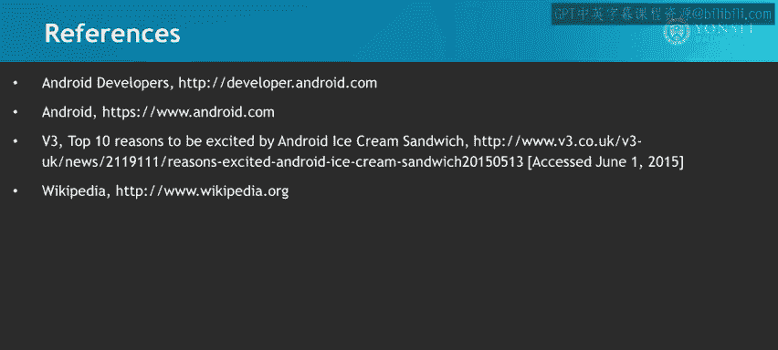

# 课程31：Android演进（第2部分） 📱

在本节课中，我们将继续学习Android操作系统的演进历程，重点关注从Android 3.0（蜂巢）到Android 8.0（奥利奥）期间引入的关键功能和特性。我们将了解每个版本如何针对不同的硬件（如平板电脑、可穿戴设备）进行优化，并引入了哪些影响深远的技术。

---

## Android 3.0 蜂巢

上一节我们介绍了Android的早期版本，本节中我们来看看专为平板电脑设计的Android 3.0蜂巢。

Android 3.0是蜂巢，其API级别为11。该系统于2011年2月发布。它是首个专为平板电脑设计的Android操作系统，并针对小型平板电脑进行了优化。

以下是Android 3.0蜂巢的主要特性：

*   **简化的多任务处理**：系统支持简化的多任务操作。
*   **操作栏与系统栏**：引入了操作栏和系统栏。操作栏位于屏幕顶部，提供上下文选项、导航和小部件访问。系统栏位于屏幕底部，用于显示通知、状态和软导航按钮。
*   **改进的平板键盘**：针对更大尺寸的平板屏幕，提供了更快、更高效、更准确的打字体验。
*   **增强的相机功能**：支持快速访问相机设置，包括曝光、对焦、闪光灯、变焦、前置摄像头和延时摄影等功能。
*   **多核处理器支持**：开始支持多核处理器。

---

## Android 3.1 蜂巢

随着蜂巢系统的更新，Android开始扩展其外部设备支持能力。

Android 3.1蜂巢的API级别为12，于2011年5月发布。此版本主要增强了外部输入/输出设备的支持。

以下是Android 3.1支持的外部设备类型：

*   键盘
*   指点设备
*   游戏手柄

---

## Android 4.0 冰激凌三明治

接下来，我们进入Android 4.0时代，这个版本在用户界面和功能上带来了许多革新。

Android 4.0至4.0.2是冰激凌三明治，其API级别为14。该系统于2011年10月发布。

以下是Android 4.0冰激凌三明治引入的主要功能：

*   **易于创建文件夹**：支持通过拖放操作轻松创建应用文件夹。
*   **增强的语音信箱**：支持可控的语音信箱播放速度，可以加速或减速播放。
*   **人脸解锁**：增加了基于面部识别的智能手机解锁功能，开启了面部识别时代。
*   **改进的相机功能**：增加了零快门延迟、延时摄影设置、全景模式以及录制过程中的变焦控制。
*   **基于地点和人物的图库布局**：图库可以根据地点和人物进行智能分类布局。
*   **内置照片编辑器**：系统集成了照片编辑工具。
*   **Wi-Fi直连**：支持设备间直接通过Wi-Fi连接传输数据。

---

## Android 4.1/4.3 果冻豆

Android 4.1和4.3均属于果冻豆系列，它们进一步提升了系统的国际化和连接能力。

Android 4.1果冻豆的API级别为16，于2012年7月发布。

以下是Android 4.1果冻豆的关键更新：

*   **双向文本与其他语言支持**：增强了对从右向左书写语言（如阿拉伯语、希伯来语）及其他语言的支持。
*   **蓝牙数据传输**：改进了蓝牙数据传输功能。
*   **Android Beam**：这是一个即时文件共享应用。当两部支持NFC的手机相互触碰时，即可激活此功能进行文件传输。
*   **键盘映射**：支持安装额外的国际键盘映射和特殊布局键盘类型。
*   **多声道音频**：支持通过HDMI输出多声道音频。对于不支持多声道的设备，系统会自动将音频降混以适应设备支持的声道数。

Android 4.3果冻豆的API级别为18，于2013年7月发布。它在连接性方面有重要升级。

以下是Android 4.3的主要新增支持：

*   **低功耗蓝牙**：支持BLE技术，更省电。
*   **AVRCP 1.3**：支持蓝牙音视频远程控制配置文件。

---

## Android 4.4 奇巧

Android 4.4奇巧在打印、支付和传感器管理方面带来了新功能。

Android 4.4奇巧的API级别为19，于2013年10月发布。

以下是Android 4.4奇巧引入的特性：

*   **无线打印**：支持无线打印功能。
*   **计步检测器**：支持计步传感器。
*   **NFC主机卡模拟**：使智能手机能够模拟智能卡，用于移动支付等场景。
*   **传感器批处理**：能够高效地批量收集和传递传感器事件，以节省电量。
*   **响度增强器**：在媒体播放应用中增强语音的响度。
*   **内置屏幕录制**：主要为开发者设计，当使用Android调试桥时，可以启用此功能。
*   **蓝牙消息访问配置文件**：支持应用与附近设备交换消息。

Android 4.4奇巧的API级别后来升级到20，于2014年6月发布。此更新增加了**可穿戴设备扩展**，为智能手表提供了平台支持，这标志着智能手表时代的开启。

---

## Android 5.0/5.1 棒棒糖

棒棒糖版本是Android向64位架构迈进的重要一步，并增强了数据管理和设备安全。

Android 5.0至5.0.2棒棒糖基于API级别21，于2014年11月发布。

以下是Android 5.0棒棒糖的主要变化：

*   **64位CPU支持**：这是一个重大迁移，操作系统开始支持64位CPU。
*   **USB音频输入输出**：支持通过USB设备进行音频输入和输出。
*   **外部存储访问**：第三方应用可以读取和修改SD卡等外部存储设备上的数据，使数据控制更加灵活。
*   **最近应用内存保持**：即使在设备重启后，最近使用过的应用状态也能被保留。
*   **新增15种语言**：操作系统包中新增了15种语言支持。

Android 5.1棒棒糖的API级别为22，于2015年3月发布。

以下是Android 5.1的关键更新：

*   **官方多SIM卡支持**：正式支持多SIM卡设备。
*   **设备保护**：如果设备丢失或被盗，它将保持锁定状态，直到机主登录其谷歌账户。
*   **高清语音通话**：支持在4G LTE设备之间进行高清语音通话。

---

## Android 6.0 棉花糖

棉花糖版本在用户体验、电池管理和硬件支持方面做出了改进。

Android 6.0棉花糖的API级别为23，于2015年10月发布。

以下是Android 6.0棉花糖引入的功能：

*   **Google Now on Tap**：长按主页按钮，Google会自动搜索屏幕上显示内容的关联信息。
*   **休眠模式**：为了节省电量，当屏幕关闭时，此模式会降低CPU速度。
*   **原生指纹读取器支持**：系统级支持指纹识别。
*   **USB Type-C**：支持新型USB接口。
*   **应用4K显示模式**：支持应用以4K分辨率显示。
*   **可适配的外部存储**：允许外部存储设备像内部存储一样工作，便于保存和读取文件。

---

## Android 7.0/7.1 牛轧糖

牛轧糖版本强化了多任务处理，并引入了虚拟现实平台。

Android 7.0至7.1是牛轧糖，其API级别分别为24和25。该系统于2016年8月发布。

以下是Android 7.0牛轧糖的主要特性：

*   **原生分屏多任务**：支持在分屏视图中同时显示多个应用。
*   **Daydream VR平台**：增加了由Google开发的虚拟现实平台，可在手机和配备无线控制器的头戴设备上运行。

---

## Android 8.0 奥利奥

最后，我们来看奥利奥版本，它在启动速度、通知管理和系统更新架构上进行了重大优化。

Android 8.0是奥利奥，其API级别为26，于2017年8月发布。

以下是Android 8.0奥利奥的显著改进：

*   **启动速度提升**：基于Google Pixel手机的测量，启动速度提升了两倍。
*   **画中画模式**：支持视频播放等应用以画中画模式运行。
*   **多显示器支持**：增强了对多显示器的支持。
*   **通知改进**：引入了通知渠道、通知点、徽章和通知暂停功能。
*   **Google Play保护与Android即时应用**：
    *   **Google Play保护**：是Android设备的安全系统。
    *   **Android即时应用**：无需安装即可在网页浏览器中运行的新型应用。其实现原理将在后续讲解Android架构的课程中详细说明。
*   **Project Treble**：这是一个新的模块化架构，旨在实现更轻松、更快速的Android系统更新。它将Android操作系统框架与供应商实现进行了分离。

---

## 总结

本节课中，我们一起学习了从Android 3.0蜂巢到Android 8.0奥利奥的演进历程。我们看到了Android如何从专为平板优化，逐步扩展到支持可穿戴设备、64位计算、增强现实，并在安全性、通知管理和系统更新效率上不断进步。每个版本都回应了当时的硬件发展趋势和用户需求，共同构建了今天我们所熟悉的强大、灵活的Android生态系统。