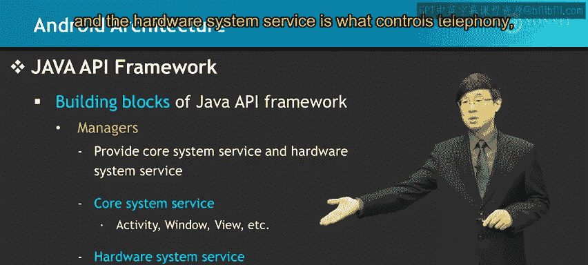
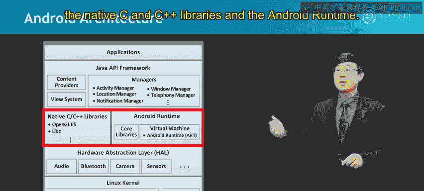
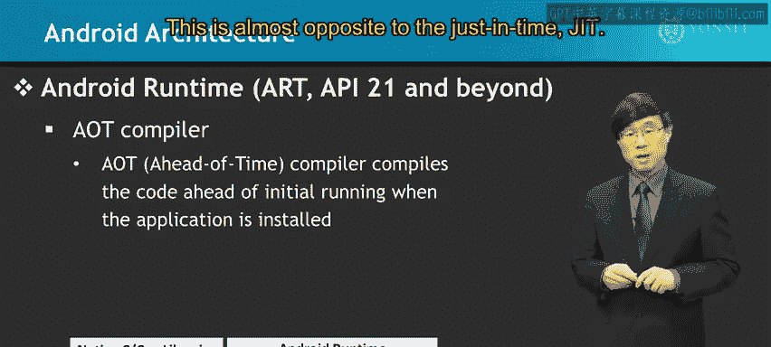
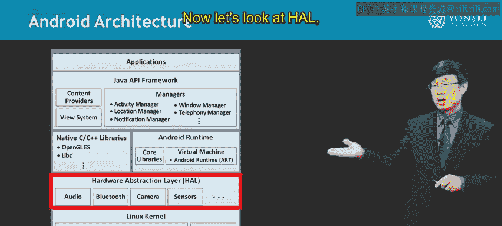
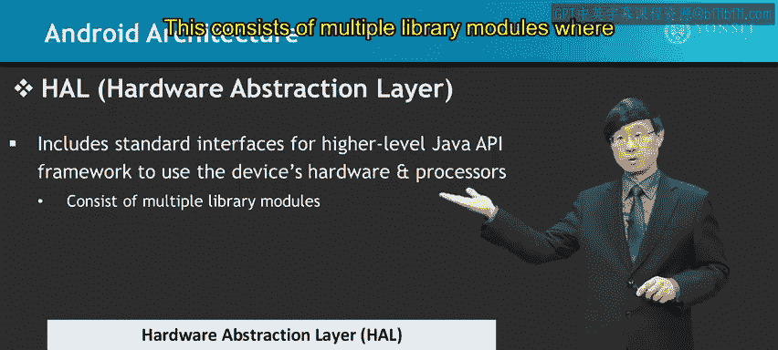
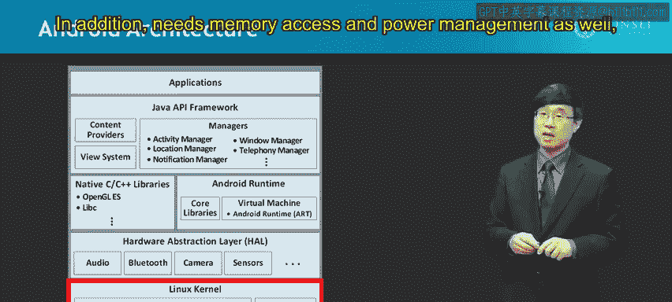
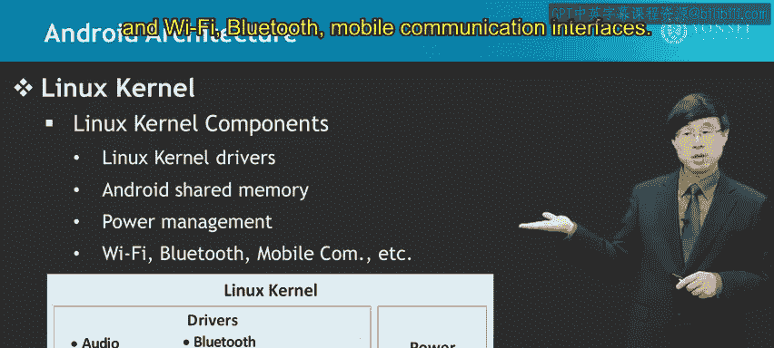
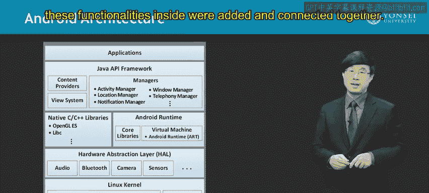

# 延世大学《新兴技术从智能手机到物联网再到大数据》课程 - P68：32_5.4 Android架构 📱

## 概述

在本节课中，我们将要学习Android操作系统的架构。Android是全球使用最广泛的智能手机操作系统。我们将从顶层应用到底层内核，逐一剖析其各个组成部分及其功能。

---

现在，让我们来看看Android架构，它是全球使用最广泛的智能手机操作系统。

Android操作系统是智能手机中最流行的操作系统。它包含了基于此结构的操作系统、中间件和关键应用程序，你可以在这里看到这个结构。它基于Linux内核，Linux内核包含了驱动程序和电源管理工具。

从顶层来看，是Java API框架。Android操作系统的所有功能都通过用Java编写的API提供。API是应用程序编程接口。Java API为开发和使用应用程序提供了支持。

Java API框架的构建模块提供了更详细的功能，其中包括视图系统。这有助于构建用户界面应用程序，包括文本框、按钮和列表。

然后是内容提供者。这使得应用程序能够访问其他应用程序的数据，例如联系人和相册。此外，还有管理器。它提供了核心系统服务和硬件系统服务。核心系统服务负责激活和控制活动、窗口、视图等组件。硬件系统服务则负责控制电话、定位、Wi-Fi、USB等功能。

应用程序直接发送其进程需求，并使用Java API框架来获得支持。但Java API框架也需要使用原生C/C++库和Android运行时。

原生C/C++库支持在Android系统中用C/C++编写的程序。这些库包括ART和HAL，我稍后会解释。流行的库包括OpenGL ES。GL代表图形库，ES代表嵌入式系统。支持使用OpenGL的2D和3D图形库。OpenMAX AL。这是OpenSL ES的配套API，用于支持原生多媒体处理的视频和音频。此外，还有Lib C，这是C运行时库。

Android运行时是Android应用程序的运行环境实例。虚拟机用于将在不同Android设备上运行的Java应用程序，我们称之为JVM，即Java虚拟机。有两种虚拟机：Java Dalvik虚拟机，这是在API 21 Lollipop之前使用的；从API 21 Lollipop及以后，我们有了Android运行时。

首先，让我们简单回顾一下。Android 5.0到5.0.2是Lollipop，这是API级别21。它于2014年11月发布。有哪些重大改进？从之前的32位处理架构转向64位架构，启用了64位CPU支持，这非常重要。此外，启用了通过USB设备的音频输入和输出，启用了最近使用应用程序的内存记录，并且在API级别21 Lollipop中新增了15种语言。

回到Android运行时ART，它是API级别21及以后的版本。Java Dalvik虚拟机基于JIT即时编译器。JIT在应用程序启动时编译代码。JIT在请求时使用部分代码段。Android运行时ART是API 21级别及以后的版本。让我们先看看Java Dalvik虚拟机。

ART包含了对改进的调试环境和改进的垃圾收集的支持。垃圾收集是什么意思？例如，当垃圾收集压缩堆内存时，显示会变得卡顿，用户界面的响应性会变差。这是什么意思？这里的堆指的是堆内存。在智能手机上，芯片、CPU、GPU支持的处理能力有限。此外，闪存、RAM以及固态存储单元的内存也有限。因此，在智能手机上，你需要清理已经完成的应用及其支持数据。为了做到这一点，这个过程就是我们所说的垃圾收集。清理那些已完成进程的旧信息。当这种情况发生时，特别是在堆内存中，垃圾收集会压缩这些组件的堆内存部分，那么显示就会变得卡顿，用户界面的响应时间，即从你触摸屏幕到出现响应的交互响应时间，会变慢。因此，你需要一些改进，这就是Android运行时所做的，它改进了垃圾收集功能。ART提供了改进的自动内存管理来防止这类问题。

AOT编译器。这是提前编译器，它在应用程序安装时，在初始运行之前编译代码。这几乎与即时JIT编译器相反。

可以获得应用程序速度和功耗性能的改进。但是，你可能需要更长的应用程序安装时间，因为当你安装时，编译器会在你实际运行代码之前提前编译代码，这就是你获得速度和功耗提升的地方，但同样，这也会花费更多时间。

现在，让我们看看硬件抽象层。这里包含了供更高级别的Java API框架使用的标准接口，以访问设备的硬件和处理器。它由多个库模块组成。

这些模块针对特定类型的硬件组件进行了定制，例如你的蓝牙、相机模块等。往下看，你可以看到我们正在讨论的模块。

然后是Linux内核，内核。你在这里看到的所有操作系统单元都需要某些东西来处理。此外，还需要内存访问和电源管理。这就是内核为你做的事情。

Linux内核是Android操作系统的处理基础。它执行所有低级功能，例如处理、线程、电源管理，以及输入输出设备，你在这里可以看到。包括蓝牙、Wi-Fi和移动通信。内核组件包括Linux内核驱动程序、Android共享内存、电源管理，以及Wi-Fi、蓝牙、移动通信接口。

这就是Android架构。正如你所见，这些功能层和内部功能块使得Android系统能够工作，并且随着内部功能的不断添加和连接在一起，各种演进也在不断进行。

这些是我使用的参考文献，我推荐给你，谢谢。

---

## 总结

本节课中，我们一起学习了Android操作系统的架构。我们从最顶层的Java API框架开始，了解了其构建模块如视图系统和内容提供者。接着，我们探讨了原生C/C++库和Android运行时，特别是从Dalvik虚拟机到ART的演进及其在垃圾收集和性能上的改进。然后，我们向下深入到硬件抽象层，它作为硬件与上层框架的桥梁。最后，我们看到了作为整个系统基石的Linux内核，它负责处理、内存管理和硬件驱动。通过理解这些层次如何协同工作，我们能够更好地把握Android系统的运作原理。