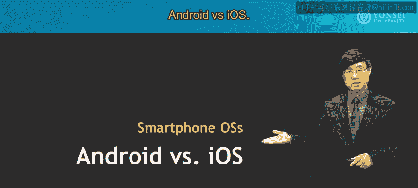
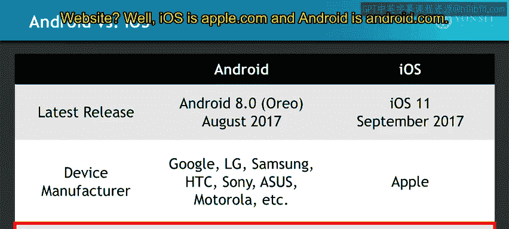
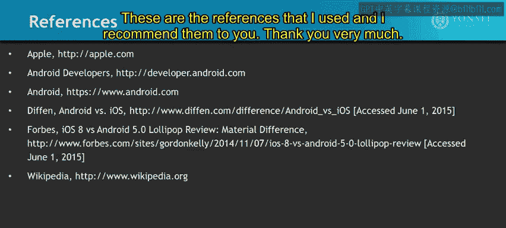

# 69：33_5.5 Android与iOS比较 📱

在本节课中，我们将要学习Android与iOS两大移动操作系统的核心特性、优缺点以及它们之间的主要区别。我们将从开发背景、技术架构、应用生态等多个维度进行比较，以帮助初学者清晰地理解这两个平台。

---

## 概述：两大移动操作系统

Android与iOS是目前全球主流的移动操作系统。本节将对它们的关键特征、优势与不足进行比较分析。

---

## 开发背景与基础信息

上一节我们介绍了课程概述，本节中我们来看看Android与iOS的基础开发背景与信息。

*   **开发者**：Android由**Google**开发；iOS由**Apple**开发。
*   **操作系统家族**：Android基于**Linux**；iOS基于**OSX**和**Unix**。
*   **可定制性**：Android的可定制性**高**；iOS的可定制性**较低**。这是因为Android是一个开源平台，而iOS是闭源平台（尽管包含部分开源组件）。
*   **初始发布日期**：iOS随iPhone于**2007年7月29日**发布；Android于一年后的**2008年9月23日**发布。
*   **编程语言**：
    *   Android：**C, C++, Java**
    *   iOS：**C, C++, Objective-C, Swift**
*   **源代码模式**：Android为**开源**；iOS为**闭源**（含开源组件）。这再次解释了Android高可定制性的原因。
*   **默认网络浏览器**：Android使用**Chrome**；iOS使用**Safari**。
*   **语音助手**：Android使用**Google Now**；iOS使用**Siri**。
*   **应用商店**：Android使用**Google Play**及其他商店；iOS使用**Apple App Store**。
*   **近期版本（课程发布时）**：Android为**Android 8.0 Oreo**（2017年8月发布）；iOS为**iOS 11**（2017年9月发布）。
*   **设备制造商**：iOS仅用于**iPhone**和**iPad**（Apple产品）；Android则被**众多**其他厂商采用。
*   **官方网站**：iOS为 `apple.com`；Android为 `android.com`。

---

## 应用生态与可用性

了解了基础信息后，我们来看看两者在应用生态和可用性方面的特点。

大多数热门应用在Android和iOS上均可用。Google的应用商店更为开放，包含一些iOS上没有的应用。

在平板电脑领域，iPad具有优势，因为许多应用是专门为iPad设计的。而许多Android平板应用是智能手机应用的放大版。

一些小型公司的开发者可能会先为iPhone或iPad开发应用，然后再进行Android版本的开发。原因是iPhone和iPad的硬件结构（如处理能力、内存选项、显示屏结构）非常明确统一。相比之下，Android设备由众多厂商生产，设备类型繁多，显示屏、内存、CPU等特性因厂商规格而异。因此，开发者先为iOS开发并测试良好后，再为Android进行适配，以确保应用能在各种不同设备上良好运行。

---

## 应用开发与发布流程

接下来，我们比较一下在两个平台上构建和发布应用的流程。

以下是开发与发布应用的关键步骤：

*   **Android**：
    1.  应用使用 **C、C++、Java** 编程。
    2.  可免费下载Android源代码和Android SDK（软件开发工具包）。
    3.  开发者需一次性支付**25美元**注册费，即可发布应用。
*   **iOS**：
    1.  应用使用 **Objective-C** 和 **Swift** 编程。
    2.  开发者需每年支付**99美元**，以获取iOS SDK并在Apple App Store上发布应用。
    3.  iOS SDK仅适用于Mac平台。
    4.  支付99美元后，应用在上架前还需经过审核流程，以确保其符合操作系统和产品制造商的要求。Apple在此方面做得很好，保证了App Store上应用的质量。

---

## 优势与不足分析

最后，我们来系统性地总结一下Android和iOS各自的优势与不足。

### Android的优缺点

**优点**：
*   **硬件选择多样**：市场上有各种品牌和型号的Android设备。
*   **硬件功能丰富**：提供不同的硬件能力、屏幕尺寸和功能。
*   **价格区间广泛**：涵盖从低端到高端的各种价位。
*   **用户界面可定制**：允许轻松定制主屏幕，可调整应用图标和添加小组件。

**缺点**：
*   **碎片化问题**：由于设备众多，系统升级和应用适配面临挑战。

### iOS的优缺点

**优点**：
*   **庞大的生态系统**：拥有非常庞大的Apple App Store，并进行严格的应用质量检查。
*   **封闭的界面**：移动运营商无法预装第三方应用。这对运营商不利，但对普通用户而言利弊参半（可能更安全、更简洁）。
*   **统一的软件升级**：iOS拥有良好的软件升级系统，提供清晰的升级通知和提醒，并在升级时考虑设备兼容性。
*   **隐私控制**：iOS在用户隐私信息（如通讯录、位置）控制方面做得较好，这是Apple设备用户所欣赏的。

**缺点**：
*   **主屏幕定制选项有限**：应用主要以图标行列排列，自定义灵活性较低。
*   **设备与价格选择单一**：仅限Apple自家设备，价格通常较高。

---

## 总结

本节课中，我们一起学习了Android与iOS操作系统的全面比较。我们从开发背景、技术基础、应用生态、开发发布流程以及各自的优缺点等方面进行了分析。关键点在于：Android以其**开放性、硬件多样性和高定制性**著称；而iOS则以其**统一的生态系统、严格的质控、顺畅的升级和较强的隐私保护**为特点。理解这些差异有助于我们根据自身需求选择合适的平台和设备。