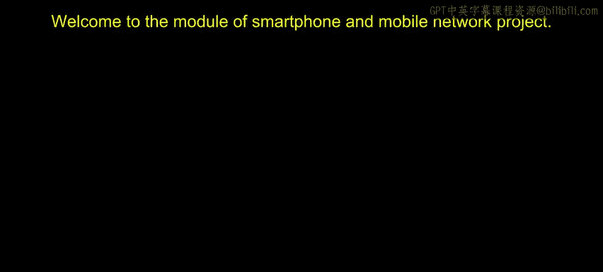
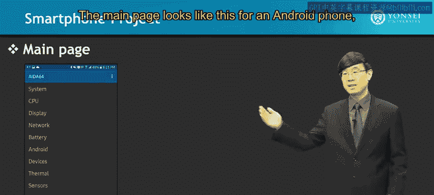
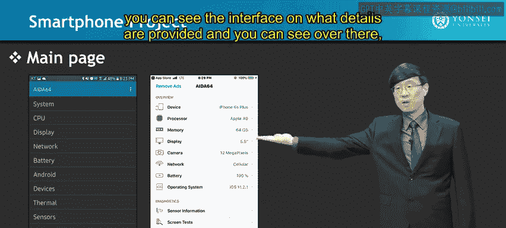
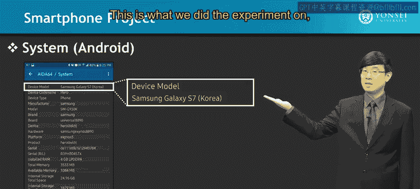
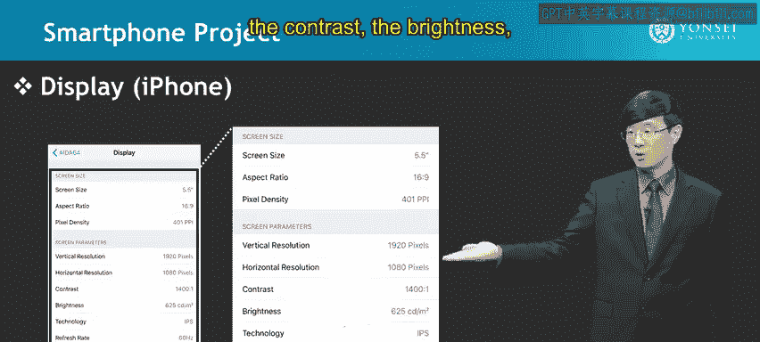
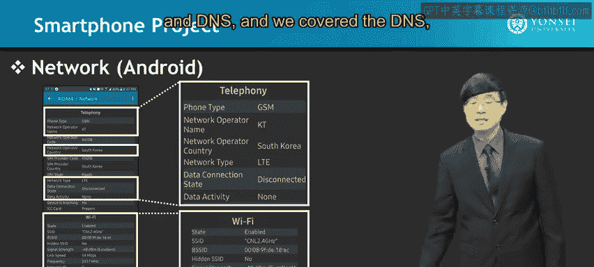
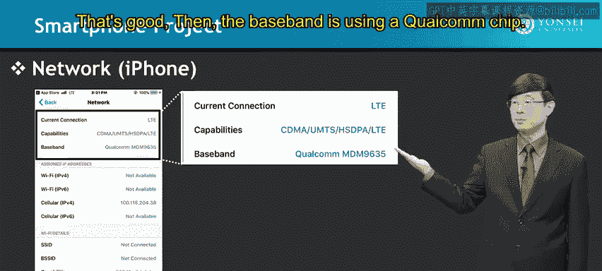
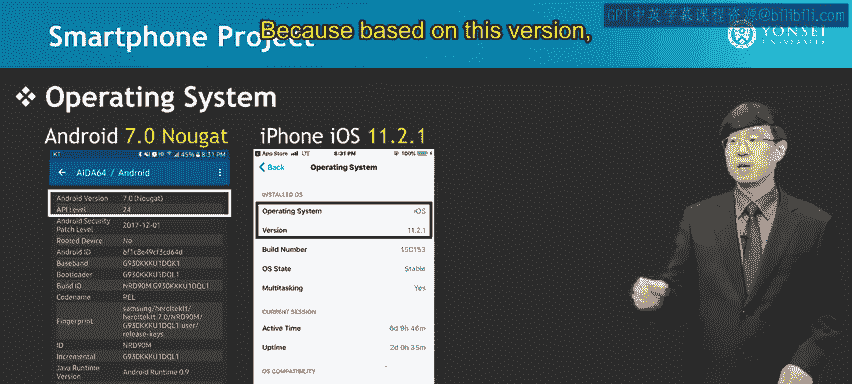
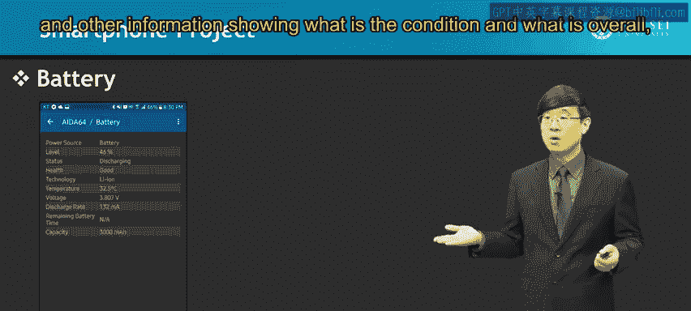
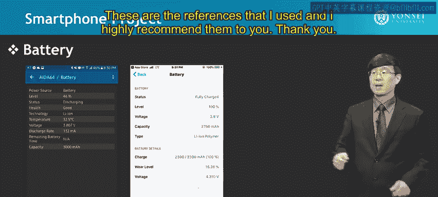

# 70：智能手机项目实战教程 📱

在本节课中，我们将学习如何利用AIDA64应用程序对智能手机的硬件、软件及网络进行实际测量与分析。我们将通过具体的操作界面，深入了解设备的各项规格和实时状态。

---

## 🚀 项目概述与工具介绍

上一节我们介绍了智能手机的软硬件基础，本节中我们来看看如何通过一个具体的工具进行实际测量。

我们将使用AIDA64应用程序。该应用可在Google Play商店和Apple App Store获取。它能提供智能手机的详细硬件与软件信息。

以下是AIDA64的主要功能：
*   提供系统、CPU、网络、电池、操作系统等详细信息。
*   适用于Android和iOS设备。

Android设备的主界面示例如下：

iPhone设备的主界面示例如下：

---

## 📊 设备与内存信息分析

现在，让我们深入查看Android设备的界面信息。设备型号显示为三星Galaxy S7，这是我们进行实验的设备。

请注意内存单元信息。通常我们只关注已安装的RAM（如4GB或8GB），但这里列出了所有存储和内存单元的详细信息。

以下是Android设备内存信息的详细列表：
*   **总内存**与**可用内存**。
*   **内部存储总空间**与**内部存储可用空间**。
*   **外部存储总空间**与**外部存储可用空间**。

对于iPhone，我们可以在内存单元部分查看类似信息，包括设备型号、总存储空间、可用存储空间、总RAM和可用RAM。

---

## ⚙️ CPU与处理器架构解析

回到CPU和处理器信息部分。可以看到SoC（片上系统）型号和核心架构。例如，三星Exynos Octa芯片采用14纳米制程技术。

查看CPU核心详情，可以看到有八个核心，CPU时钟频率范围从442MHz到2.6GHz。在当前状态下，核心7和8处于休眠状态，核心5和6运行在728MHz，而核心1、2、3、4的运行频率则高得多，但仍未达到最大频率。

通过观察这些数据，可以了解智能手机当前的处理能力使用情况。我的手机并未高负荷运行，有空闲核心，且部分核心运行在较低频率。

需要理解其背后的架构。如本课程之前讲座所述，三星Exynos八核结构基于**big.LITTLE架构**，包含四个大核和四个小核。

**big.LITTLE架构**的核心思想是：
*   **大核**处理繁重任务，针对高性能优化，能耗相对较低。
*   **小核**处理轻量任务，针对低功耗优化。
*   这种设计旨在根据任务需求智能分配核心，以优化能效。

在iPhone方面，可以看到CPU是Apple A9（由三星制造），当前运行速度为1.85GHz，采用14纳米技术，拥有两个活跃核心。下方还显示了GPU信息，包含六个核心。

---

## 🖥️ 显示与网络信息查看

进入Android设备的显示信息部分，可以看到屏幕分辨率、尺寸、对角线长度、像素密度、GPU供应商等信息。例如，GPU拥有20个核心，但当前未被利用。

对于iPhone的显示详情，可以看到屏幕尺寸、宽高比、像素密度、分辨率（垂直和水平）、对比度、亮度、支持的技术以及色彩伽马值。

回到Android设备，查看网络信息。显示当前为GSM类型，网络基于LTE（在韩国）。数据连接状态为断开，数据活动为无。然而，在Wi-Fi方面，提供了详细信息：已启用，正在使用2.4GHz ISM频段。SSID显示为“CNL”，这是我的实验室（通信网络实验室）接入点的名称，并非协议名称。此外，还显示了基站ID、信号强度（-48 dBm，优秀）、支持速率（54 Mbps）、网络ID、网关、子网掩码和DNS信息。

然后是iPhone的网络信息。可以看到当前连接信息：支持LTE、CDMA、UMTS和HSDPA，但目前正在使用LTE。基带使用的是高通芯片。

此外，还有Wi-Fi IPv4、Wi-Fi IPv6（未使用）信息。蜂窝LTE网络当前使用IPv4地址，目前未使用IPv6。

---

## 🧭 传感器与系统信息

传感器列表显示了设备内部的所有传感器。包括加速度计、磁力计、其他生物识别信息、陀螺仪和其他颜色传感器。这些信息是动态的。

对于iPhone，显示信息包括GPS信息（经度、纬度）、旋转信息、加速度信息以及检测到的磁场信息。

操作系统信息显示在此处。当前Android设备使用的是Android 7.0 Nougat，我们在课程中已解释过其含义和主要功能升级。iPhone使用的是基于版本11.2.1的iOS。检查操作系统版本很重要，因为它决定了设备可能支持的功能。

电池信息至关重要。可以看到电池电量在46%左右，并显示了电池状况、整体温度以及电池类型。

对于iPhone，可以看到相关的电池信息，此时电池已充满电。显示了电池的整体容量、类型以及其他信息。

---

## 📚 课程总结与参考资料

本节课中，我们一起学习了如何使用AIDA64工具对智能手机进行全面的硬件、软件和网络状态分析。我们查看了设备型号、内存、CPU架构（特别是**big.LITTLE设计**）、显示规格、网络连接、传感器数据、操作系统版本和电池信息。

这些实践测量帮助我们更直观地理解了智能手机内部复杂的工作机制和实时状态。

以下是我使用的参考资料，我强烈推荐给你：

