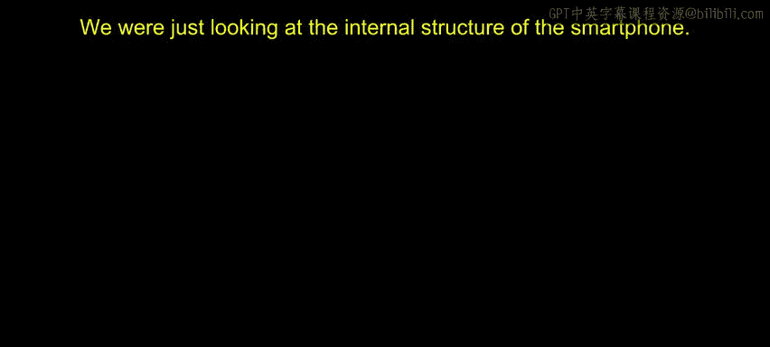
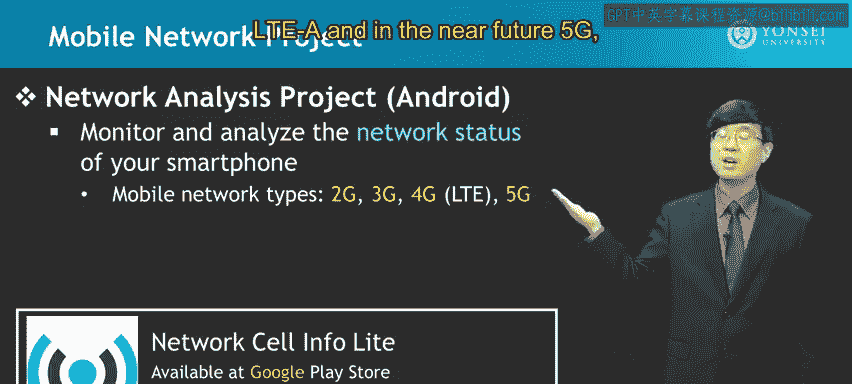
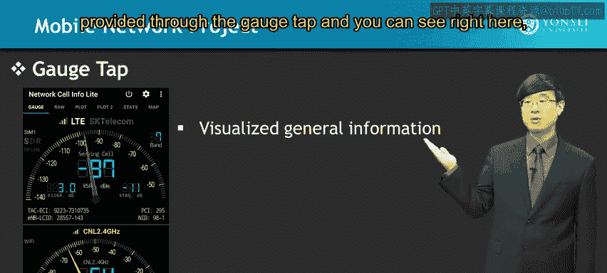
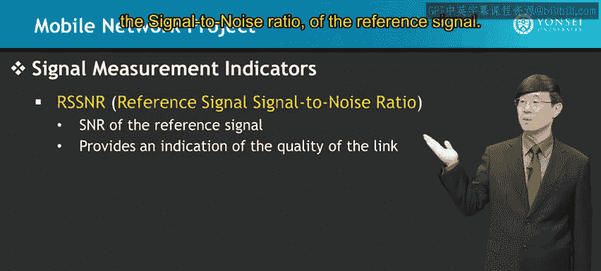
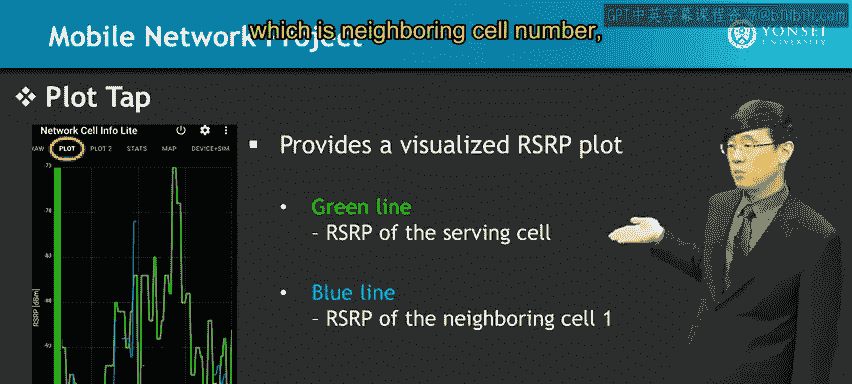
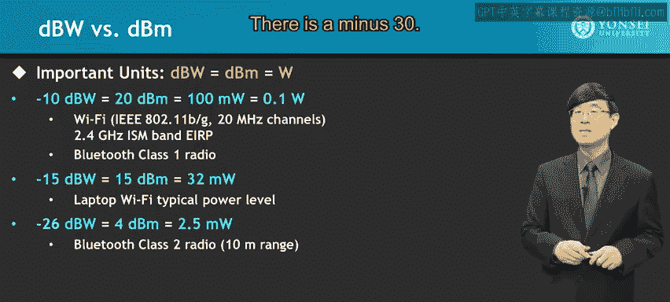
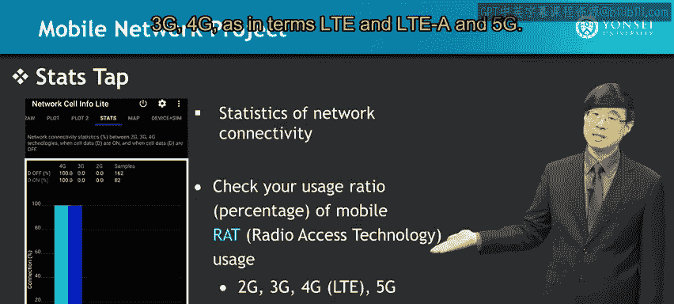
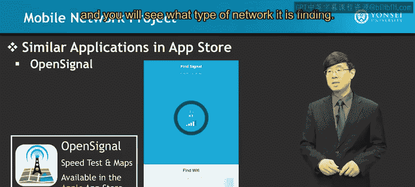
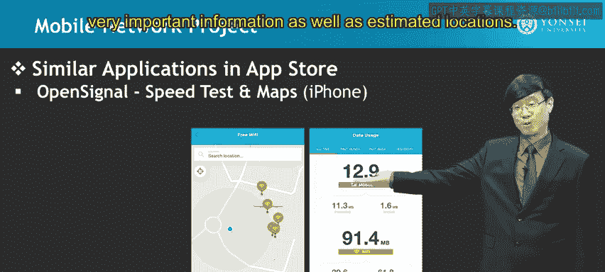

# 课程 35_6.2：移动网络项目 📱

在本节课中，我们将学习如何监控和分析智能手机所连接的移动通信网络。我们将使用特定的应用程序来查看网络状态、信号强度和质量指标，并理解这些数据背后的含义。

上一节我们介绍了智能手机的内部结构。本节中，我们来看看智能手机的外部连接，特别是它与移动通信网络的交互。我们将专注于移动网络，而基于Wi-Fi或蓝牙的物联网连接将在后续课程中讨论。

## 项目概述：网络状态监控与分析

本项目旨在通过特定应用程序，监测和分析您智能手机的网络状态。我们将从Google Play商店的“Network Cell Info”应用开始。苹果App Store中也有类似应用，稍后会提供详细信息。

以下是本项目的核心步骤：

1.  **安装应用**：在Android设备上安装“Network Cell Info”应用。
2.  **监控网络状态**：观察并记录您智能手机连接的网络类型和信号信息。
3.  **分析数据**：理解应用提供的各项指标，如信号强度、质量和基站信息。

## 核心概念：网络类型与信号指标

移动网络类型，正式称为**无线接入技术**。常见的类型包括2G、3G、4G以及即将普及的5G。

应用可以显示服务小区和邻近小区的详细信息，并通过仪表盘标签提供可视化的概览信息。

在应用中，您可以查看蜂窝网络或Wi-Fi的连接状态。原始数据标签提供了网络状态的详细信息，包括服务基站和邻近基站的信息。

以下是应用显示的关键信号测量指标：

*   **参考信号接收功率**：这是参考信号在全带宽和窄带上的功率。在之前的LTE示例中我们提到过它。
*   **参考信号接收质量**：这是一个基于载波干扰比的测量值，表示接收到的参考信号的质量。OFDM信号基于密集排列的正交载波，因此我们不仅关注整体信号，还关注每个载波的干扰情况。
*   **参考信号信噪比**：这是参考信号的信噪比，用于指示链路的质量。
*   **任意强度单位**：这是一个与手机测量的接收信号强度成正比的整数值。
*   **信道质量指示**：这个指标携带了关于通信信道质量好坏的的信息。

## 数据可视化：图表解读

图表标签提供了可视化的RSRP图表。底部的图例中，绿色代表服务小区的RSRP，蓝色代表邻近小区的RSRP。

第二个图表提供了服务小区信号强度的可视化信息。图例在底部，您可以看到以dBm和dB为单位的数值。其中，绿线代表服务小区的RSRP，天蓝色线代表服务小区的RSRQ，深蓝色线代表服务小区的RSNR。所有这些都基于服务小区的统计数据。

## 单位解析：dBW与dBm

您看到的单位是dB或dBm，它们代表什么？

*   **dBW**：这是以1瓦特为参考的功率比的分贝值，用于电力能源系统。计算公式为：`dBW = 10 * log10(P / 1W)`，其中P是接收到的功率。
*   **dBm**：这是以1毫瓦为参考的功率比的分贝值，通常用于无线电、无线通信、微波或光纤信号等更小的电子或光学信号。计算公式为：`dBm = 10 * log10(P / 1mW)`。

dBm和dBW之间的换算关系是：`dBW = dBm - 30`。

## 功率参考值

了解一些常见的功率参考值有助于解读信号强度：

*   **1000瓦**：常用于家用或商用的微波炉。
*   **2瓦**：用于3G UMTS功率等级1或GSM 850/900MHz频段的手机最大输出功率。
*   **0.5瓦**：用于3G UMTS功率等级2。
*   **0.251瓦**：这是一个非常常见的数值，用于3G功率等级3的手机最大输出，也用于5GHz频段、20MHz信道的802.11a Wi-Fi。
*   **0.1瓦**：用于2.4GHz频段、20MHz信道的802.11b/g Wi-Fi以及蓝牙Class 1射频系统。
*   **32毫瓦**：典型的笔记本电脑、平板电脑使用的Wi-Fi功率，对应15 dBm。
*   **2.5毫瓦**：蓝牙Class 2射频的典型功率，对应4 dBm。
*   **1毫瓦**：蓝牙Class 3短距离通信的功率，对应0 dBm。
*   **0.1皮瓦**：这大约是接收信号的底线，对应-100 dBm。如果接收信号低于此值，大多数移动通信、Wi-Fi或蓝牙设备将无法成功建立连接。即使略高于此值，通信质量也可能很差。

## 统计信息与应用

统计数据标签以百分比形式显示不同网络类型的使用比例。

对于苹果设备，App Store中有类似应用，例如“Open Signal”。它可以查找免费Wi-Fi、进行Wi-Fi和蜂窝网络速度测试、检查数据使用情况。界面中间会有一个圆圈，显示天线连接水平以及发现的网络类型。

它显示的信息包括重要的网络数据和估计的位置。

另一个苹果应用是“Field Tester”，可用于评估手机信号强度和数据/Wi-Fi网络质量，适用于iOS 10及以上系统。界面会显示整体连接、电话信号、延迟信息、数据网络和Wi-Fi状态是否活跃，以及包括经纬度在内的GPS信息。

还有“Network Utility”应用，可以提供关于网络、Wi-Fi和蜂窝网络的详细信息。在界面顶部，您可以看到互联网服务提供商。此外，还可以查看蜂窝网络信息，如供应商、网络类型、数据使用量等。

## iPhone内置工具：工程模式

iOS的工程模式是一个强大的内置工具。进入该模式后，可以查看服务小区的测量值，如RSSI、平均RSRP和物理小区ID。

您可能担心进入工程模式后如何退出。只需按下Home键，即可直接返回主屏幕。

进入工程模式的方法是：在拨号界面输入`*3001#12345#*`，然后按下绿色的呼叫按钮。您可以在其中找到服务小区的信号强度、RSRP和PCI等重要信息。

## 总结

本节课中，我们一起学习了如何通过特定应用程序监控和分析移动网络。我们了解了关键的信号指标、数据可视化图表、功率单位dBW和dBm的含义，以及一些常见的功率参考值。我们还介绍了适用于Android和iOS设备的多种工具，包括利用iPhone内置的工程模式进行深度网络诊断。掌握这些知识，将帮助您更好地理解智能手机的无线连接性能。