# 课程一：物联网、无线网络与云计算新兴技术介绍 🚀

在本课程中，我们将学习物联网、无线网络与云计算等新兴技术的基础知识、架构、关键组件及其应用。课程内容涵盖从市场分析到具体技术实现，旨在为初学者构建一个清晰的知识框架。

---

## 课程模块概览

本课程包含以下核心模块：

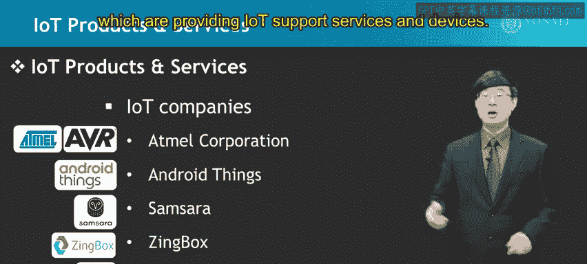

*   **物联网业务与产品**：探讨物联网的市场、产业及服务模式。
*   **物联网架构与技术**：深入分析物联网的层次结构、传感器和主流硬件平台。
*   **物联网网络**：重点研究Wi-Fi和蓝牙等无线通信技术。
*   **基于云的技术**：学习云计算的服务模型和主要提供商。
*   **实践项目**：通过动手项目，综合应用物联网、蓝牙、Wi-Fi和AWS EC2云服务。

---

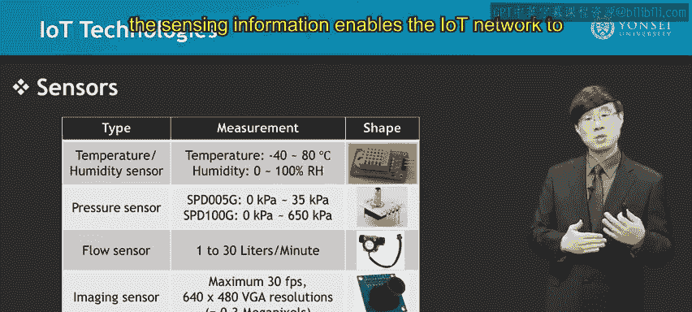

## 模块详解与学习路径

上一节我们概述了课程的整体结构，本节中我们将逐一深入了解每个模块的具体内容。

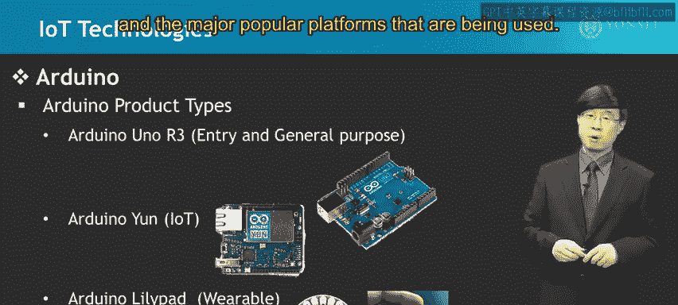

以下是各模块的详细学习要点：

1.  **物联网市场与产业**
    *   详细回顾物联网市场现状与产业链。
    *   分析物联网的功能单元与服务模式。

2.  **物联网生态系统**
    *   研究物联网与机器对机器通信的生态系统。
    *   了解相关的服务描述、模型及支持厂商。

3.  **物联网架构层**
    *   探讨物联网各架构层（如感知层、网络层、应用层）的功能及其相互关系。

4.  **传感器与射频识别技术**
    *   学习各类传感器的具体功能，它们是物联网感知物理世界的基础。
    *   研究RFID单元的不同类型及其技术规格。

5.  **物联网硬件平台**
    *   聚焦主流物联网开发平台，如Arduino、树莓派和BeagleBoard系统。
    *   比较各平台的规格、优缺点及特性。

6.  **物联网网络架构**
    *   分析物联网的网络架构，包括可穿戴设备网络及其在生物识别与健康监测系统中的应用。

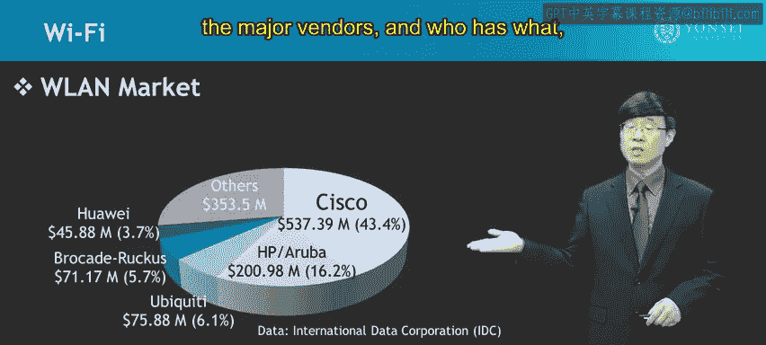

7.  **ISM频段与无线技术**
    *   探讨ISM频段，这是物联网服务常用的无线频段。
    *   比较各类无线技术：
        *   **无线局域网**：以Wi-Fi为代表。
        *   **无线个域网**：以蓝牙、ZigBee和6LoWPAN为代表。
        *   **低功耗广域网**：以LoRa和SigFox为代表。
    *   从数据速率和服务范围等角度，分析这些技术的共存关系与服务特性。

8.  **移动通信物联网技术**
    *   研究基于3GPP标准的移动通信物联网支持技术，了解其标准演进如何服务于物联网。

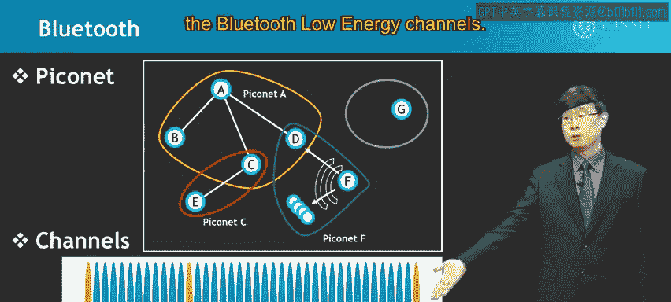

9.  **Wi-Fi技术深度解析**
    *   分析无线局域网市场与主要厂商。
    *   学习基础设施模式和自组织模式等Wi-Fi网络架构。
    *   探讨2.4 GHz和5 GHz双频技术带来的优势。

10. **蓝牙技术深度解析**
    *   聚焦蓝牙网络、微微网及其服务信道。
    *   详细介绍低功耗蓝牙技术。
    *   回顾蓝牙技术的整体演进历程与新版本特性。
    *   深入理解蓝牙协议的技术特点。

11. **云计算技术**
    *   分析云计算市场的份额、主要服务与产品类别。
    *   聚焦四大云服务提供商：亚马逊AWS、微软、IBM和谷歌。
    *   详解三大服务模型：
        *   **软件即服务**：`SaaS`
        *   **平台即服务**：`PaaS`
        *   **基础设施即服务**：`IaaS`
    *   探讨虚拟机的交付与运行模式、PaaS的服务提供与集成开发环境作用，以及SaaS的云连接与业务流程。

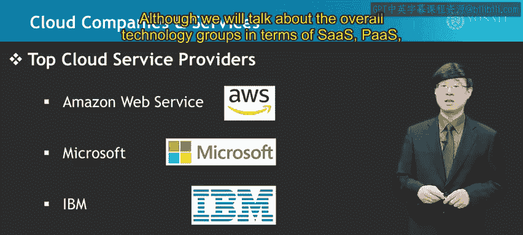

12. **边缘计算技术**
    *   学习雾计算、移动边缘计算和云际计算等前沿边缘计算技术。
    *   理解这些技术如何将计算资源靠近用户，以减少骨干网络流量并提升服务响应速度。

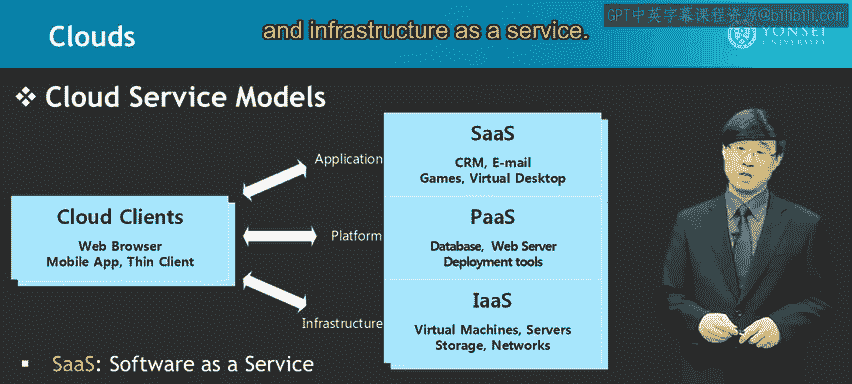

---

## 实践项目环节

理论需要结合实践。在掌握了核心技术概念后，我们将通过以下项目进行综合应用。

以下是三个动手实践项目：

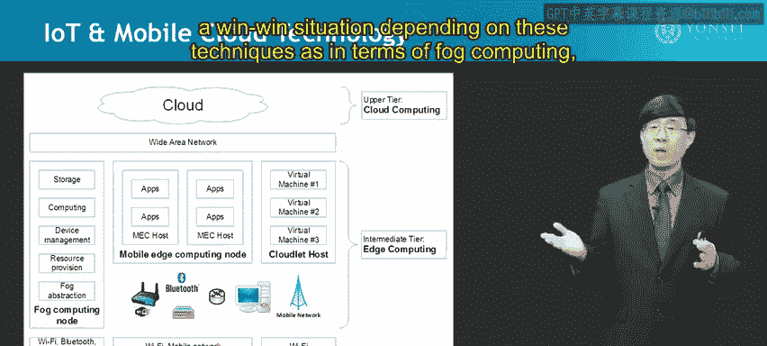

1.  **蓝牙扫描项目**
    *   使用扫描工具探测周边蓝牙设备及其位置。
    *   分析特定设备（如Gear S3智能手表）的详细信号特征。

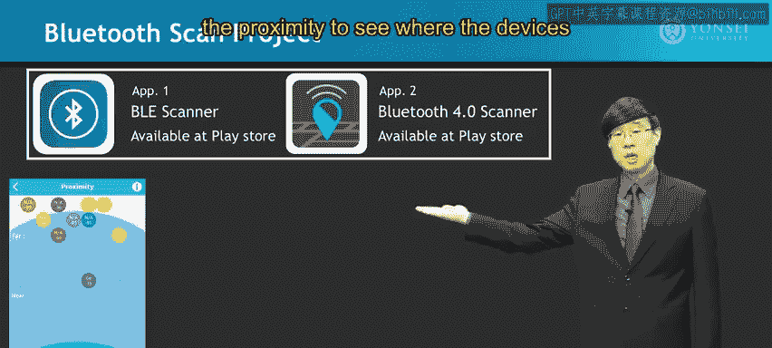

2.  **Wi-Fi网络分析项目**
    *   研究Wi-Fi网络特性与信号接收。
    *   分析2.4 GHz和5 GHz频段中具体子信道的使用情况。

3.  **AWS EC2云服务器项目**
    *   在亚马逊AWS云平台上，亲手创建并配置一台EC2虚拟服务器。
    *   学习云服务器的基本操作，并在此基础上完成更复杂的解决方案。

---

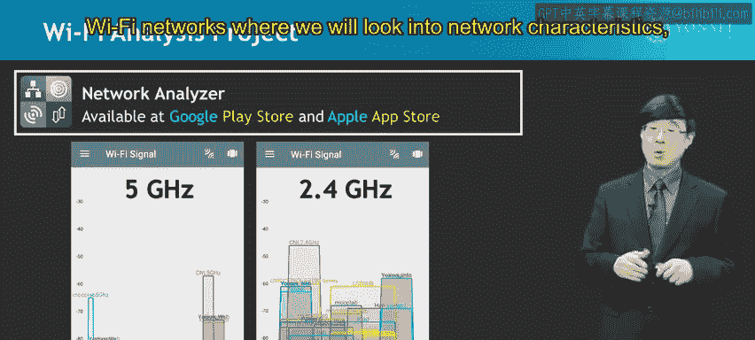

## 总结

在本节课中，我们一起学习了《物联网、无线网络与云计算新兴技术》课程的完整框架。我们从物联网的市场与架构出发，逐步深入到传感器、无线通信、云计算及边缘计算等具体技术领域，并规划了相应的实践项目。希望本介绍能为你接下来的学习提供清晰的路线图。

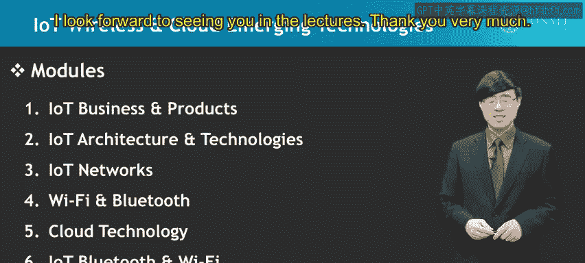

期待在后续的课程中与你共同探索这些精彩的技术内容。