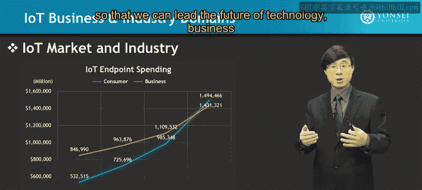

# 73：1_1.1 物联网商业和行业领域（第1部分）📡

## 概述

在本节课中，我们将要学习物联网（IoT）的基本概念、其网络规模、影响力以及北美市场的概况。我们将探讨物联网如何连接万物，并分析其在商业和消费领域的巨大潜力。

---

物联网网络是物联网需要支持的关键特性之一。它的核心是连接物品、人员、应用程序和数据。为了实现连接，网络是必不可少的。它通过互联网进行连接，因此我们将这项新兴技术统称为物联网（IoT）。物联网的基本目标是连接所有可控制且需要被监控的事物。它实现了远程控制、管理、交互和集成服务。

上一节我们介绍了物联网的基本定义和目标，本节中我们来看看物联网的网络规模。

物联网网络规模方面，移动设备的数量将超过地球上的人口数量。全球人口大约为76亿，而移动设备的数量预计将超过这个数字，因为一些人会拥有不止一个智能设备来满足需求。想一想，你可能已经拥有智能平板电脑或智能手表，未来你还可能拥有支持增强现实和各种虚拟现实交互服务的智能眼镜。此外，还将有智能可穿戴设备，如鞋子、腰带、领带等各种组件。考虑到这些，预计移动设备，特别是智能设备的数量将超过人口数量，这是非常明显的。

以下是基于此规模的一些预测：
*   到2020年，将有500亿个物品连接到互联网，这是一个巨大的数字。
*   此外，需要考虑到76亿的总人口与500亿物品的对比。因此，在我们的工作场所、从家到办公室的途中或家中，考虑围绕每个用户的物品数量并取平均值，就可以看到物联网设备将被部署的广阔范围和方式。这也使得物联网服务支持变得如此重要。

我们在这个领域有很多工作要做。一些先进的物联网设备需要收集、分析和处理原始传感器数据片段，并将其转化为操作控制信息。

可以这样理解：当我说原始传感器数据时，这些是数字、度量值、符号、可能没有特定含义的文本值。然而，一旦你收集了它，并将其与其他收集到的信息放在一起，你就会得到信息——即具有某种意义、能给你指示、告诉你警报或该做什么不该做什么的东西。通常，这就是我们将数据转化为信息的意思。

物联网网络规模庞大，一些传感器数据库可能因物联网设备数量巨大而拥有海量规模。因此，物联网数据库将需要云计算的支持，以处理收集到的海量数据。此外，为了将我们接收到的数据转化为信息，云计算也将成为应用大数据技术的基础。这将使大数据服务能够支持通过我们的原始数据源进行信息转化。

为了做到这一点，大数据引擎需要做的是：
*   首先，使用各种过滤技术过滤掉无用信息。
*   整合重要的信息。
*   权衡更重要和较不重要的信息。
*   将其聚合成一种形式，使我们能够准确获得我们想知道的信息，那将成为我们的核心信息。

上一节我们探讨了物联网的规模和数据转化，本节中我们来看看物联网的影响力。

物联网的影响力显然是巨大的，它将以各种方式改变世界。
*   首先，从人开始，我们可以监控和控制更多事物，因此人们将变得更有能力。
*   在流程方面，更多用户和机器可以实时协作，这将使得更复杂的任务能够在更短的时间内完成。
*   在数据方面，可以更频繁、更可靠地收集数据。这些结果将使我们能够做出更准确的决策，从而控制这数百万乃至数十亿的物联网模块，使我们能够在现有基础设施上获得更安全和更高的生产力。
*   此外，物品本身也变得更具可控性。移动设备和物品变得更有价值。可以这样想：你有一个可以打开灯的开关，然而，如果有一种方法可以让灯调暗、调亮并根据需要改变颜色，仅仅想到这样一个简单的应用，就会让你的光源以多种不同的方式变得更有用。就像这样，如果有一种方法能以非常符合你需求的特定方式控制某物，那么它就会变得有价值得多。这就是物联网技术将为你提供的。

上一节我们了解了物联网的广泛影响力，本节中我们聚焦于北美物联网市场与行业。

北美物联网市场与行业概况如下：总体而言，出现了2888家公司和产品，这个数据基于一份非常出色的参考资料，我推荐你详细阅读。此外，融资总额达1250亿美元。有95家独角兽初创公司，这意味着这些初创公司通过各种投资获得了超过10亿美元的资-源。由此产生的物联网市场和行业领域的员工数量为34.2万人，并且预计会变得更大。总体而言，物联网技术在北美（通常指美国和加拿大）创造了6130亿美元的总价值。

观察物联网市场和行业趋势，其中蓝色代表消费者领域，橙色代表商业领域。你可能会发现一个有点令人惊讶的现象：基于已安装的物联网单元总数，消费者领域的总体规模大于商业领域。这意味着，个体客户购买和使用的这些单个组件，其总和实际上超过了核心商业领域本身的使用量。这表明未来存在着更大的潜力，一个广阔的蓝海市场，尤其是在消费者领域。因为当消费者决定他们想要改变，或者有新产品能增加他们所做事情的价值或让他们的工作更轻松时，显然不止一个人，而是数亿到数十亿的人会想要它、需要它、获得它，并使他们的生活更高效、更有效。因此，代表消费者已安装物联网单元数量的这条蓝线，实际上本身就是物联网未来市场和行业领域的一片蓝海。

继续看物联网终端支出，自然因为它是终端技术，你可能认为更多的是面向商业的用途和基于商业或行业的应用。然而，即使在这个趋势中，与这里看到的商业线相比，总体个人消费者线在这里交叉。从这一点之后，你可以预期这个差距会变得更大。此外，看看我们这里的数值，单位是百万。所以这里的最低基数6466，其中的6代表600万，因此这些数字确实非常巨大，范围在数百、数千、数万亿甚至更高，这就是我们未来所预期的。随着这条线不断上升，我们获得更多服务，我们将进入一个预计在2030年左右达到数百亿级别的市场。延伸这条线，想想如果这种趋势持续下去（预计会持续），未来会发生什么。所以请更加关注这门课程，与我一起，引领技术、商业和工业的未来。

---

## 总结

本节课中我们一起学习了物联网的核心概念，它旨在连接并远程控制万物。我们探讨了物联网设备数量将远超人口的巨大网络规模，以及数据如何通过云计算和大数据技术转化为有价值的信息。我们还分析了物联网在提升人的能力、优化流程和决策方面的影响力。最后，我们审视了北美物联网市场的现状，特别是消费者领域展现出的巨大增长潜力和蓝海市场机会。物联网正在并将持续深刻地改变世界。