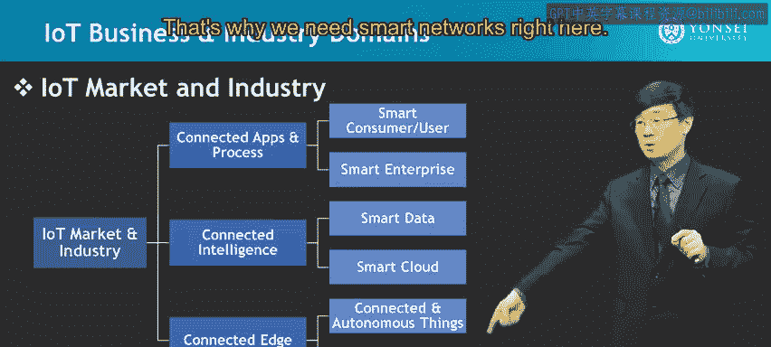

# 74：2_1.1 物联网商业和行业领域（第2部分）📚

在本节课中，我们将学习物联网市场与行业的细分领域，特别是“连接智能”与“连接边缘”这两个核心部分。我们将探讨它们各自包含的关键技术，并理解它们如何共同构成物联网的生态系统。

上一节我们介绍了物联网市场的第一个细分领域“连接应用与流程”，本节中我们来看看另外两个重要的组成部分。

## 连接智能：数据与云的智慧 🧠

“连接智能”领域包含两个核心要素：**智能数据**和**智能云**技术。

智能数据主要涉及大数据引擎。这些引擎负责汇聚和收集各种类型的半结构化、非结构化以及结构化数据。其核心工作流程如下：

1.  **汇聚与收集**：从不同源头聚合数据。
2.  **过滤与提取**：筛选数据，并从中提取必要的**键值对**。
3.  **加权与分析**：对数据进行重要性加权，并从中提取有用信息。

为了处理海量数据、赋予其意义并提取面向未来的洞察，大数据引擎天然地融合了机器学习和人工智能技术，从而使数据变得“智能”。

为了承载如此大规模的数据处理任务，我们必然需要云的支持，即云计算。那么，什么是“智能云”呢？智能云通常提供以下支持：

*   **基础设施**：提供计算、存储和网络资源。
*   **平台**：提供开发和运行应用程序的环境。
*   **软件功能**：提供各种服务以支持应用程序运行。

这就是云计算的核心作用。关于云计算的更多细节，我们将在后续课程模块中深入探讨。

## 连接边缘：万物互联的末梢 🌐

接下来是“连接边缘”。这里的“边缘”指的是连接自主的物体。

这意味着我们拥有新的、连接到主干基础设施的物体或实体。它们接收智能信息和指导，并能基于指令自动运行。其具体运作方式是：小的、即时的决策被预先编程，以确保它们安全、稳定、可靠地运行；而整体的行动范围和方式则由更大规模的系统以及人类的控制和监控来指导。

以下是连接边缘的典型示例：

*   **智能汽车/自动驾驶汽车**：作为自主物体，它们通过车载单元连接到智能交通系统。
*   **智能交通系统**：包含路侧单元和车载单元。车载单元是车辆的“大脑”，路侧单元则连接到ITS主干网络，提供导航、交通控制、安全及应急支持（如为救护车、消防车提供便利）。

所有这些连接在一起，形成了由连接和自控物体构成的系统，这就是“连接边缘”的含义——连接一直延伸到为人类提供直接服务的终端设备。

## 支撑边缘：智能网络的重要性 📡

为了支持这些连接的自主物体，我们当然需要一个能够连接到边缘的**智能网络**。

网络为什么必须是“智能”的呢？原因在于，物联网设备所使用的网络类型会随着场景变化而逐级改变。

*   **核心网**：连接国家之间（通过卫星、海底光缆）以及国内城市之间（距离数百公里）。
*   **城域网/区域网**：连接城市或区域内部。
*   **局域网**：连接建筑物、工厂或校园内部。

这些网络采用不同的协议、以不同的方式运行，并在不同的网络实体和子网组中进行安全和管理。将它们无缝连接，使其像一个具有统一协议和运维的整体网络一样协同工作，是一项需要智能支持的复杂技术组合。

在未来物联网市场中，设备会不断移动并切换所连接的网络。例如，一个人佩戴的智能手表、口袋里的智能平板、智能腰带、智能鞋和增强现实眼镜，在移动时可能需要根据所需服务，连接到移动通信网络、不同技术的Wi-Fi或蓝牙等。

正因为有如此多样化的技术需要被智能地管理和控制，所以我们才需要“智能网络”。

---

本节课中我们一起学习了物联网市场与行业的三大细分领域。我们深入探讨了“连接智能”，它通过**大数据引擎**和**云计算**使数据变得有用；也分析了“连接边缘”，它涉及**自主物体**（如自动驾驶汽车）与**智能交通系统**的交互；最后，我们理解了支撑这一切的**智能网络**的必要性，它确保各种异构网络能像单一网络一样无缝协同工作，以支持移动的物联网设备。这些部分共同构成了一个完整、智能且互联的物联网世界。