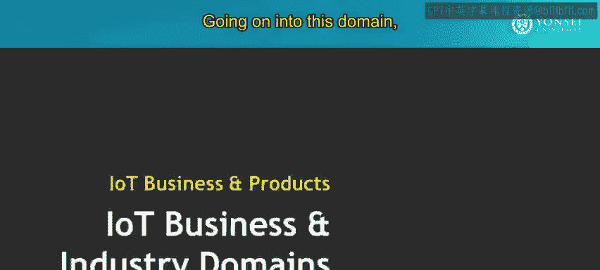
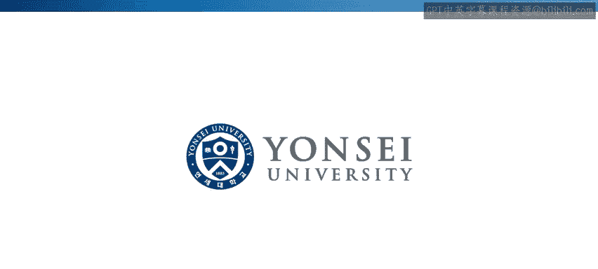

# 75：物联网商业与行业领域（第3部分）🚀

在本节课中，我们将继续探讨物联网在商业和行业中的具体应用领域。我们将了解物联网技术如何融入消费者生活、企业运营及关键行业，从而创造更智能、更高效的服务与产品。

上一节我们介绍了物联网在部分商业领域的应用，本节中我们来看看物联网在更广泛的消费者与企业服务中的具体表现。

## 智能消费者与用户领域

进入连接应用与流程的领域，我们可以看到多种多样的应用。以下是该领域的主要组成部分：

**1. 辅助现实**
例如谷歌眼镜和微软等公司支持的产品。这里指的是增强现实、混合现实或部分虚拟现实相结合的技术。这些技术能提供导航指引，并随时随地提供所需的娱乐内容。

**2. 智能家居**
智能家居的概念是，家中的物联网模块连接到一个云平台，该平台由用户选择的支持服务进行监控和维护。这可能涉及以下功能：自动检测冰箱或橱柜中缺少的食品并下单；在用户不在家时，将送达的物资安全存放在具备温控、压力与湿度控制的环境中，待用户回家后再取用。这一切都基于符合用户日程安排的便利性。

**3. 联网汽车**
联网汽车，或者说自动驾驶汽车、智能汽车，它们可以自主行驶。即使不能完全自动驾驶，各种辅助技术也能发挥作用：防止驶入错误地点；提前预判以避免事故；提前警示以避免违反交通信号，从而避免罚单和罚款，保住驾照。此外，这些安全机制、自动驾驶系统以及支持服务都连接到智能交通系统骨干网络。该网络通过路侧单元和设备，以及车辆上的车载单元和设备为用户提供支持。

接下来，我们将目光转向对个人福祉至关重要的领域——智能健康。

## 智能健康

智能健康的作用显而易见：监测脉搏；如有血压问题则监测血压；如有糖尿病则测量血糖水平（新技术正致力于实现无创测量）；监测心率、总体出汗和紧张程度；预测是否会昏厥；在昏厥时能否自动呼救；在窒息、心脏病发作或高血压引发癫痫时，能否立即呼叫救护车支持。这就是智能健康要实现的目标。

当然，你的健康状况与你购买和需要购买的商品相关联。此外，当你进行个人操作、购物、做出企业对企业或企业对消费者的决策时，你需要运行自身的基础设施，并需要利用基于物联网的共享经济技术。

这实际上直接将我们带入了智能企业的领域。

## 智能企业与服务

智能企业服务将我们已讨论的内容提升到更深的层次，以支持商业运营、行政管理、销售，并深入到制造业。

**1. 交通运输**
我们谈论交通运输时，当然会提到上一部分的联网汽车。若想让智能汽车联网，你需要一辆智能汽车；若想将智能汽车连接到智能交通系统整体网络，你必须拥有智能交通网络。所有这些都得到交通运输业务的支持。此外，还包括我们即将在目标服务中讨论的大众交通业务，例如优步等技术。

**2. 零售业**
对于零售业的智能企业，物联网市场和行业已非常明显。这是我们长期以来一直看到的事物，它将变得更加普遍和日常化。零售部分涉及物流——确保合适的产品在正确的时间出现在正确的地点，数量不多不少。此外，不仅包括物流，如果无法在商店交付给个人，需要送货上门或到其公司时，所有这些都整合于此。像亚马逊、沃尔玛这样的公司正在基于物联网的智能企业零售领域做得非常出色。

**3. 建筑与施工**
想想这个领域，智能建筑系统是建筑的新趋势。它将供暖、空调、照明以及整个基础设施全部整合在一起，确保资源不被浪费：温度适宜、湿度恰当、亮度足够，使建筑内各区域能在合适的环境下运作，同时防止资源浪费，保障基础设施安全，并预防意外事故和犯罪。这就是智能建筑或智能建筑系统。当然，要拥有这样的系统，你必须建造它。如果你想建造一座能预防事故、打滑、多车连环碰撞，并能根据结冰、下雨、起雾等不同条件控制整体摩擦力和路况、照明的智能桥梁，那么在建造时就需要植入智能技术以确保其正常工作。这就是基于智能企业的施工技术。

**4. 制造业**
制造业正变得智能化，即基于智能工厂的技术。其核心思想是：不再盲目生产所有产品然后运往各地希望售出，而是根据用户需求精确定制产品，在几天内配以完美匹配的配件送达用户家中。这样可以节省时间、精力和材料，避免生产滞销产品，从而防止资源浪费和仓储空间的浪费（因为滞销产品需要存储空间，直到能以超低价清仓处理）。智能制造正是为了解决这些问题。

**5. 石油、天然气与能源**
当然，这涉及能源消耗和智能电表。我们谈论的不再是仅显示和记录已用电量的传统模拟电表，而是能够预测未来使用量、控制用量、确保不浪费能源的智能电表。将这些智能电表连接到家庭、企业和房间正是我们所讨论的。此外，石油和天然气方面可以这样理解：电力相对容易开关控制，尽管在大型发电厂层面控制也不简单且耗时，但其输送系统在特定节点是可控制的。然而，石油和天然气作为流体或气体，其流动动力学不那么容易控制。基于智能企业的控制服务可以使这些石油和天然气实体实现智能控制，从而：第一，将所需资源输送到需要的地方；第二，在不需要时可以停止流动，将剩余资源用于支持其他需要的地区。想想看，日出日落，我们在白天、早晨、下午、夜晚以及睡眠时所需的资源都在变化，我们所在的位置也在变化。因此，在正确的时间、正确的地点、以正确的数量提供所需的资源，正是石油、天然气和能源智能企业服务所谈论的内容。

**6. 医疗保健**
基于智能企业的医疗保健。典型的应用包括：预防患者发生各种事故；为保险公司节省开支。此外，在我们的整体系统中，我们可能去多家医院。在一家医院基于所显示症状做出的整体诊断信息被保存并上传到云端。这些数据以可与健康数据以及医生用于诊断疾病、根据患者特定症状制定治疗方案的系统互操作的格式存在。为了实现这一点，你需要将旧档案保存在云端，并根据其他医院、医疗服务系统或保险公司可能使用的不同数据格式传输过去。为了与所有这些不同的数据库、协议和软件平台互操作，正是智能化医疗保健服务能够提供帮助的地方。

---

本节课中，我们一起学习了物联网在智能消费、智能健康及多个关键企业服务领域（如交通、零售、建筑、制造、能源和医疗）的具体应用。我们看到，物联网技术通过深度集成，正在重塑商业运营模式与个人生活方式，其核心在于实现资源优化、流程自动化与服务的个性化定制。