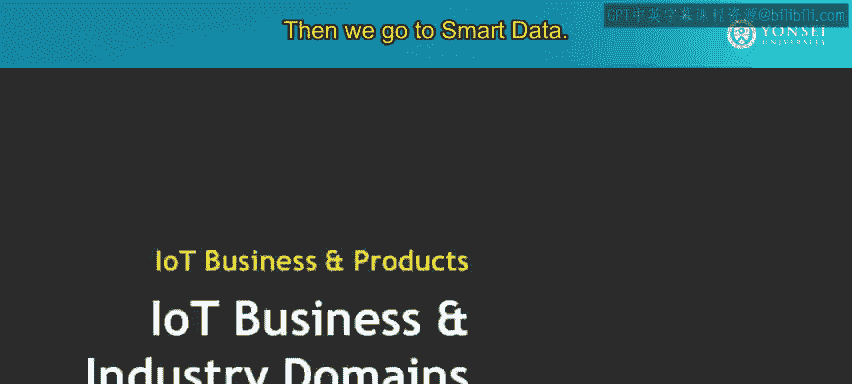

# 76：4_1.1 物联网商业和行业领域（第4部分）📚

## 概述
在本节课中，我们将学习物联网（IoT）生态系统中的几个核心组成部分，包括智能数据、数据安全、人工智能与机器学习、智能云以及云服务模式。这些技术共同构成了现代物联网解决方案的基础。

## 智能数据
上一节我们讨论了物联网的硬件和网络层面，本节中我们来看看数据层面。数据有多种类型。

以下是数据的主要分类：

*   **结构化数据**：指已经具备固定格式的数据，通常存储在数据库中。例如，在Microsoft Excel工作表中，数据必须按正确的格式和范围填入特定的行和列，否则系统会报错。这种数据易于用传统数据库工具处理。
*   **非结构化数据**：指没有固定格式的数据。例如，我们拍摄的照片、各种文档、社交媒体上交换的文本信息，或者在搜索引擎中输入的关键词。这类数据无法直接放入传统的行列式数据库。
*   **半结构化数据**：指具有一定结构但并非完全规范的数据。例如，XML或JSON格式的文件。

将非结构化和半结构化数据转化为可从中提取海量隐藏信息的数据库，正是**大数据技术**的核心任务。

## 数据安全
智能数据必须得到保护。数据需要以不同规模进行传输，有时是小文件，有时则是整个或部分数据库这样的大文件。

有多种技术支持大数据引擎在不同地点间安全地移动大型文件，例如**Flume**等技术。数据安全至关重要，特别是某些数据需要比其他数据更高级别的保护。因此，数据安全领域不断涌现新技术和初创公司，例如基于人工智能或深度学习的智能安全解决方案。

## 人工智能与机器学习
我们还有人工智能和机器学习技术，它们能完成各种任务。这是一个属于人工智能、机器学习和深度学习的新时代。

目前，人工智能和机器学习技术无处不在，从数据收集、数据集中、数据聚合到数据格式转换。例如，将视觉数据转换为文本，将文本转换为语音，或将一种视频格式转换为另一种格式。正是大数据技术、人工智能和机器学习，使得我们所说的“智能”成为可能，例如本页左侧提到的“智能数据”和“智能云”。人工智能和机器学习适用于一切领域，尤其是物联网技术。

## 智能云
我们需要云技术，本课程后续模块将更详细地讨论云计算。

那么，什么是物联网支持的云？为什么它如此重要？原因如下：物联网模块需要智能控制。它们将收集海量的各类传感器数据并传送到云端。云端需要过滤出重要信息，做出智能决策，然后控制物联网模块，以提供我们所需的服务。

为了实现这一点，我们需要云技术。这是因为，并非所有物联网设备都具备完整的决策和数据处理能力。此外，即使单个设备能处理自身生成或接收的数据，但要做出真正智能的决策，需要将它的数据与更大范围的数据相结合。例如，观察该区域其他设备的情况，或了解可能影响你业务的环境变化。这就需要结合和收集智能信息。

因此，即使你的设备能独立处理和决策，其准确性和功能性也有限。这正是需要智能云技术支持的地方。在许多情况下，物联网模块本身智能程度很低，处理能力有限，感知范围也窄。为了整合信息并做出基于海量微观信息的智能决策，你需要一个智能云。这就是为什么智能云和物联网技术密不可分，也是本课程同时涵盖物联网和云计算的原因。

## 云生命周期
这指的是通过云计算技术延长物联网设备、物联网市场和服务领域的生命周期。

实现这一点的方法有很多。从表面看，如果物联网设备能在正确的时间开启和关闭以节省能源，那么你所管理或监控的整个物联网领域的生命周期就会延长，无需频繁更换电池或部件。这样，你既提升了其价值，又节省了额外的基础设施投资，是多赢的局面。可实现的典型功能都基于此。

此外，还有事件与云集成。在基于事件的场景中会发生各种事情，云计算技术则集成这些信息，帮助你做出智能决策。因为当事件发生、环境变化或服务提供方式需要调整时，你需要做出智能决策。在许多情况下，系统无法预编程所有可能的应对和控制场景。基本上，当发生意外情况时，你的系统需要做出智能决策并响应出现的问题，这就需要各种技术的支持。

## 数据中心
我们再次谈到云计算。我们收集数据，根据数据类型将多个数据库整合到位于数据中心的整体数据仓库中。我们如何控制这一切？此外，数据中心内部包含的各种模块、存储模块以及数据中心本身都需要监控和控制，因为它是一个由大量计算机、内存单元、连接网络、巨大电源以及空调和各种传感器（用于防止洒水、控制湿度、避免事故）组成的超级大型设施。为此，你需要强大的技术来支持你的数据中心，而使其“智能化”无疑是保护和利用现有资源的明智投资。

## 数据安全（智能云层面）
我们已经讨论过数据安全。但在智能云中，再次强调，这里是所有重要信息的汇集地。自然，它也成为了黑客渴望攻击的目标。他们可能进行勒索软件攻击、拒绝服务攻击，或悄悄潜入、破坏系统、将其变成“僵尸计算机”并窃取重要信息。无论如何，你都不希望这些情况发生。你不希望你的云被污染、攻击或监视。如何保护它？这就是你需要解决的问题。

## 云服务模式：IaaS, PaaS, SaaS
在云计算中，我们基本上有三种基础服务模式。

以下是这三种核心服务模式：

*   **基础设施即服务**：即**IaaS**。它支持我们所说的基础设施，换句话说，包括处理能力、数据库、网络安全以及你无法直接访问的大规模连接能力。然而，通过你的云连接，云服务提供商为你提供了你可以使用的基础设施接口。虽然这些资源不属于你，但通过订阅的云服务，你能够使用这些庞大的资源。这就是基础设施即服务。
*   **平台即服务**：即**PaaS**。它提供你所不具备的各种平台技术，包括数据库服务、处理能力以及其他各种平台服务领域。一个例子是操作系统：你需要在不同的计算平台上使用各种操作系统，如Microsoft Windows、Linux、Unix、各种Ubuntu等。它们需要访问不同类型的数据库。什么能为你提供这些？那就是PaaS，即平台即服务。当然，还有更多内容。

## 总结
本节课我们一起学习了物联网生态中的关键使能技术。我们了解了**智能数据**的三种类型（结构化、非结构化、半结构化），认识了**数据安全**在数据传输与存储中的重要性，探讨了**人工智能与机器学习**如何为物联网注入“智能”。我们还深入分析了**智能云**与物联网协同工作的必要性，以及云如何通过**生命周期管理**和**事件集成**提升物联网价值。最后，我们介绍了云计算的三种基本服务模式：**IaaS**、**PaaS**和**SaaS**。理解这些概念是构建和运用现代物联网解决方案的基础。