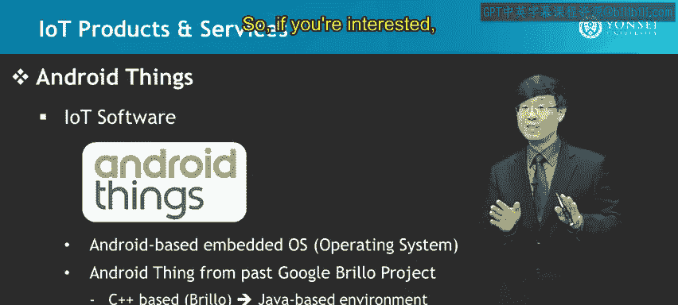
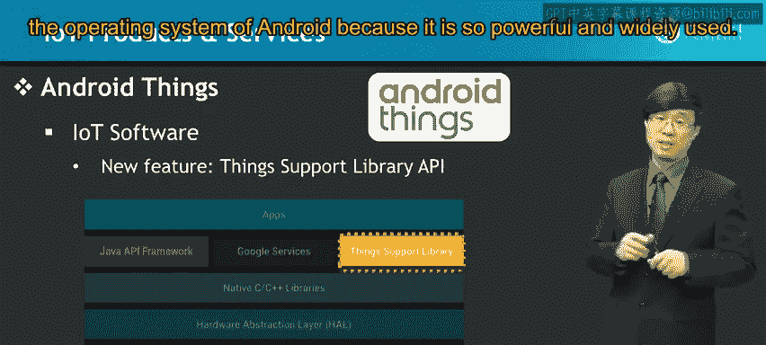
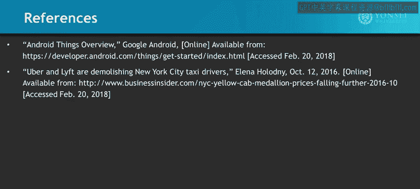

# 延世大学《新兴技术：从智能手机到物联网再到大数据》课程 - P78：6_1.2 物联网产品和服务（第1部分）📡

在本节课中，我们将学习物联网领域的代表性产品与服务。我们将从硬件和软件两个层面，探讨一些领先或新兴的公司及其解决方案，了解它们如何推动市场发展并获得投资。

上一节我们介绍了物联网的宏观概念，本节中我们来看看具体的产品和服务实例。我们将选取几个来自不同重要领域的代表性公司进行分析，同时也关注一些正在崛起的新兴公司。了解这些公司的业务模式和市场表现，与研究大型企业的发展同样重要。

因此，我将这两部分内容结合起来，开始我们的学习。

## 物联网硬件：Atmel公司 💾

无论何种物联网应用，硬件都是基础。你需要处理器来运算，需要存储设备来保存数据，然后才能进行处理。这是所有物联网应用的基石。当然，在此之上还需要软件。

Atmel是一家半导体制造与设计公司。它开发各种微控制器、射频设备、闪存以及特定应用产品等。2015年，其营收达到11.7亿美元，其中很大一部分来自微控制器业务，而未来这部分业务将更多地服务于物联网硬件。

以下是Atmel的一个主要产品线：

*   **AVR系列**：这是Atmel的微控制器家族品牌。它是世界上最早使用片上闪存进行程序存储的微控制器之一。当时许多其他公司的微控制器使用一次性可编程ROM、EPROM等技术。片上闪存提供了更快的访问速度和显著优势，使得AVR微控制器芯片具有更快的处理能力和更低的功耗，这正是Atmel产品极具吸引力的原因。

在AVR产品线中，我们主要讨论的是**megaAVR**系列。这是一系列被**Arduino**物理计算平台采用的微控制器。

关于Arduino是什么，在后续讲解物联网技术的课程中，我会进行更详细的介绍。本节课我们主要聚焦于产品和服务层面。因此，一些你可能渴望了解的细节在本节课中不会深入展开，但请等待后续的模块，我会提供更多相关信息。现在，让我们专注于产品层面以及从这些设备中能获得的服务。

如图所示，这里展示的是各种Arduino开发板及其描述。中间一栏的描述显示，这些开发板支持入门级物联网和可穿戴技术设备。不同的Arduino开发板基于不同的微处理器，支持相应的研发工作。这些微处理器经过定制，以适应图中所示的各种服务。可以看到，这些Atmel AVR微控制器足以提供物联网技术的入门级支持。对于基于Arduino Uno和Arduino Leonardo的物联网开发环境来说，它们非常合适。

所谓“合适”是指，这些模块和开发板所支持的微处理器，其处理能力（例如每秒指令数、所需的浮点运算能力）正是为入门级物联网设备定制的。更详细支持物联网操作的是Arduino Yun和基于Arduino Ethernet的设备，支持它们的AVR处理器也在此列。我们也会关注一些处理能力指标，例如典型的ATmega328模块（这里也使用了328P型号，我们会在后续课程中讨论）。

此外，还有适用于开发可穿戴物联网应用的Arduino开发板，例如Arduino LilyPad，其支持的处理器类型也在此列出。

## 物联网软件：Android Things 📱

你很可能听说过Android，因为它很可能就在你的智能手机上。在现有的智能手机市场中，超过70%的设备由Android系统支持。因此，Android是全球智能手机和平板电脑中最主流的操作系统。这使其成为极具吸引力的物联网软件选择。

然而，如前所述，物联网设备的计算能力通常低于智能手机。因此，我们需要一个更轻量级、同时能支持物联网应用的Android操作系统，这就是**Android Things**的由来。

它是一个基于Android的嵌入式操作系统，源自谷歌过去的项目。它支持C++编程，也基于Java环境。得益于这些应用和编程语言的特性，它能够在动态领域中运行和使用。

Android Things最初支持Raspberry Pi 3和Intel Edison进行产品原型开发。关于Raspberry Pi 3是什么，我将在后续讲解物联网技术的课程中讨论，本节课暂不展开。如果你感兴趣，请稍作等待。

Android操作系统架构如图所示。观察整体结构，图中**Things Support Library**是一个库，其中包含了所有基于物联网的Android Things函数和过程。如果你需要基于上层的应用或旁边的Google服务，或者Java API框架，或者通过上下层架构与原生C/C++库交互来实现某些功能，这个库就位于Android操作系统（基于Linux内核）的分层架构中。

这一层为你提供了所需的详细功能和特性，用以开发非常高效的物联网技术。这些技术能与你的Android智能手机完美协作，因为它们基于相同的操作系统，并且拥有已经以高效节能和速度优化的方式集成在操作系统中的特殊功能和技术（两者都基于Linux内核）。

请注意，关于Android操作系统的更深入细节，不在本课程中讲解，而是在我的另一门关于智能设备和移动新兴技术的课程中。在那门课里，我会详细讨论iOS和Android操作系统。这是“从智能手机到物联网再到大数据”这个更大专业方向的一部分。我建议你去学习那门课程，以更深入地研究强大且广泛使用的Android操作系统。

进一步来看，Things Support Library API主要基于几个API单元：

*   **外围输入/输出API**：支持这类物理连接。
*   **用户驱动程序API**：使应用程序能够与硬件事件通信。如何实现？就是通过这个API，因此我们称之为驱动程序。用户驱动程序使得用户运行的应用程序能够与硬件单元、嵌入式系统组件、附件设备以及输入/输出设备进行通信。为了实现这个过程，你需要一个驱动程序，这就是用户驱动程序API的作用。
*   **控制功能**：它还控制触摸板、键盘、游戏控制器和物理运动传感器。换句话说，如果你有一个游戏，并且使用游戏杆或遥控器（无论无线还是有线）来玩，那么你就需要用户驱动程序API，以便将游戏杆或控制面板的控制信号传递到连接电视的主游戏机，以及连接到互联网的环境传感器。

你需要某种机制来建立所有这些连接，并以低延迟、高可靠性、高吞吐量的方式提供服务，以确保游戏体验不会出现任何中断。你绝不希望因为网络连接和物联网支持不佳而导致游戏处于劣势或输掉比赛。如果要输，也应该是因为技不如人，而不是技术故障。因此，我们需要这些用户驱动程序API来确保尽可能可靠。

此外，还有为Android Things开发者提供的**功能外设套件**，包含Android代码示例。其中包括项目套件，以及一个基于“彩虹帽”的硬件设备附加在上面，这样我们就可以利用套件中的资源，开发各种易于开发的应用，并快速构建可定制为各种产品的开发模块。

在本节关于物联网产品和服务的课程中，你只会看到这些内容的一瞥。这个市场正在不断增长，在后续课程中，你将看到更多细节。

## 总结 📝

本节课中，我们一起学习了物联网领域的两类基础产品与服务。首先，我们探讨了物联网硬件代表**Atmel公司**及其**AVR微控制器**，特别是应用于Arduino平台的megaAVR系列，它们为入门级物联网设备提供了核心处理能力。接着，我们转向物联网软件，介绍了**Android Things**——一个为物联网设备优化的轻量级Android嵌入式操作系统，并了解了其架构中的关键支持库和API。这些硬件和软件基础共同支撑着丰富的物联网应用开发。