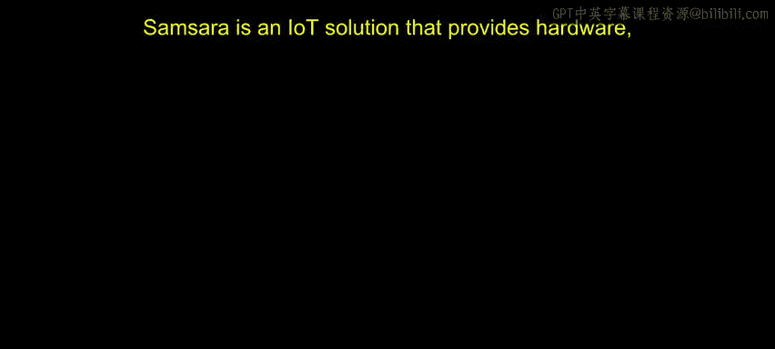
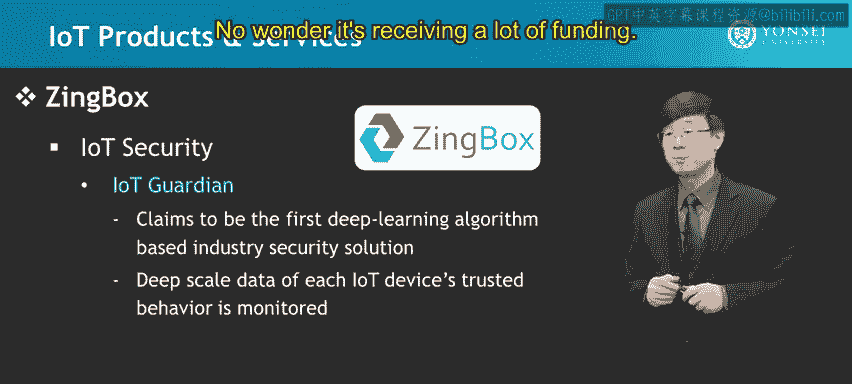
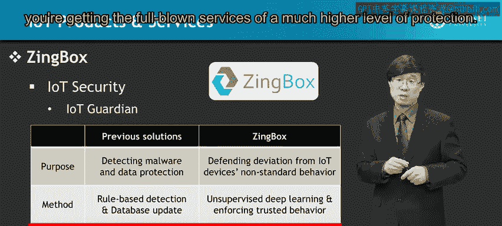
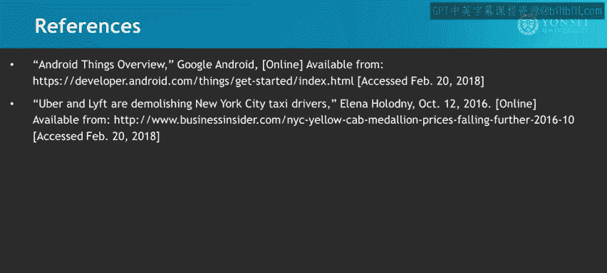
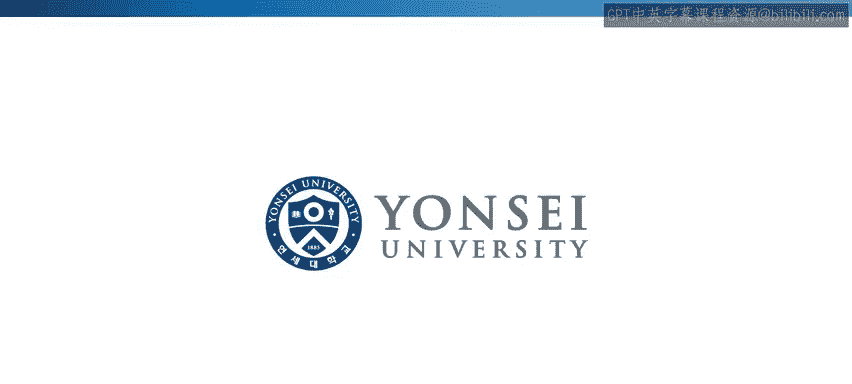

# 79：7_1.2 物联网产品和服务（第2部分）🚀

在本节课中，我们将继续探讨几个具有代表性的物联网公司及其解决方案。我们将了解它们如何通过创新的硬件、软件和服务，在特定领域解决实际问题并创造巨大价值。课程将涵盖从工业物联网平台到安全解决方案，再到改变我们日常生活的交通服务。

---

上一节我们介绍了一些物联网的基础概念，本节中我们来看看几个具体的物联网公司案例，了解它们的产品、服务以及成功的关键因素。

## Samra：一体化物联网解决方案 🛠️

Samra 是一个提供硬件、软件和网络连接的一体化物联网解决方案公司。该公司成立于2015年，并在同年被《福布斯》和《财富》杂志评为未来领先的物联网公司之一。这个案例表明，只要拥有正确的技术并在合适的细分领域提供有价值的服务，物联网初创公司同样可以成为独角兽企业。

Samra 提供面向物联网网关、摄像头、传感器模块的集成平台，以及用于移动应用和云端仪表盘的软件。

以下是 Samra 解决方案的核心特点：

*   **易于部署**：为工业领域提供易于部署的物联网技术。这一点至关重要，因为没有人希望使用难以编程、调试或学习的技术。
*   **快速安装**：采用即插即用技术，支持在15分钟内完成直观的安装。仅需15分钟设置即可开始开发，这是一个非常吸引人的特性。
*   **多样化应用**：其网关可用于车辆、无线环境监测等领域，并提供相应的软件解决方案。

此外，Samra 的解决方案还可用于车队管理行业。通过提供**GPS跟踪、行车记录仪技术、Wi-Fi热点**等多种功能，满足了行业的广泛需求。

## Zingbox：专注于物联网安全 🔒

Zingbox 是一家开发企业级物联网安全解决方案的初创公司。它的核心功能是发现并保护已连接的物联网设备。该公司在2017年被提名為高德纳（Gartner）的“物联网安全领域酷供应商”，这显示了其技术的突出性。

该公司成立于2014年，获得了230万美元的天使投资，并在B轮融资中从戴尔科技资本和Tri Ventures等机构筹集了2200万美元。它于2017年2月9日推出了名为“IoT Guardian”的物联网安全产品。

那么，IoT Guardian 有何潜力能吸引如此大规模的投资？它声称是首个基于**深度学习算法**的工业安全解决方案。深度学习是**机器学习**的一个子集，而机器学习又是**人工智能**的一个分支。简单来说，这项技术能让系统自我学习如何应对各种情况，即使它没有被预先编程处理所有特定场景。

具体而言，Zingbox 的方案会深度分析每个物联网设备的数据，监控其可信行为，并强制执行这种可信行为，重点在于数据保护。

与之前的解决方案相比，Zingbox 的创新之处在于：

*   **检测机制不同**：传统方案主要基于规则库更新来检测恶意软件和保护数据。而 Zingbox 致力于防御物联网设备的非标准行为偏差。
*   **技术基础不同**：传统方案是**规则驱动型**的，依赖于预设的规则库。Zingbox 则利用**深度学习技术**，通过无监督学习机制来强制执行可信行为。
*   **部署方式不同**：传统方案需要在终端安装产品。而 Zingbox 是**无客户端**的，无需安装和管理软件代理。

这种基于深度学习、高精度、且无需复杂客户端安装的安全方案，无疑具有巨大优势。

## Uber：变革交通服务的物联网应用 🚗

Uber 是一家全球知名的公司，它通过大规模创新为交通行业带来了新面貌。人们对这类服务感兴趣，是因为它涉及衣食住行等生活必需品领域。任何能在这些领域提供便利、节省成本、使生活更高效安全的技术，都会受到大众欢迎。

Uber 本质上是一个物联网应用：它将汽车（物）通过互联网连接到服务器，再服务于用户。系统利用司机和乘客智能手机上的**位置传感器数据**，通过后端云系统进行分析和统计，从而优化匹配最佳的司机-乘客组合。

这种物联网应用使 Uber 在2018年将其服务扩展至84个国家的超过760个城市。在美国，Uber 占据了网约车市场77%的份额。其增长十分显著，例如在纽约市，其出行份额在2015年4月至2016年4月的一年内，就从15%增长到了27%。

以下是一些关键数据，展示了 Uber 的规模和影响力：

*   **总融资额**：220亿美元
*   **2016年总收入**：200亿美元
*   **2016年净收入**：65亿美元
*   **2017年公司估值**：690亿美元
*   **2017年司机平均月收入**：364美元

这些数字说明了 Uber 为何如此杰出，以及它如何改变我们利用物联网技术的方式。随着更多物联网技术的出现，Uber 的服务和功能预计还将持续增长和进化。

---

本节课中我们一起学习了三家物联网公司的案例。我们看到了 **Samra** 如何通过一体化、易部署的平台服务于工业物联网；了解了 **Zingbox** 如何利用前沿的深度学习技术提供无客户端的物联网安全解决方案；也探讨了 **Uber** 如何将物联网应用于日常交通，彻底改变了我们的出行方式。这些案例表明，物联网的成功在于找准细分市场，利用核心技术解决实际需求，并为用户创造显著价值。