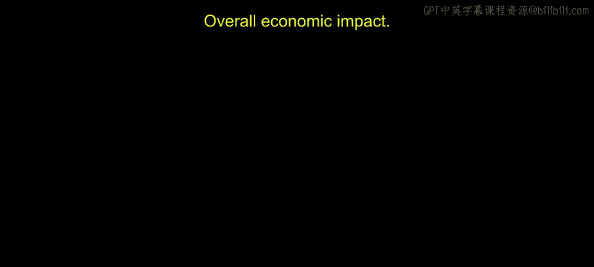
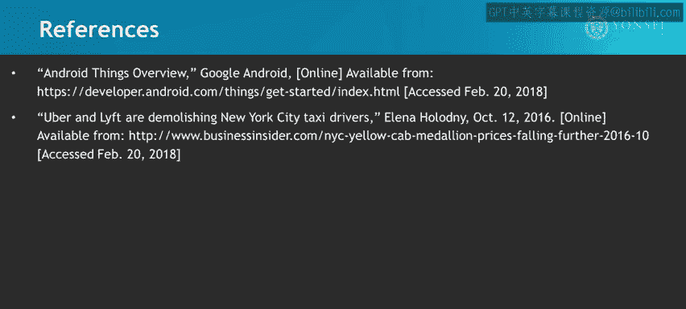

# 课程8：物联网产品与服务（第3部分）📡

在本节课中，我们将探讨物联网的经济影响、核心通信模式（如M2M）以及物联网在不同行业（如安防、交通、制造）的具体应用。我们还将了解构成物联网生态系统的关键参与者。

---

## 经济影响预测 📈

上一节我们介绍了物联网的基本概念，本节中我们来看看其宏观的经济影响。

总体而言，物联网的经济影响预测普遍乐观。物联网有潜力在2022年之前，将全球企业利润总额提升21%。这种影响主要体现在以下几个领域：
*   **资产利用率**
*   **员工生产力**
*   **供应链与物流**
*   **客户体验**
*   **创新**

目前，这些预测数据仍在增长。随着物联网技术的持续发展，人们认为现有的预测可能偏于保守，未来实际影响可能更大。

---

## M2M、M2P、P2M与P2P通信模式 🔄

理解了经济影响后，我们需要了解物联网中设备与人是如何交互的。这涉及到几种关键的通信模式。

物联网的一部分是智能模块，即传感器和物联网设备与服务器通信。服务器是机器，物联网设备也是机器，这种**机器对机器（M2M）** 的通信是核心。

另一方面，物联网也涉及包含人的交互组合。例如，一个联网设备为你提供警报、家庭安防或信用卡保护服务，然后你打电话给另一个人获取所需服务。这种**人对人（P2P）** 的交互，借助物联网技术，能帮助你在正确时间获得更好的服务。

还有**人对机器（P2M）** 的交互，例如我通过与服务器通信获取信息，以帮助做出明智的商业决策。有时甚至不需要我主动操作，我的智能手机可能检测到我的需求，自动获取并显示相关信息，这就是服务预测和内容预置。

为了实现这种在需要时即时获取服务的体验，相关的服务、内容和网络功能需要被预测、获取并推送到临近位置，然后在恰当时机呈现给我。例如，如果我佩戴增强现实智能眼镜，在商务活动中，即使我从未请求，正确的信息也会在恰当时刻显示在镜片上，只有我能看到。

如何实现这种预测和内容交付？这需要一个结合了智能网络、智能云、智能设备以及智能软硬件的协同结构。它是多种智能技术综合集成的成果。

---

## 物联网应用领域 🏭

在了解了通信模式后，我们来看看物联网具体在哪些领域发挥作用。

物联网的应用非常广泛，涵盖以下关键领域：

**安防**
支持监控、警报、实时物体与人员追踪。

**交通**
支持车队管理、道路安全、收费支付、实时交通监控，以及综合性的智能交通系统（ITS）。

**制造**
实现智能工厂。

**供应与配置**
例如分布式监控、自动售货机管理等。

**设施管理**
涵盖家庭、企业、楼宇、园区等各类场所的管理。

**公用事业**
包括智能计量设备，以及公用事业的供应、测量和计费。

**医疗保健服务**
涵盖电子医疗、个人安全、身体传感器设备等领域。

---

## 物联网生态系统中的关键角色 🤝

看过了应用领域，我们最后来认识一下构建和运营这些物联网解决方案的参与者。

观察整个物联网和M2M生态系统，可以从服务层面开始描述。关键角色包括：

**服务与解决方案层**
*   **商业服务提供商（BSP）** 和 **商业解决方案提供商**
*   **系统集成商** 和 **企业物联网解决方案提供商**

**网络层**
*   **网络运营商**
*   **通信服务提供商**
*   **传输基础设施提供商**

**软件层**
*   **软件制造商**，不仅包括应用软件，还包括**中间件**、**固件**、**操作系统**以及设备中运行的内核（如智能手机的Linux内核）等相关技术。

**硬件层**
包括**GPS模块**、**无线传感器**、**可穿戴设备**、**执行器**、**嵌入式硬件设备**等。本课程后续将有专门讲座深入讨论物联网技术、传感器、执行器及其他组件。

---

## 总结 📝

本节课我们一起学习了物联网的宏观经济影响预测，深入探讨了M2M、P2P、P2M等核心通信模式及其如何实现智能服务。我们还浏览了物联网在安防、交通、制造等多个行业的具体应用，并认识了构成物联网生态系统的各类关键参与者，包括服务提供商、网络运营商、软件和硬件制造商。下节课我们将更深入地探讨物联网的技术细节。