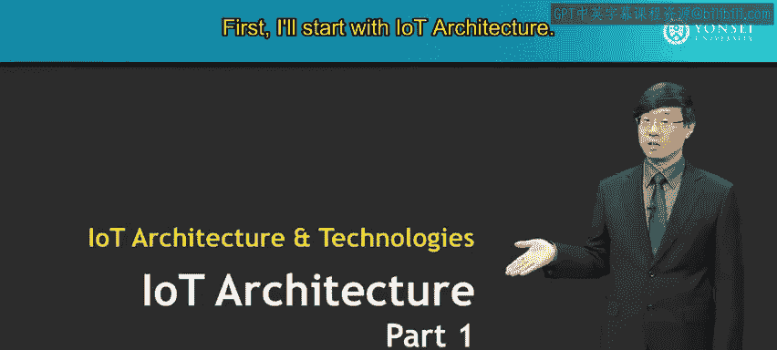
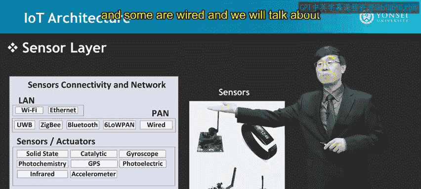
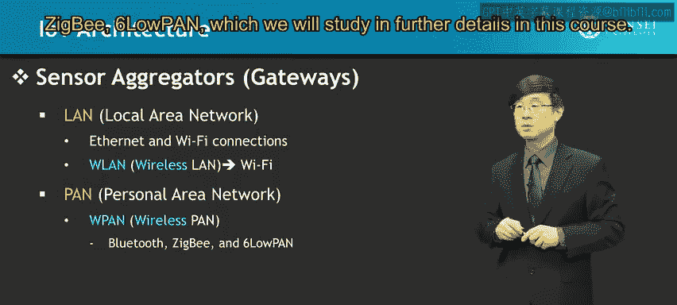

# 延世大学《新兴技术从智能手机到物联网再到大数据》课程 - P81：9_2.1 物联网架构（第1部分）🏗️

在本节课中，我们将要学习物联网架构的基本层次和底层技术，特别是传感器网络层及其相关组件。

物联网架构可以被划分为多个层次。底部是更基础的技术，如传感器和网络技术，向上则涉及管理，最顶层是应用层。我们将从底层开始，逐步向上介绍。

## 传感器网络层 📡

上一节我们介绍了物联网架构的整体分层，本节中我们来看看最底层的传感器网络层。

传感器网络层由传感器、执行器、标签（如RFID标签、条形码标签）以及其他各种传感技术组成。这些设备相互连接，多个模块再连接到网关和网络。

为了实现连接，我们需要网络技术。移动通信技术提供了连接到大范围广域网的能力，例如第二代移动通信GSM、第三代UMTS、第四代LTE/LTE-A技术。这些技术以有线和无线两种方式提供连接。此外，还有WiFi、以太网和各种网关控制技术，用于提供到网关和整体网络的连接。

服务提供管理工具基于设备建模、配置和管理组件，用于控制数据流、安全控制以及物联网网络的其他各种功能。所有这些都旨在支持应用层提出的直接需求。

应用层包括环境监测、人员追踪、零售、医疗保健、能源、交通、供应链等各种应用。这些技术由各层共同支持，以提供整体的物联网网络服务。

## 传感器与设备 🧩

接下来，我们聚焦于传感器层的具体组件。

在传感器层，底部是各种标签和传感器。这些设备被部署用于提供监控、检测运动、温度、湿度、亮度、各种气体以及其他传感功能，也包括健康监测设备。

这些收集和生成信息的单个传感器和标签，是我们在硬件层面关注的核心，由整体的传感器和执行器支持。

以下是传感器层包含的一些关键要素：
*   **传感器类型**：包括测量倾斜度、运动、震动、速度变化、方向变化、光照水平变化等的传感器。
*   **网络连接**：主要是无线连接，也有一些是有线连接。我们将在后续课程中讨论更多细节。

## 无线传感器网络 🌐

传感器层由传感器和智能设备组成，用于收集和处理实时信息。传感器通常使用低功耗和低数据率的连接方式。

我们形成了无线传感器网络，它们以自组织网络的形式连接，具有多种形态。这意味着它可能是一串设置在路边的长序列传感器，也可能是覆盖多层建筑的传感器网络，每层有多个传感器，整个建筑构成一个完整的传感器网络域。具体采用何种形式完全取决于应用、领域以及传感需要保护、收集和管理的环境。

传感器根据目的和数据类型进行分组。例如，当涉及热量、温度、湿度时，这类传感器可能会连接到火灾报警系统，与烟雾探测器等协同工作。此外，在节能方面，会关注光照水平、空调和供暖系统的使用情况，以及该区域是否有人。目的决定了整体传感器数据如何被收集、监控和联网。

因此，环境传感器、军事传感器、身体传感器、家庭传感器、监控传感器等都有其特定的领域和网络连接形式。

## 网关与网络连接 🔗

然后，我们有用于聚合传感器数据的网关。因为我们需要收集数据，过滤掉不必要的信息，并将任何重要信息发送给控制单元，以便它们得到更多关注，并在需要时做出控制操作响应。

局域网可以是以太网或WiFi连接。当我说LAN时，指的是局域网，例如以太网就是一种使用网线在建筑物内、楼层内、实验室内或办公室内连接的有线局域网。我们还有无线局域网，即WLAN，这基本上就是WiFi，我们很快会详细讨论。

比局域网更小的网络称为个域网。什么是个人区域网络？看看你现在所在的房间，你看到房间里的各种东西，比如你的电脑、显示器、笔记本电脑，还有控制空调和暖气的开关，控制窗帘、百叶窗的开关等。在这个我个人区域（即我所在的房间）内，我直接看到的模块就是你的个人区域。有专门的协议用于此，例如Zigbee、蓝牙。而当你谈论WiFi时，你指的是一个稍大的网络，不仅仅是一个房间或个人区域，而是包括隔壁房间、走廊，甚至整个楼层。如果以无线方式实现，最常见的协议就是WiFi。

无线局域网的服务范围目标大约在30米到40米左右，某些情况下甚至更大，可能达到50米到100米。而个人区域网络的范围更短，大约在5到10米以内。这些是非常短距离的无线通信技术，其无线模式称为无线个域网。例如蓝牙、Zigbee等，我们将在本课程中进一步详细研究。

## 直接互联网连接 🌍

最后，我们来看一种特殊情况。

不需要连接到局域网网关的传感器，可以通过广域网直接连接到互联网。这意味着，如果房间里有某些传感器，你没有蓝牙主设备或无线接入点来收集数据，那么我的智能手机有一个移动通信单元，可以直接将我连接到移动通信广域网。

然后，我将使用我的移动通信模块，我的LTE连接、UMTS连接或GSM连接，接入整个移动通信骨干网络，并找到我的云服务器来支持我的服务需求。

---

本节课中我们一起学习了物联网架构的基础，特别是传感器网络层的组成、无线传感器网络的形式、传感器分组方式，以及通过网关或直接通过广域网连接到互联网的不同路径。理解这些底层组件是构建和理解完整物联网系统的基础。