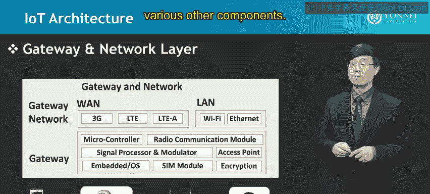
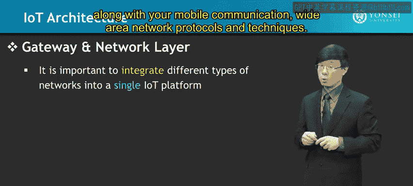

# 课程10：物联网架构（第2部分）🌐

在本节课中，我们将学习物联网架构的第二层：**网关与网络层**。我们将探讨这一层所需的技术、面临的挑战以及关键的性能要求。

---

上一节我们介绍了物联网架构的感知层，本节中我们来看看**网关与网络层**。为了将感知层收集的数据连接到互联网，我们需要更广泛的无线局域网（WLAN）、有线局域网以及移动通信技术。

以下是构建这一层所需的关键硬件与技术组件：

*   **网络设备**：路由器、集线器、交换机。
*   **通信模块**：无线电通信模块、微控制器、信号处理单元、接入点。

这些硬件共同构成了**网关**，其核心任务是**收集、聚合**来自感知设备的数据，并将其连接到互联网服务。

---

为了处理海量物联网数据，网络层必须满足极高的要求。这些数据由无线传感器和智能设备产生，其规模是巨大的。

那么，我们预测的数据量有多大呢？在我的另一门关于智能设备与移动新兴技术的课程中，我们讨论了第四代和第五代移动通信技术。第五代移动通信（5G）即将到来，事实上，在2018年韩国平昌冬奥会上，5G通信模块已经在各种平台和设备上进行了演示。

根据第五代移动通信的规范，其连接密度目标是：在**一平方公里**的区域内，支持**100万台甚至更多**的物联网设备。这就是我们所说的“海量”规模。试想一下，一栋60层或更高的摩天大楼，其内部需要连接的设备数量可能远超这个密度。

这种超密集的连接水平，要求网络和网关必须具备**强大且可靠**的性能。具体而言，网络层需要支持以下关键特性：

*   **网络模型**：支持私有、公有和混合网络模型。
*   **服务质量**：低延迟、低错误概率、高吞吐量、高能效。
*   **安全与可扩展性**：高级别的安全性和**可扩展性**。

**可扩展性**至关重要。有些网络在规模较小时运行良好，但当规模扩大10倍、100倍时，可能因协议或网络管理不可扩展而无法有效工作。例如，网络规模小时，请求能在1秒内得到响应；但当100个用户同时使用时，响应可能需要数分钟甚至数小时，这就是不可扩展的表现。对于需要聚合海量物联网数据并提供服务的场景，可扩展性是核心要求。

---

此外，将不同类型的网络集成到统一的物联网平台中也非常重要。网络技术种类繁多，仅在本课程中，我们就会讨论各种无线局域网和无线个域网技术，例如LoRa、蓝牙、Wi-Fi、6LoWPAN、Zigbee等。它们各有自己的协议和特性。

即使在同一技术类别内（如Wi-Fi或蓝牙），也存在多种不同的模式和协议规范。因此，物联网网关需要整合这些各异的无线技术，并与有线技术、移动通信广域网协议相结合，形成一个**能力强大、集成度高、互操作性**强的统一服务平台。

---

综上所述，物联网传感器通过多种协议和异构网络技术进行聚合。因此，我们必须提供强大、集成、同质且可互操作的服务。由于网络域内设备数量庞大，IT网络必须再次强调**可扩展性**，以支持数据收集、聚合、网关服务、网络安全和服务质量保障。可扩展性是实现这一切的自动前提。

本节课中，我们一起学习了物联网架构的网关与网络层。我们了解了该层所需的硬件基础、处理海量数据时面临的挑战，以及**可扩展性、集成性和服务质量**等关键性能要求。这些是构建可靠、高效物联网系统的基石。