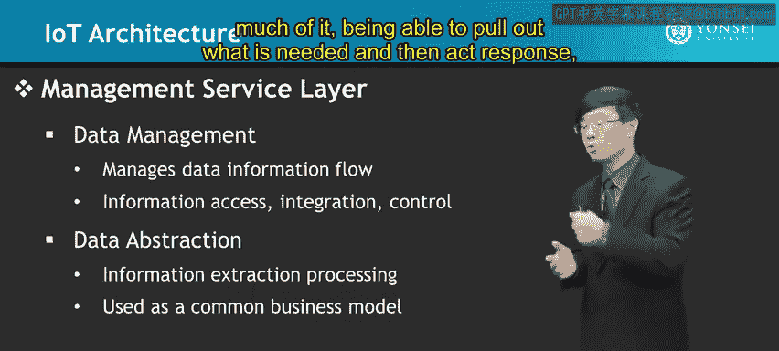

# 83：11_2.1 物联网架构（第3部分）📚


在本节课中，我们将要学习物联网架构中的**管理服务层**。这一层位于应用层和网络网关域之间，负责对从海量传感器和设备收集上来的数据进行高效、智能的管理与控制，是确保整个物联网系统稳定、安全、可盈利运行的关键。

上一节我们介绍了物联网的硬件、软件和网络基础，本节中我们来看看如何管理和利用这些基础层产生的数据。

---

## 🛠️ 管理服务层的核心功能

假设所有传感器数据和信息都已通过硬件、软件和网络顺利上传，接下来就需要以正确的方式进行管理。管理服务层主要承担以下几类关键服务：

以下是管理服务层包含的主要系统类型：

1.  **运营支持系统**：负责设备建模、配置、性能管理与安全管理。
2.  **计费支持系统**：处理计费、报告。当用户超出已付费的服务套餐时，系统需要中断服务或要求额外支付，然后才能继续提供服务。从商业角度看，这是最重要的一环，因为服务提供商需要通过收入来维持运营。
3.  **服务分析平台**：涉及统计分析、数据挖掘、文本挖掘、内存分析和**预测性分析**。预测性分析在物联网中尤为重要，它能支持需要快速响应和零延迟的服务，例如触觉物联网或触觉互联网服务，为用户提供身临其境的沉浸式体验。
4.  **安全服务**：包括访问控制、加密、身份识别和访问管理。安全至关重要。
5.  **业务规则管理**：涵盖规则定义、建模、模拟与执行。
6.  **业务流程管理**：包括工作流流程建模、模拟执行等。

总而言之，管理服务层负责**信息分析、安全控制、流程建模和设备管理**。

---

## 📊 数据管理的挑战与策略

数据管理是需要重点考虑的方面。海量的物联网设备持续发送信息，其中许多设备会进行周期性上报（例如每秒报告一次），这可能导致信息洪流。

为了高效管理，需要在数据到达管理服务器之前进行过滤。例如，当传感器处于正常状态、未检测到异常时，可以将聚合数据简化为长期报告，只提交更简洁的信息。这需要一种过滤和管理机制。

代码如下，展示了一个简单的数据过滤逻辑概念：
```python
if sensor_status == “NORMAL”:
    send_data = aggregate_and_simplify(data) # 聚合并简化数据
else:
    send_data = data # 发送原始数据
    priority = “HIGH” # 标记为高优先级
```

另一方面，如果传感器检测到异常行为（如温度过高、气体浓度超标、湿度过高或某区域出现异常），则需要立即生成并传送**高优先级的报警信息**。这些信息不能与普通的周期性数据同等排队等待处理，必须被优先传送。

因此，网络服务和管理模块必须能够同时高效支持紧急需求和普通操作需求，提供智能的网络服务。

---

## 🔑 信息访问与控制的商业意义

数据管理还包括管理信息流、信息访问、集成与控制，这些都需要基于具体的业务来设计。

公司内部不同角色需要的信息不同：首席执行官、首席财务官和首席技术官关注的信息各有侧重，他们下属员工所需的信息也因具体工作、研发和规划内容而异。因此，需要对信息进行分级控制，因为信息是公司的核心资源之一。

信息访问、集成控制和**数据抽象**是另一个关键领域。从海量数据中提取有用信息，并据此做出响应或调整商业模式，是必须完成的工作。这正是数据抽象和信息提取处理的意义所在。

---

## ✅ 课程总结




本节课中，我们一起学习了物联网架构中的**管理服务层**。我们了解到，这一层通过运营支持系统、计费系统、分析平台和安全控制等功能，对物联网数据进行智能管理。同时，面对数据洪流的挑战，需要采用过滤、优先级处理等策略。最后，信息必须根据不同的业务需求进行有效的访问控制与抽象，才能转化为有价值的商业洞察。