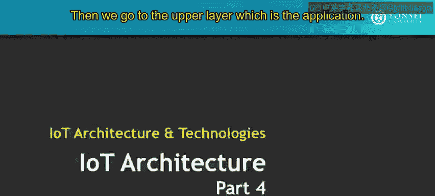
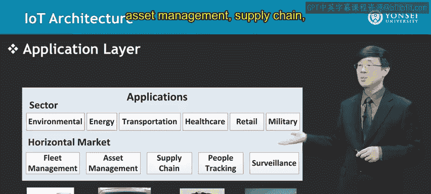
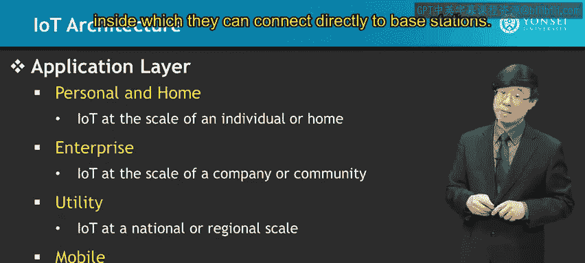
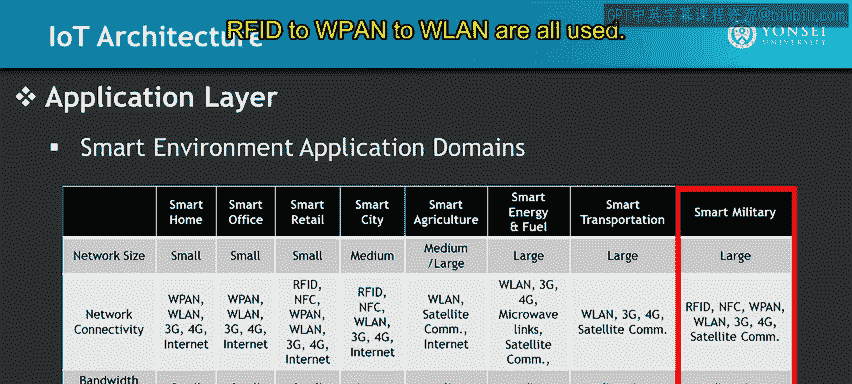
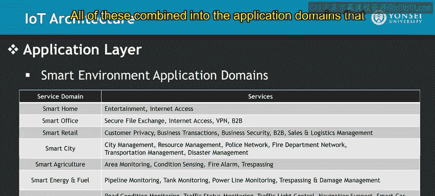
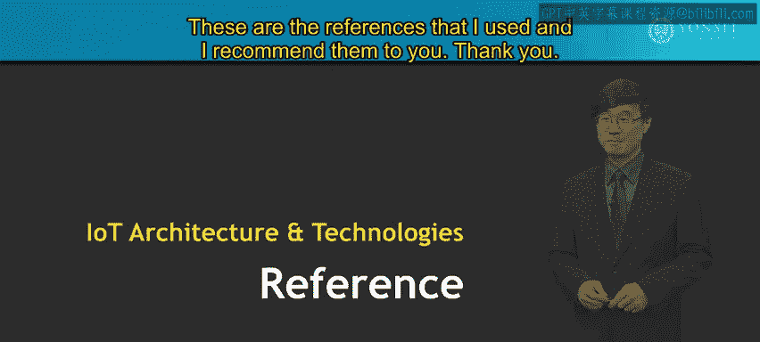

# 84：12_2.1 物联网架构（第4部分）📚

在本节课中，我们将要学习物联网架构中的顶层——应用层。这一层直接与用户交互，是物联网技术最终价值的体现。我们将探讨物联网应用的广泛领域、分类方式以及在不同智能环境中的具体应用。

## 应用层：与用户的接口 🖥️

我们来到架构的上层，即应用层，这是与用户交互的接口。

物联网的应用领域非常广泛。基本上，你所知道的一切都可能成为应用领域。目前是否有被排除在外的领域？没有。也许现在针对某些特定应用还没有传感器或物联网设备，但在不久的将来，肯定会出现，并会基于各种应用自然地融入整个物联网领域。

以下是当前已知的一些热门应用领域，总结如下，涵盖了多个行业板块：
*   环境
*   能源
*   交通
*   医疗保健
*   零售
*   军事
*   横向市场（例如车队管理、资产管理、供应链、人员追踪、监控等）

## 应用分类与规模 📊

上一节我们介绍了物联网应用的广泛领域，本节中我们来看看如何对这些应用进行分类。

深入了解细节，各行业领域的多种应用都可以利用IT服务来增强。应用的分类可以基于业务模式、网络类型、可用性、异构性、覆盖范围、规模、实时或非实时需求等。这些是分类的基础，决定了如何划分应用。

以下是基于应用规模的主要分类：

*   **个人与家庭**：这个类别指的是在个人或家庭规模下的物联网应用领域。
*   **企业**：这个类别指的是在公司或社区规模下的物联网应用，侧重于公用事业。
*   **公用事业**：这指的是国家或区域规模的应用，将具有共同基础或相关的公用事业连接在一起。
*   **移动**：移动设备通常是分散的，广泛分布在各个领域。它们根据所连接的蜂窝区域进行划分。就像互联网被划分为子网一样，移动通信网络和智能手机的连接也存在基本层级。当物联网设备连接到移动通信网络时，智能手机可以作为接口，或者物联网设备内部可能装有移动通信模块，可以直接连接到基站。

## 智能环境应用领域详析 🏙️

上一节我们根据规模对应用进行了分类，现在我们来具体看看不同的智能环境应用领域。这些领域的划分主要基于网络规模、网络连接性和带宽需求。

以下是主要的智能环境应用领域及其技术特点：

*   **智能家居**：由于是家庭环境，网络规模相对较小。需要无线个域网、无线局域网、移动通信技术以及有线互联网。带宽需求与家庭成员数量成正比，但相比其他领域，其需求较小。
*   **智能办公室**：与智能家居类似，网络规模和需求相近。
*   **智能零售**：零售业务需要射频识别标签和读写器以及近场通信技术来进行产品识别和购买，这是其与智能家居/办公室的主要区别。
*   **智能城市**：网络规模变为中型或大型。需要包含所有现有的网络连接技术，包括RFID、NFC、无线局域网、无线个域网、3G/4G和互联网等。
*   **智能农业**：涉及广阔的农业区域，数据速率需求低，但需要大范围的监控和管理。需要广域网覆盖（如卫星通信）、互联网和无线局域网技术。有些无线局域网技术专为户外低数据速率、远距离节点通信设计。
*   **智能能源与燃料**：该领域通常拥有自己的基础设施（如电缆、管道、高塔），因此可以建立卫星链路或在大型塔楼之间使用微波技术，在独立的无线或有线网络上支持通信需求。
*   **智能交通**：主要基于无线局域网、3G/4G和卫星通信。其中，**WAVE**（车载环境无线接入）协议是关键，它使用 **IEEE 802.11p** 标准。
*   **智能军事**：需要全方位的通信服务，从卫星通信到RFID、无线个域网、无线局域网等所有技术都会被使用。

## 各应用领域的服务内容 🛠️

了解了不同领域的技术基础后，我们来看看这些物联网应用具体提供哪些服务。

下表展示了各应用领域的服务内容：

*   **智能家居**：支持娱乐、互联网接入。
*   **智能办公室**：提供安全文件交换、互联网接入、虚拟专用网络和企业对企业服务。
*   **智能零售**：支持客户隐私、商业交易、商业安全、B2B交易、销售和物流管理。
*   **智能城市**：城市管理、资源管理、警察网络、消防部门网络、交通管理、灾难管理。
*   **智能农业**：区域监控、状况感知、火灾报警、入侵检测。
*   **智能能源与燃料**：管道监控、储罐监控、电力线监控、入侵和损坏管理。
*   **智能交通**：路况监控、交通状况监控、交通灯控制、导航支持、智能汽车支持、交通信息支持，以及整体的智能交通系统。
*   **智能军事**：指挥与控制、通信、传感器网络、态势感知、安全信息和军事网络。

所有这些共同构成了由物联网技术支持的智能环境应用领域。

## 总结 📝

本节课中，我们一起学习了物联网架构的应用层。我们了解到应用层是直接面向用户的接口，其领域几乎无所不包。我们探讨了基于规模的应用分类方式，并深入分析了智能家居、城市、农业、交通、军事等多个具体应用领域的技术特点和服务内容。物联网技术正通过这些多样的应用，深刻改变着我们的生活和各行各业。

