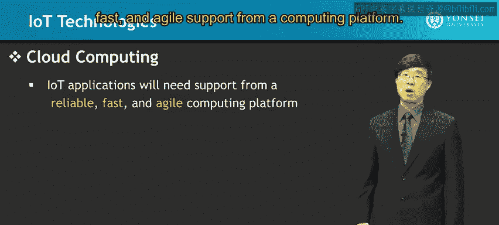

# 85：13_2.2 物联网技术（第1部分）🌐

在本节课中，我们将学习构成物联网网络与服务的关键技术。我们将从无线传感器网络开始，探讨其核心特点与挑战，并理解云计算如何成为物联网不可或缺的支撑平台。

## 无线传感器网络

上一节我们介绍了物联网的宏观概念，本节中我们来看看其基础构成技术——无线传感器网络。

无线传感器网络的核心在于为远程传感应用提供高效、低成本、低功耗的设备。其使能技术主要是低功耗集成电路和无线通信。

大量智能传感器收集原始数据，经过分析、处理和过滤后，将其转化为可用的信息。

无线传感器网络面临的基本挑战如下：

以下是无线传感器网络节点面临的主要限制：

*   **有限的处理能力**：节点需保持低功耗和低成本，因此其CPU处理能力有限。
*   **有限的存储能力**：在低成本设备上无法安装大容量内存模块，因为内存本身成本较高。
*   **对云计算的依赖**：物联网设备感知数据后，需将其发送到某处，然后接收控制信号以触发相应操作（如阻断、开启或调节温度）。这个过程需要云计算的支持。

## 云计算的作用

理解了物联网节点的局限性后，我们来看看云计算如何弥补这些不足。

可以将物联网系统类比为人体的运作：传感器如同手和脚，负责感知和接触；执行器负责移动物体或行走奔跑；而云端则如同大脑，负责存储信息并做出智能决策。对于高级物联网服务，需要一个中心来收集、分析和处理原始数据片段，并将其转化为用于控制的信息。

物联网设备需要云计算支持的原因包括：

以下是云计算对物联网至关重要的几个方面：

*   **弥补设备不足**：物联网设备可通过云计算克服软件、固件、内存和硬件处理能力等方面的缺乏。
*   **节省能源**：设备只需感知和发送数据，然后即可进入休眠模式，这能显著节省能源，延长电池寿命。
*   **安全存储与综合分析**：数据被安全地存储在远程位置。云端可以综合某个区域内所有需要共同考虑的数据，以做出智能决策。
*   **实现计算卸载**：将设备自身无法完成的操作和处理任务，通过远程处理或数据积压的方式转移到云端执行，这被称为**计算卸载**。其核心公式可表示为：`本地能耗 = 本地计算能耗 + 数据传输能耗`。通过将计算密集型任务 `C` 卸载到云端，可以显著降低本地能耗。

云计算不仅支持物联网，也支持智能手机、笔记本电脑、平板电脑、增强现实设备和游戏机等。

## 云服务模型

既然云计算如此重要，那么它具体通过哪些方式提供服务呢？

云服务模型主要包括以下三种：

以下是三种主要的云服务交付模式：

1.  **软件即服务**：如果你的智能手机上没有某个软件，可以从云端虚拟机获取该服务。例如，从应用商店下载并使用一个游戏或应用程序，这就是在使用SaaS。
2.  **平台即服务**：如果你需要使用特定的数据库进行操作，那么需要的就不仅仅是软件，还需要连接到主机并使用其处理平台和数据库结构，这就是PaaS。
3.  **基础设施即服务**：这涉及使用其他网络、特殊安全选项，以及将大量数据存储到骨干云上。它提供硬盘、大规模内存、网络支持和服务支持等底层资源。

因此，通过云服务，你基本上可以获得所需的一切。

---

本节课中我们一起学习了物联网的基础技术。我们首先探讨了无线传感器网络的特点与挑战，包括其有限的本地处理与存储能力。接着，我们深入了解了云计算如何作为物联网的“大脑”，通过提供计算能力、存储空间和智能分析来克服这些限制，并详细介绍了软件即服务、平台即服务和基础设施即服务三种云服务模型。理解这些基础技术是构建和运用更复杂物联网系统的关键第一步。