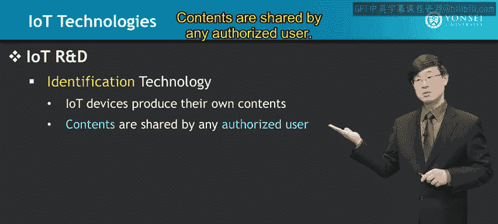

# 延世大学《新兴技术：从智能手机到物联网再到大数据》课程 - P86：14_2.2 物联网技术（第2部分）📡

## 概述

在本节课中，我们将继续深入学习物联网（IoT）技术。我们将探讨物联网设备的特点、其运行所依赖的网络基础架构，以及确保物联网系统安全、高效运行所需的关键技术要素，如认证、授权、能源管理和身份识别等。

---

## 物联网设备与网络基础

上一节我们介绍了物联网的基本概念。本节中，我们来看看物联网设备的具体特点及其运行的网络环境。

许多物联网设备具有内存小、处理能力和通信能力有限的特点，并且通常由电池供电。物联网需要将多种技术网络集成到一个共同的IP网络平台上，而这个平台就是互联网。这正是我们正在研究的“物联网”概念的核心。

由于物联网基于互联网，IPv4和IPv6协议是其运行的基石。可以将其理解为互联网的“血液”和“成分”，数据包通过路由器和网关内的路由表进行传输，这就是其基本的运行模式。将“物”连接到互联网，自然需要使用IPv4和IPv6协议。

> **注**：关于TCP/IP、IPv4/v6、TCP/UDP的详细内容，有一门名为《TCP/IP入门》的独立课程。如果你对此感兴趣，强烈建议你学习那门课程以获取更深入的知识。

物联网将对未来的互联网架构产生重大影响，这也是我们需要详细研究它的原因。

---

## 物联网的安全与隐私 🔒

物联网服务必须保证信息的安全、隐私和完整性，以及用户的机密性。因为我们周围遍布传感器，我们身上也可能佩戴着可穿戴物联网设备，我们的个人信息和行为可能被记录。如果这些个人信息被他人控制，我们可能会在身体和财务等各方面受到伤害。正因为物联网信息关乎我们自身，所以机密性至关重要。

以下是物联网研发中一些关键的安全特性：

*   **设备认证与授权**：在允许某个设备使用你的网络之前，你需要确保它是一个经过授权的设备，并对其进行验证和认证。否则，如果它是一个黑客设备，意图获取网络访问权限并发起勒索软件攻击、拒绝服务攻击或入侵你的系统，后果将不堪设想。因此，不能允许任何设备随意连接。设备需要通过认证，认证通过后，再根据其授权级别授予相应的访问权限（例如，只能访问特定范围的特定数据库）。
*   **用户认证与授权**：设备需要被检查和授权，用户同样也需要。
*   **物联网公钥与私钥管理**：公钥和私钥用于管理认证和授权，确保受保护的信息被加密，并且只能由授权用户解密打开。
*   **物与物之间的访问控制**：回想之前的课程，我们提到过机器对机器（M2M）通信，即连接物与物。这是物联网领域中一个庞大的组成部分，约占45%。此外，还存在人-物、物-人、人-人等交互模式。

---

## 低功耗协议与移动性支持

考虑到物联网设备的资源限制，其网络技术需要具备低开销和低复杂度的特点。我们将讨论一些无线个域网（WPAN）技术，以及其他专为物联网网络设计的低功耗、低处理能力的技术，这些技术的目标是让设备在正确执行特定任务的同时，拥有非常长的使用寿命。

**移动性支持**同样关键。对于佩戴在你身上的传感器，如智能手表、智能手机、智能平板、智能腰带、智能鞋、支持增强现实的智能眼镜等，它们会随着你移动。因此，所有这些设备都需要网络提供移动性支持。网络需要在你移动时，将你的连接切换到不同的接入点，确保无论你走到哪里都能持续获得服务。

这种切换不仅发生在连接层面，更贯穿于从你的设备到服务器、或到另一个人的端到端数据流全程。从小范围的无线切换（如在接入点边缘、移动通信基站、蓝牙节点或ZigBee主节点之间），到骨干网和所有接入网络的整体切换，都需要协同工作，为你提供无缝、不间断的服务。

基于移动平台的物联网能够支持极其广泛的未来应用。虽然实现起来非常困难，但一旦成功运作，将带来巨大的附加价值。位置服务、随时随地社交、环境监测与交互等，都将借助物联网的移动支持成为可能。

---

## 能源与资源管理 ⚡

能源问题至关重要，它关系到能量收集、节约和使用的优化。这些对于物联网的发展是必不可少的。

*   **能量收集**：许多设备周围存在各种能量源。有些可以从光源充电，有些可以利用风能，有些可以收集来自微波、本地Wi-Fi组件或移动通信信号的辐射能量进行充电储存。此外，现在已有许多无线充电技术，例如各种厂商提供的无线充电板。随着远程无线充电技术越来越可行，为物联网设备电池充电的机会将越来越多。能量收集的核心思想是：第一，以最节约的方式使用最少的能量，避免浪费；第二，抓住一切可能的充电机会；第三，储存能量并在需要时使用。物联网研发中关于能量收集的研究正是围绕这些方面展开的。

> **注**：如果你对物联网设备或智能设备的无线充电板技术感兴趣，请考虑学习本系列课程中的《智能设备与移动新兴技术》讲座。该课程更详细地讨论了无线充电技术和协议标准。

*   **资源限制考量**：唤醒延迟、功耗、电池容量、数据包大小等，所有这些因素都需要在物联网研发中加以考虑。

---

## 身份识别技术

物联网设备会产生自己的内容，这些内容由任何授权用户共享。因此，身份识别和认证技术需要在全球范围内实现融合与互操作。

这是因为，世界一端的一个设备可能需要与另一端的一个设备或用户通信。此处的认证协议可能与彼处不同。此外，这个网络的认证协议也可能与那个网络不同。由于物联网是关于连接互联网上可能位于世界任何地方的“物”和人，很可能此处的协议和彼处的协议会不同，认证和授权方式以及策略也会不同。这意味着最终需要支持某种程度的融合和互操作性。

明确需要管理物的唯一身份，这是认证的一部分。显然，也需要处理用于人员和位置的多个标识符。

---

## 总结

本节课中，我们一起深入探讨了物联网技术的多个核心方面。我们了解了物联网设备资源受限的特点及其对IP网络的依赖，重点学习了确保系统安全所需的认证、授权和密钥管理。我们还分析了为实现设备长寿命和移动连接所必需的低功耗协议与移动性支持技术，并讨论了至关重要的能源收集与资源管理策略。最后，我们认识到，在全球范围实现身份识别技术的融合与互操作，是物联网大规模应用的关键挑战之一。