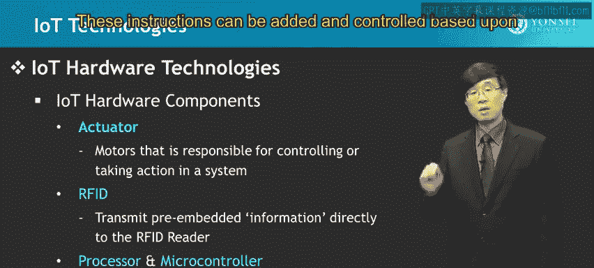
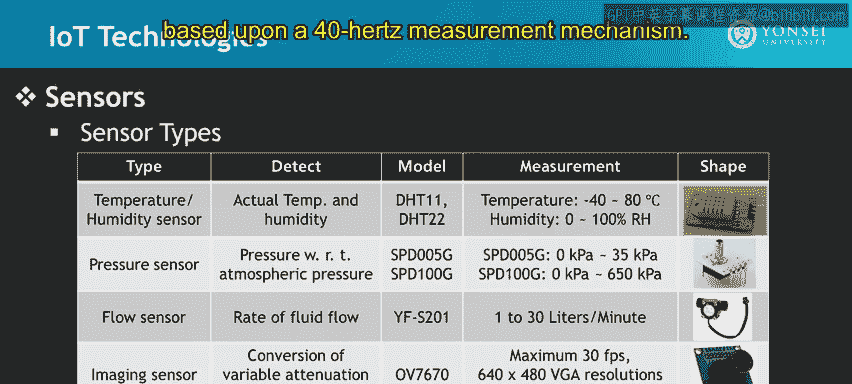
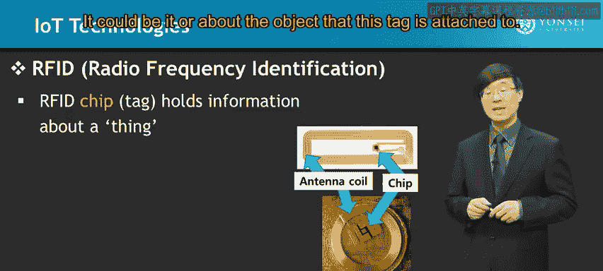
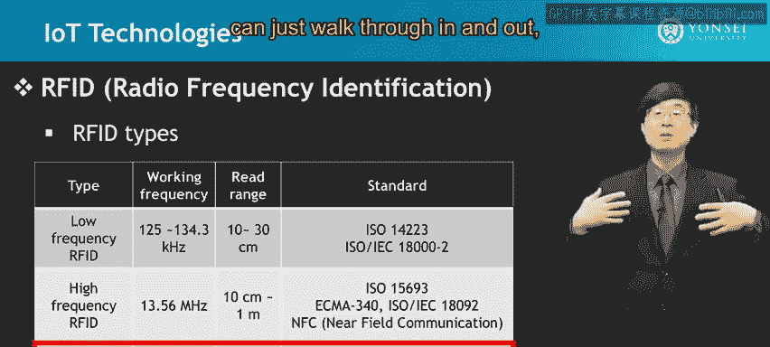
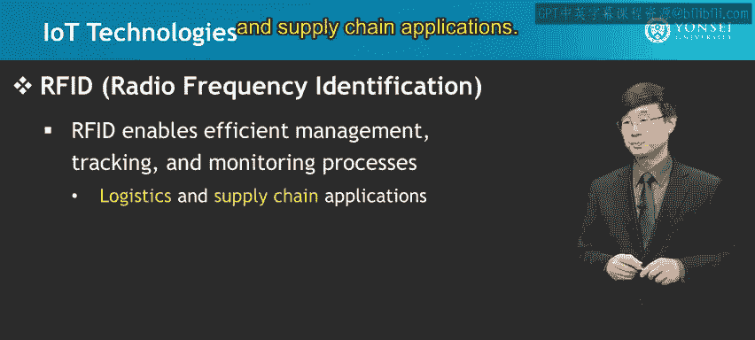

# 87：15_2.2 物联网技术（第3部分）📡

## 概述

在本节课中，我们将学习物联网硬件平台的核心组成部分。我们将详细探讨传感器、执行器、RFID设备以及处理器与控制器的功能与类型，了解它们如何协同工作以收集、处理数据并连接至互联网。

---

## 物联网硬件平台

在物联网生态系统中，物联网硬件平台负责在互联网连接上收集、存储和处理数据。

物联网硬件组件包括传感器和执行器。传感器用于检测附近物理环境（如温度、图像、红外线、气体和湿度）中的事件和变化。执行器则是电机或开关等装置，它们作为可控单元，负责执行关闭或开启某物的指令，这可以在物理和电子层面提供帮助。

RFID是另一个重要领域。RFID标签在被附着后，当RFID阅读器足够靠近并为标签充电时，标签内存储的任何信息会立即传送给阅读器。这项技术广泛应用于物流控制，以及人员、机器、机器人和无人机的身份标识。

此外，还有处理器和控制器，它们将传感器和执行器连接到互联网。这些设备根据特定的操作和指令运行，并且这些指令可以根据需要，通过编程和人工智能进行添加和控制。

---

## 传感器类型

现在，让我们简要了解一下传感器的类型。我们将从类型、检测对象、型号、测量范围和形状这几个类别来考察。

以下是几种常见的传感器：

1.  **温湿度传感器**：用于检测温度和湿度。典型温度检测范围为 **-40°C 至 80°C**，这是一个非常宽的动态范围。湿度检测范围为 **0% 至 100%**，即从完全干燥到潮湿。
2.  **压力传感器**：典型应用包括测量大气压、工业设备压力、液位或其他类型的压力。测量范围可以从 **0千帕** 到 **35千帕**，或高达 **650千帕**，具体动态范围取决于应用场景。
3.  **流量传感器**：用于测量流体流速。范围可能在 **每分钟1升至30升** 之间，具体取决于仪表类型。
4.  **图像传感器**：负责将图像的光强变化转换为电信号。例如，一个提供 **每秒30帧**、**640x480 VGA分辨率**（即 **0.3兆像素**）图像的传感器。当然，也存在数据率更低或分辨率更高的图像传感器（如高清监控摄像头）。决策时还需考虑是否加入了基于增强现实的图像处理。典型的帧率范围从低至 **8-10 FPS** 到常见的 **20 FPS**，最高可达 **30 FPS**。
5.  **超声波传感器**：通过超声波检测物体的存在。采用非接触式测量，范围约为 **2厘米至400厘米**。测量机制基于 **40 kHz** 的频率。

---

## 执行器类型

接下来，我们需要更详细地了解执行器类型。

执行器主要有以下几种：

*   **电动执行器**：将电能转换为机械扭矩。
*   **机械线性执行器**：将旋转运动转换为线性运动。你可以用它来实现关门、开门等动作，或控制空气、气体和流体的流动环境。
*   **液压与气动执行器**：将流体（液体或气体）的压力转换为机械运动。典型的运动类型包括线性、旋转、振荡等。

---

## RFID设备

现在我们来看RFID设备。如图所示，其内部有一个线圈和一个芯片。它没有电池。当RFID阅读器足够靠近并发送一个足以激活它的能量脉冲或射频脉冲时，天线线圈将为芯片充电。随后，芯片可以读取其存储的信息并将其激活，将标识信息发送给RFID阅读器，这就是信息交换过程。因此，RFID芯片存储着关于某个物品或其所附着对象的信息。

RFID芯片附着在物体上，并向阅读器传输数据。天线用于从阅读器接收能量，同时也用于运行并将信息发送回阅读器。因此，天线既是充电单元，也是无线回复发送单元。RFID标签将其信息传输回阅读器。

我们需要了解一些RFID类型，包括其工作频率、读取范围和相应标准。

以下是主要的RFID类型及其特性：

*   **低频RFID**：
    *   工作频率范围：**125 kHz 至 134.3 kHz**
    *   检测、充电和信息交换范围：约 **10厘米 至 30厘米**
    *   遵循ISO相关标准。
*   **高频RFID**：
    *   工作频率：**13.56 MHz**（“高频”名称由此而来）。
    *   由于频率更高，读取范围扩展至 **10厘米 到 1米**。
    *   支持标准包括ISO和ECMA标准。近场通信也属于此类别。
*   **超高频RFID**：
    *   工作频率范围：**860 MHz 至 960 MHz**。
    *   凭借更高频率，读取范围可达 **12米**。常见于大型门禁场景，多名佩戴或携带RFID身份标签的员工可以进出，整个门禁系统通过与RFID标签交换信息来提供区域访问控制，记录人员进出。

这些类型都基于所列的ISO标准。RFID技术能够实现高效的管理、跟踪和监控流程，广泛应用于物流和供应链领域。

---

## RFID研发重点

RFID的研究与开发主要聚焦于以下几个方面：

*   数据流支持
*   芯片设计
*   能源使用优化
*   自动抄表应用
*   家庭自动化应用
*   车辆与交通应用

---

## 总结

本节课中，我们一起学习了物联网硬件平台的关键组件。我们详细探讨了各种传感器（如温湿度、压力、图像传感器）的工作原理与参数，了解了执行器（电动、机械、液压/气动）如何将指令转化为物理动作。我们还深入研究了RFID技术，包括其工作原理、不同类型（低频、高频、超高频）的特性及其在物流、门禁等领域的广泛应用。理解这些硬件基础是构建和认识整个物联网系统的重要一步。