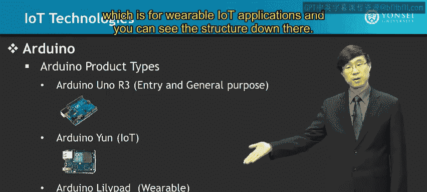
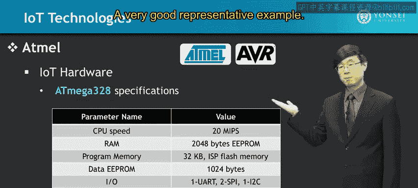
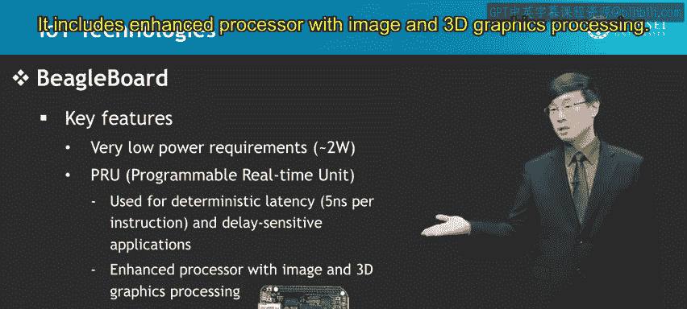

# 88：16_2.2 物联网技术（第4部分）📡

在本节课中，我们将要学习支持物联网技术的核心硬件平台，包括处理器、微控制器以及几种流行的单板计算机。我们将了解它们如何协同硬件、软件、传感器和网络模块工作，并探讨其关键特性与适用场景。

---

上一节我们介绍了物联网的基本架构，本节中我们来看看构成物联网设备“大脑”的硬件平台。

支持物联网技术的处理器和微控制器构成了物联网设备平台。这些平台需要整合硬件、软件、传感器和接口协同工作的处理器与微处理器，网络模块也需要一同工作。当然，作为“大脑”的中央处理单元（CPU）正是基于这些处理器和微控制器。

总体而言，连接用户、传感器到执行器的硬件接口，包括用户设备、传感器模块和执行器，都需要微控制器和处理器。它们都需要支持其驱动程序的接口，这些接口将支持输入和输出单元。

操作系统需要在处理器和微控制器上运行，以支持软件接口并控制硬件资源，例如电源、内存、文件输入/输出以及其他各种操作。

---

### Arduino：开源微控制器平台 🛠️

Arduino 是一个开源的微控制器和硬件设备。你也可以将 Arduino 视为一个开源硬件和软件项目。这些概念之间的术语可以交互或互换使用。

Arduino 本质上提供的是一个**单板微控制器和套件**。由于其灵活性、易于部署、易于构建和编程，它非常受欢迎。

现在，Arduino 板的电路设计和集成开发环境（IDE）都可以在 Arduino 官网上获取。用户可以使用 IDE 开发和上传特定程序，通过 USB 连接到 Arduino 板。

以下是 Arduino 的主要产品类型：

*   **Arduino Uno R3**：这是一种入门级和通用型电路板，是一个单板计算系统。
*   **Arduino Yun**：专为基于物联网的特定应用设计。
*   **LilyPad**：用于可穿戴物联网应用。

---

### 深入硬件细节：ATmega AVR 处理器 🔌

接下来，我们深入了解 Arduino 所使用的硬件处理器类型。

Arduino 物理计算平台采用了 ATmega AVR 系列产品，例如 ATmega328P 和 ATmega328。这些是我们之前看到的入门级、物联网和可穿戴设备中的代表性模块。

查看 ATmega 328 的规格，我们可以看到以下关键参数：

*   **CPU 速度**：20 MIPS（每秒百万条指令）。一个指令是处理器单元内需要单独处理的命令，这意味着它每秒能处理高达 2000 万条指令。
*   **RAM 和可编程内存**（此处为闪存）。
*   **数据 EEPROM**。
*   **输入/输出接口**、**定时器**、**温度范围**和**工作电压范围**。

这些参数展示了物联网硬件中吸引人的流行配置。

---

### ATmega 328P 的低功耗特性 🔋

现在，我们重点看看 ATmega 328P 模块。它支持低功耗模式，其他规格通常与 328 类似。它被主流 Arduino 和 Arduino Uno 系统采用，在 1.8 伏电压下以 1 兆赫兹运行。

观察其整体电流水平（毫安、微安级别），**功率（P）** 可以通过 **电压（V） × 电流（I）** 的公式计算。由于电压（1.8V）相对较小，电流值也很小，相乘后得到的功率值自然很低。

低功耗意味着：
1.  电池续航时间将大大延长。
2.  设备通常产生的辐射热和其他热量很少。热量排放少，就能实现更紧凑的设计和紧密的封装，设备也不会因功耗低而过热。
3.  设备拥有很长的使用寿命，充电一次可以持续运行很久。

这就是 ATmega 328P 模块的低功耗特性如此吸引人的原因。

---

### Raspberry Pi：低成本单板计算机 🍓

除了微控制器，我们还有功能更全面的单板计算机。

Raspberry Pi 由英国树莓派基金会开发，是一种为在学校推广基础计算机科学技能而设计的低成本单板计算机。它支持通用计算和基本的网络服务器功能。

其硬件规格包括 Broadcom 片上系统（SoC）、ARM CPU、片上 GPU 以及 Raspbian 操作系统软件。

以下是其产品系列：

*   **Raspberry Pi 3 Model B（主流型号）**：运行于 1.2 GHz ARM Cortex CPU 的微计算机，适用于通用物联网功能。
*   **Raspberry Pi Zero W（子系列）**：尺寸更小，输入/输出和 GPIO 能力有限。

---

### BeagleBoard：功能强大的开源单板计算机 🐶

BeagleBoard 是由德州仪器（Texas Instruments）生产的开源单板计算机。它是一个功能齐全的基础计算机，支持包括 Linux 和 Android 在内的多种操作系统。考虑到其附加的操作系统功能和更高级的操作能力，如果需要这些功能，它是一个非常有吸引力的选择，尽管比其他单板计算机稍贵一些。

查看 BeagleBone Black 的关键特性：
*   功耗要求非常低，最高约 2 瓦。
*   包含 **PRU（可编程实时单元）**，用于确定性延迟（如每条指令 5 纳秒）和对延迟敏感的应用，这非常吸引人。
*   包含具有图像和 3D 图形处理能力的增强型处理器。

---

### 总结 📝

本节课中，我们一起学习了物联网设备的核心硬件平台。我们从作为设备“大脑”的处理器和微控制器入手，详细探讨了开源的 **Arduino** 平台及其低功耗的 **ATmega AVR** 处理器。接着，我们介绍了功能更强大的 **Raspberry Pi** 单板计算机和具备高级特性（如实时单元）的 **BeagleBoard**。理解这些硬件平台的特性和适用场景，是设计和构建高效、可靠物联网系统的基础。