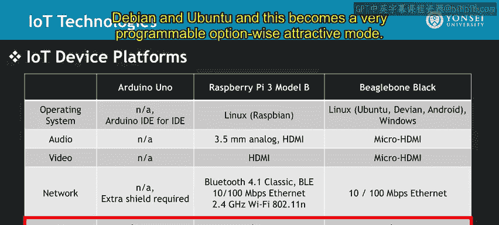

# 89：17_2.2 物联网技术（第5部分）🔍

在本节课中，我们将学习三种流行的物联网开发板：Arduino Uno、Raspberry Pi 3 Model B 和 BeagleBone Black。我们将通过对比它们的核心规格，帮助你理解如何根据项目需求选择合适的硬件平台。

现在，我们来比较之前讨论的三种开发板。

我们将从 Arduino Uno、Raspberry Pi 3 Model B 和 BeagleBone Black 开始比较。我们将从类别、片上系统（SoC）与中央处理器（CPU）、内存、输入输出模块和尺寸这几个方面进行对比。下一页还有更多特性，但首先让我们浏览这些规格。

## 类别与处理器架构

在类别方面，Arduino Uno 是一个**微控制器**，而另外两个是**单板微型计算机**。

在 SoC 和 CPU 方面：
*   Arduino Uno 使用 **ATmega328**，主频为 **16 MHz**。
*   Raspberry Pi 3 Model B 使用 **Broadcom SoC** 和 **ARM Cortex-A53** CPU，主频为 **1.2 GHz**，基于**四核**架构。
*   BeagleBone Black 基于 **ARM Cortex-A8** CPU，采用**单核**单元。

## 内存与输入输出

接下来我们看内存单元。通常可以看到 SRAM，以及 LPDDR2 和 micro SDHC 支持单元。Raspberry Pi 使用了类似的单元，但 BeagleBone Black 还包含了 **512 MB** 的 **DDR3** 技术。你可以看到在内存容量上存在一些明显的选项和差异。

以下是输入输出接口的对比：
*   **Arduino Uno**：拥有 **14** 个数字 GPIO 接口和 **6** 个 10 位模拟输入。
*   **Raspberry Pi 3 Model B**：拥有 **40** 个数字 GPIO 单元和 **4** 个 USB 2.0 接口。
*   **BeagleBone Black**：拥有 **69** 个 GPIO、**4** 个 UART 串口和 **8** 个 PWM 模式。

在尺寸方面，整体上最小的是 Arduino Uno，其尺寸和重量都是最轻的。就重量而言，BeagleBone Black 比 Raspberry Pi 3 Model B 更轻。在尺寸大小上，Raspberry Pi 3 Model B 和 BeagleBone Black 有些相似。

## 操作系统、音视频与网络

还有更多我们需要了解的特性，这些特性引出了下一页的内容：操作系统、音频视频、网络和价格。这些都是非常重要的特性。

在操作系统方面：
*   Arduino Uno 使用 **Arduino IDE**。
*   Raspberry Pi 3 Model B 使用 **Linux**，这是一个非常有吸引力的选项。
*   BeagleBone Black 支持 **Unix** 和 **Windows**。在 Unix 方面，它支持 **Ubuntu**、**Debian** 和 **Android**。这些选项非常有吸引力，不仅基于 Linux，还包含了 Windows。

在音频方面，Raspberry Pi 3 Model B 有一个 **3.5毫米** 模拟接口和 **HDMI** 接口，而 BeagleBone Black 有一个 **micro HDMI** 接口。与 Arduino Uno 没有音频接口相比，拥有 HDMI 接口是一个巨大的差异，也是选择开发板时的决定性因素之一。

在视频接口方面，同样，Arduino Uno 如果需要视频支持，需要一个单独的单元来支持。而 Raspberry Pi 3 Model B 有 HDMI，BeagleBone Black 有 micro HDMI 接口，这非常有用。然而，如果你需要 HDMI 和视频支持，显然 Raspberry Pi 3 Model B 和 BeagleBone Black 变得更有吸引力。

但如果你不需要音频和视频，只想创建一个轻量、低能耗的小型物联网模块，那么显然可以发现 Arduino Uno 将是一个有吸引力的选择。然而，如果你需要音频和视频支持，那么显然 Raspberry Pi 3 Model B 以及 BeagleBone Black 将成为你选择的主要选项。

还有其他关键的选择选项吗？是的，那就是**网络**。这可能是选择模块时最重要的决定因素之一。Arduino Uno 通常不具备完整的有线或无线以太网或其他选项的能力。然而，Raspberry Pi 3 Model B 具备**蓝牙 4.1 BLE**、以太网连接以及基于 802.11n 的 **2.4 GHz Wi-Fi**。如果你想使用它，那么这些规格本身就告诉你为什么选择 Raspberry Pi 3 Model B。如果你想让智能手机成为它的远程控制器和监视器，因为你的智能手机有蓝牙、BLE 和 Wi-Fi，所以你的智能手机可以自动成为 Raspberry Pi 3 Model B 的远程控制器、监视器甚至数据接口收集器。这就是它如此受欢迎的原因之一。

然后是 BeagleBone Black，它可以连接到有线以太网，支持 **10Base-T** 和 **100Base-T**，同时支持 **10 Mbps** 和 **100 Mbps** 成为其选项。因此，在桌面或开发环境中，你可以把它放在面前的桌子上进行编程，这些以太网连接变得非常有用和有吸引力。这就是它如此受欢迎的原因。当涉及到 10Base-T 和 100Base-T 以太网连接，支持 10 Mbps 和 100 Mbps 以太网时，Raspberry Pi 3 Model B 和 BeagleBone Black 内部都支持这种连接。总的来说，在网络连接方面，Raspberry Pi 3 Model B 是最受欢迎的选择选项。

## 价格对比

当你从价格方面看时，Raspberry Pi 3 Model B 的优势就显现出来了。因为你可以看到 Arduino Uno 和 Raspberry Pi 3 Model B 在成本上没有显著差异。Arduino Uno 大约是 **$29.95**，而 Raspberry Pi 3 Model B 大约是 **$35**。但是，你得到了所有这些不同的数据接口，包括有线和无线，以及音频和视频接口。这就是 Raspberry Pi 3 Model B 如此受欢迎的原因。但在另一方面，BeagleBone Black 的成本是 **$55**，但它具有显著的处理能力。以更高的成本，它额外支持音频和视频。此外，作为你的开发平台的操作系统，支持 Windows、基于 Android、Debian 和 Ubuntu 的 Linux，这成为一个在编程选项方面非常有吸引力的模式。

这些是我使用的参考资料，我强烈推荐给你。物联网技术还有更多内容，这只是冰山一角。请保持关注，我们下一讲再见。

---

**本节课总结**

在本节课中，我们一起学习了三种主流物联网硬件开发板：Arduino Uno、Raspberry Pi 3 Model B 和 BeagleBone Black 的核心特性对比。我们详细分析了它们在**类别**（微控制器 vs 单板机）、**处理器与内存**、**输入输出接口**、**操作系统支持**、**音视频能力**、**网络连接**以及**价格**等方面的差异。

通过对比可知：
*   **Arduino Uno** 适合简单、低功耗、无需复杂操作系统和多媒体功能的控制项目。
*   **Raspberry Pi 3 Model B** 凭借其强大的综合性能、丰富的接口（尤其是集成的 Wi-Fi 和蓝牙）以及极高的性价比，成为最通用和流行的选择，尤其适合需要网络连接、多媒体处理或作为小型服务器的项目。
*   **BeagleBone Black** 则提供了更强的实时处理能力和更丰富的原生 I/O 接口，适合需要精确控制或更复杂嵌入式应用的项目，尽管价格稍高。

理解这些差异将帮助你在实际物联网项目开发中，根据具体的功能需求、性能要求和预算，做出最合适的硬件选择。