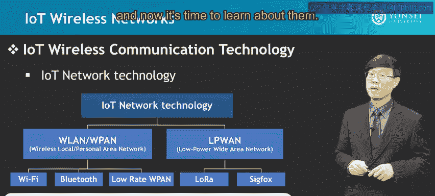

# 90：物联网无线网络 📡

在本节课中，我们将学习物联网网络，首先从物联网无线网络开始。我们将了解构成物联网连接基础的各种无线技术，包括其类型、标准和应用场景。

物联网网络架构可以表示为以下形式：各种通信组件连接到某种建筑物，而该建筑物又与互联网相连。然而，在前端，我们作为用户交互的许多基于物联网技术的设备，基本上连接到移动通信网络（蜂窝网络），例如2G、3G、4G或未来的5G。基于4G的技术包括LTE（长期演进技术）和LTE-Advanced技术。当然，这是一个主要组成部分，特别是因为我们的智能手机具有Wi-Fi和蓝牙连接功能，这些功能在许多情况下实现了物联网的直接访问。

## 无线个人区域网络与无线局域网

上一节我们介绍了物联网网络的整体架构，本节中我们来看看两种关键的短距离无线技术：无线个人区域网络和无线局域网。

无线个人区域网络是一个小范围网络，旨在实现装有特定调制解调器模块的设备在个人区域（例如一个房间内）的无线连接。蓝牙技术就是其代表。

此外，我们还有无线局域网技术，它覆盖的范围比个人区域网络更大，可能包含几个个人区域网络的范围。其代表性技术是Wi-Fi。

蓝牙和Wi-Fi非常重要，因此我们将在后续专门关于Wi-Fi和蓝牙的模块中重点介绍这两种协议的细节。这是因为它们是智能手机的主要连接方式，也是世界上使用最广泛的协议，可以与移动通信并称为“三大”无线技术。

在无线个人区域网络中，除了蓝牙，还有其他模块，如ZigBee和6LoWPAN技术。我们将在本讲座中重点介绍这些技术，以及广域网连接技术。

## 可穿戴设备与物联网网络

现在，让我们看看物联网网络在可穿戴设备中的应用。具有物联网连接功能的可穿戴设备，其无线连接使我们能够通过智能手机或智能手表连接到蜂窝网络。这些连接通常是移动通信，如LTE、3G或未来的5G通信。

而我们的设备连接到智能手机的方式，则可能是蓝牙、ZigBee、6LoWPAN或其他技术。

具体来说，可穿戴设备可用于从我们鞋子、手表、眼镜、腰带和起搏器等设备中的传感器和物联网模块检测生物特征信息。这类设备可以将信息发送到我们的智能手机，然后智能手机再将其连接到蜂窝网络。

此外，在某些情况下，这些设备可能配备特殊类型的无线技术，可以直接连接到广域网。

## 无线连接的角色与路径

智能设备可以从可穿戴设备收集信息并与控制中心通信。如果是医疗信息，则与医疗中心通信。通过这些连接，我们肯定需要无线连接，这可能是一个或多个环节，例如从无线局域网到移动通信协议，或从无线个人区域网络到无线局域网协议。

例如，使用蓝牙连接到智能手机，再通过移动通信连接到互联网；或者使用Wi-Fi连接到接入点，再接入互联网。

无论哪种方式，我们都会连接到控制中心。如果是生物医学信息，则会连接到医疗服务器，以监测我们的健康状况并提供重要的决策和警报信号。例如，如果您心脏病发作，它将提供紧急响应和帮助，例如呼叫救护车。

## Wi-Fi 技术详解

上一节我们概述了连接路径，本节我们深入探讨Wi-Fi技术。Wi-Fi是一种基于IEEE 802.11标准的无线局域网技术。IEEE代表电气和电子工程师协会，它是世界上最大的专业会员协会之一，为电气和电子工程师服务。该组织因其参与者的特性，积极进行大量研发和标准化工作，其标志性成果之一就是802.11标准。

Wi-Fi设备包括您的智能手机、智能设备、笔记本电脑、个人电脑等。一些智能手表可能只有蓝牙，但有些智能手表会同时具备蓝牙和Wi-Fi，这取决于其设计和用途。

应用领域包括从家庭、学校、计算机实验室到办公楼等几乎所有场景。

Wi-Fi设备和接入点在室内的无线连接范围约为30米。“室内”意味着有墙壁、门、天花板和地板，这些结构中的金属材料或其他材料会阻挡射频传播。因此，当您在室内时，信号的传播范围受到周围房间和建筑环境的限制。当然，如果在室外，Wi-Fi的范围会扩大。

以下是影响Wi-Fi数据速率的关键因素和不同协议的理论最高速率：

*   **协议类型**：不同IEEE 802.11协议支持不同的最大数据速率。
*   **与接入点的距离**：距离越远，数据速率越低。
*   **共享用户数**：连接到同一接入点的用户越多，可用带宽被分摊得越多。

不同协议的理论最高速率示例：
*   `802.11a`: 最高 54 Mbps
*   `802.11b`: 最高 11 Mbps
*   `802.11g`: 最高 54 Mbps
*   `802.11n`: 最高 150 Mbps
*   `802.11ac`: 最高 866.7 Mbps
*   `802.11ax`: 最高 7 Gbps

## 蓝牙技术详解

接下来，我们看看另一种重要的短距离技术：蓝牙。蓝牙是一种无线个人区域网络技术，这与作为无线局域网技术的Wi-Fi不同。无线局域网范围更大，而个人区域网络范围更短、更小。

蓝牙旨在取代连接许多不同类型设备的电缆。例如，您使用的无线耳机很可能采用了蓝牙技术。换句话说，如果没有蓝牙，从智能手机或MP3播放器到耳机就需要一根电缆。然而，您可以使用蓝牙来取代智能手机和耳机之间的那根电缆或电线连接。

此外，蓝牙还用于将打印机连接到您的本地计算机、笔记本电脑或平板电脑。它通常取代短距离设备。您的个人区域可以定义为：当您在一个房间里，所有物体几乎都在可触及的距离内，您站起来伸手走几步就能触摸到那个设备，这通常被认为是您的个人区域网络。而局域网则可能是您所在的房间和周围的几个房间，甚至楼上和楼下的房间可能共享一个接入点，该接入点连接到无线局域网，进而连接到互联网。因此，您的局域网比您的个人区域网络更大。

蓝牙的标准个人区域网络范围通常约为10米。然而，更先进的标准如蓝牙4.0及更高版本，在某些情况下，根据设置，可以达到50米左右。

蓝牙低功耗技术也包含在蓝牙4.0中。它提供了更低的功耗（因此得名LE）和成本，同时保持了类似的通信范围。

以下是不同蓝牙协议类型的数据速率示例：
*   `蓝牙 2.0 + EDR`: 最高 2.1 Mbps
*   `蓝牙 3.0 + HS`: 最高 24 Mbps
*   `蓝牙 4.0`: 最高 25 Mbps
*   `蓝牙 5.0`: 最高 50 Mbps

关于Wi-Fi和蓝牙的更多细节，我们将在下一个模块中详细介绍，因为它们使用更频繁、更重要，并且存在于您的智能手机和平板电脑上。

## 物联网网络技术全景

最后，让我们俯瞰物联网网络技术的整体范围。总体来看，有无线局域网和无线个人区域网络，其中包括Wi-Fi、蓝牙、低速率无线个人区域网络技术。

此外，还有LPWAN，即低功耗广域网。诸如LoRa和SigFox等协议属于此范围。它基本上以特定的方式使用低功耗信号，使您能够直接连接到远处的接入点或基站，并通过该接入点或基站直接连接到互联网。因此它是一个广域网，因为尽管数据速率低且信号功率低，但您可以直接进行长距离连接，从而直接访问互联网。

您可能听说过的标准和协议包括：
*   **无线局域网/个人区域网络**：`Wi-Fi`、`蓝牙`、`ZigBee`、`6LoWPAN`
*   **低功耗广域网**：`LoRa`、`SigFox`

您可能已经见过这些标志，现在是时候了解它们了。

## 总结

本节课中，我们一起学习了物联网无线网络的基础知识。我们探讨了物联网的网络架构，区分了无线个人区域网络和无线局域网，并详细介绍了Wi-Fi和蓝牙这两种核心技术的特点、标准和应用。我们还了解了无线连接在可穿戴设备中的角色，以及从设备到互联网的各种连接路径。最后，我们概览了包括LPWAN在内的更广泛的物联网网络技术全景。掌握这些无线技术是理解物联网如何实现万物互联的关键第一步。