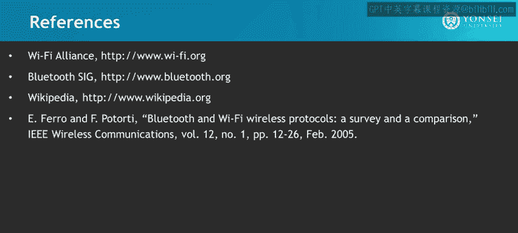

# 课程 19：ISM频段详解 📡

在本节课中，我们将学习ISM频段。ISM频段是物联网网络中最常使用的频段之一，了解其特性、包含的具体频段以及哪些频段更为重要，对于理解和开发无线通信设备至关重要。

---

## 什么是ISM频段？

上一节我们提到了ISM频段的重要性，本节中我们来看看它的具体定义。

ISM频段是工业、科学和医疗频段的缩写。这些频段专为工业应用、科学研究和医疗设备设计，旨在提供一个无需许可即可使用的频段，以便开发者能够利用短距离通信技术开发新设备和实现设备间通信。

然而，这并不意味着在任何情况下都可以随意使用这些频段。虽然无需申请许可，但设备必须严格遵守国际和当地政府的法规。国际电信联盟的无线电规则第5条及其脚注（如5.138、5.150和5.280）规定了这些频段的频率范围、频谱、发射功率限制及其他特性。

因此，即使ISM频段是免许可的，也并不意味着可以随意使用。在开发使用ISM频段的产品时，必须获得当地政府的正式批准，确保设备符合本地及国际政策。

---

## 2.4 GHz频段：最流行的ISM频段

了解了ISM频段的基本概念后，我们来看看其中最著名的一个频段。

工作在2.4 GHz范围的频段可能是目前最流行的ISM频段。其流行原因在于，许多关键技术都使用它：
*   Wi-Fi
*   蓝牙
*   基于IEEE 802.15.4标准的设备（如Zigbee、6LoWPAN）
*   无绳电话
*   业余无线电设备
*   微波炉
*   婴儿监视器

这个频段之所以有用，是因为众多技术都依赖它。但这也带来了挑战：由于使用设备过多，如何有效地共享频谱资源变得非常困难。因此，其优势在某些情况下也可能转化为劣势。

---

## ISM频段的干扰问题

既然有如此多的设备共享频段，干扰问题就不可避免。以下是几种主要的干扰类型：

*   **同协议设备间的干扰**：例如，Wi-Fi设备之间会相互干扰，需要有效地共享信道资源。如果共享不当，通信就会受到影响。
*   **不同协议设备间的干扰**：在2.4 GHz频段，Wi-Fi、蓝牙和Zigbee设备会相互干扰，在某些情况下甚至可能导致通信完全中断。因此，必须考虑共享同一频段的其他协议和网络带来的干扰。
*   **其他设备的辐射干扰**：例如，密封不严的微波炉在加热食物时，会泄漏出2.4 GHz信号。如果附近有Wi-Fi或蓝牙设备在工作，微波炉的辐射就会干扰通信。

---

## 主要ISM频段及其特性

为了更深入地了解ISM频段，我们需要查看其频率范围、带宽、中心频率和可用性等关键参数。以下是几个重要的ISM频段：

*   **6.765 - 6.795 MHz**
    *   **带宽**：30 kHz
    *   **可用性**：需本地批准。这意味着能否使用取决于当地政府的规定。携带无线设备跨国使用时，必须检查当地法规，因为该频率可能被消防、警察或军事部门占用。

*   **13.553 - 13.567 MHz**
    *   **带宽**：14 kHz
    *   **可用性**：全球可用。被指定为全球可用的ISM频段对产品开发极具吸引力。

*   **26.957 - 27.283 MHz**
    *   **带宽**：326 kHz
    *   **可用性**：全球可用。

*   **40.66 - 40.70 MHz**
    *   **带宽**：40 kHz
    *   **可用性**：全球可用。

*   **433.05 - 434.79 MHz**
    *   **带宽**：1.74 MHz
    *   **可用性**：需本地批准。

*   **902 - 928 MHz**
    *   **带宽**：26 MHz
    *   **可用性**：需本地批准。这是一个非常流行的频段，因为其信号穿透力强，能有效穿过实体墙并传播较远距离。同时，26 MHz的带宽足以支持高速数据通信，且天线可以做得较小。

*   **2.4 - 2.5 GHz**
    *   **带宽**：100 MHz
    *   **可用性**：全球可用。这是目前使用最广泛的ISM频段。它全球可用，信号传播特性好，且100 MHz的宽带宽足以同时为多个用户提供高速宽带数据速率。但也正因如此，该频段设备极其密集。

*   **5.725 - 5.875 GHz**
    *   **带宽**：150 MHz
    *   **可用性**：全球可用。该频段频率较高，可用于更高速的数据通信，加之全球可用，使其非常有吸引力。

*   **24 - 24.25 GHz**
    *   **带宽**：250 MHz
    *   **可用性**：全球可用。此频段广泛用于无线个域网和极宽带接入。但需要注意的是，频率高于10 GHz的信号开始表现出类似光的特性，无法穿透固体物体。通信依赖视距传输，一旦被阻挡，信号可能完全中断。

*   **61.0 - 61.5 GHz**
    *   **带宽**：500 MHz
    *   **可用性**：需本地批准。

*   **122 - 123 GHz**
    *   **带宽**：1 GHz
    *   **可用性**：需本地批准。

*   **244 - 246 GHz**
    *   **带宽**：2 GHz
    *   **可用性**：需本地批准。

---

## 总结

本节课中，我们一起学习了ISM频段。我们首先了解了ISM频段的定义及其免许可但需合规使用的特点。然后，我们重点分析了最流行的2.4 GHz频段及其面临的干扰挑战。最后，我们详细列出了多个ISM频段的关键参数，包括频率范围、带宽和可用性，并解释了像2.4 GHz和5.8 GHz这样的频段因兼具良好的传播特性、高带宽和全球可用性而备受青睐的原因。记住，开发或使用无线设备时，务必确认目标地区的具体法规。