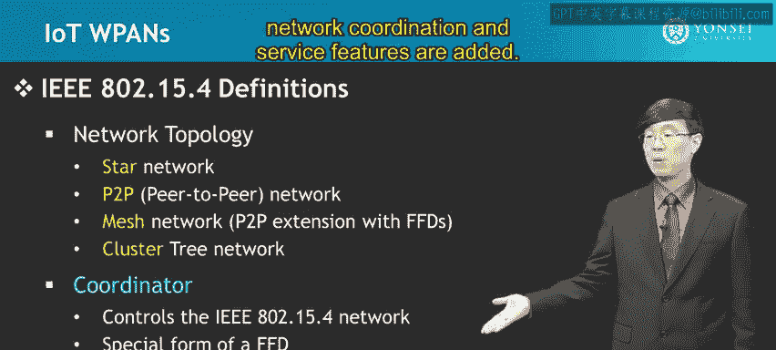
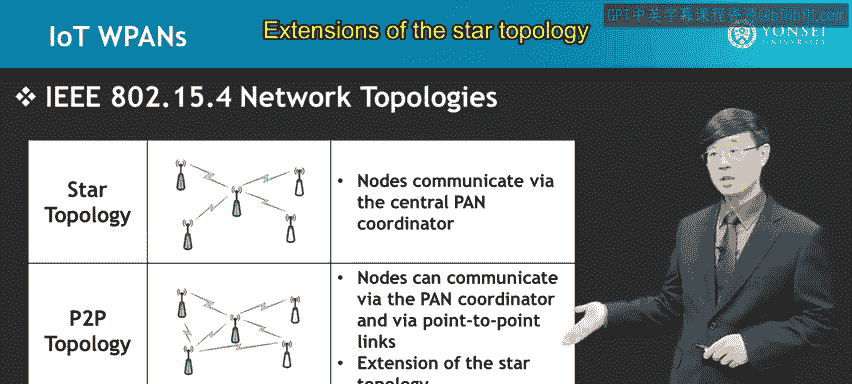
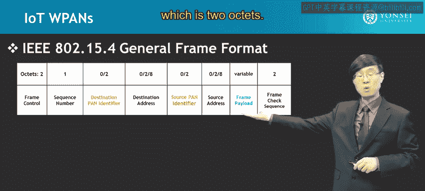

# 92：20_3.3 物联网WPAN（第1部分）📡

在本节课中，我们将要学习物联网无线个域网。物联网WPAN是我们现在要研究的内容。

最流行的现代规范是**IEEE 802.15.4**标准，它用于低成本、低速率和低功耗的典型场景。低速率意味着数据传输速率不会很高。这同样是一个无线个域网。因此，低功耗通常非常重要。

## IEEE 802.15.4的应用领域 🌐

以下是基于IEEE 802.15.4标准的一些主要应用：

*   **ZigBee**
*   **6LoWPAN**：全称为“IPv6 over Low power Wireless Personal Area Networks”。
*   **WirelessHART**：其中HART代表“Highway Accessible Remote Transducer”。
*   **MiWi**：Microchip公司的协议。
*   **RF4CE**：全称为“Radio Frequency for Consumer Electronics”。
*   **ISA100.11a**

## 设备类型 🔧

这些标准下的设备类型通常分为两种：全功能设备和精简功能设备。

*   **全功能设备**：顾名思义，具备完整功能。它可以发送、接收、路由数据，并形成簇。它可以充当**PAN协调器**。这意味着对于一个个人区域网络，它是一个协调节点，负责管理、控制网络访问和整体连接性。这是一个关键的功能，使得网络能够扩展其整体的多跳连接性。
*   **精简功能设备**：功能当然有所精简。精简意味着它不具备FFD所拥有的全部功能。它只能与FFD通信，不能充当PAN协调器。它通常扮演简单传感器或开关的角色，并且不具备路由功能。

## 网络拓扑结构 🕸️

在网络拓扑方面，可以有星型网络、对等网络和网状网络。

上一节我们介绍了设备类型，本节中我们来看看它们如何组织成网络。以下是几种主要的网络拓扑结构：

*   **星型网络**：节点通过位于中心的PAN协调器进行通信。
*   **对等网络**：节点可以通过PAN协调器以及点对点链路进行通信。星型拓扑的扩展是通过对等拓扑实现的。
*   **网状网络**：如果需要使用网状网络，则需要具备对等扩展功能的全功能设备。同时，其中一个全功能设备需要充当PAN协调器。
*   **簇树网络**：协调器控制着IEEE 802.15.4网络，它是全功能设备的一种特殊形式，并添加了典型的FFD功能和网络协调与服务特性。

接下来，让我们更详细地了解这些拓扑结构。

### 星型拓扑 ⭐

在星型拓扑中，节点通过位于中心的PAN协调器进行通信。图中蓝色节点是全功能设备，白色节点是精简功能设备。如图所示，这就是星型网络的结构。

### 对等拓扑 ↔️

在对等拓扑中，节点可以通过PAN协调器以及点对点链路进行通信。观察上下两图，可以看到底部增加了一个FFD和RFD之间的连接。这就是该规范额外描述的内容。

### 簇树拓扑 🌳

如果你要扩展一个网络，如果拥有许多物联网设备，那么簇树拓扑绝对是必需的选择。簇树拓扑对于拥有大量节点的无线传感器网络和物联网网络非常有吸引力。

在我们正在进入的万物互联的物联网世界中，即使是5G移动通信标准，在一个一平方公里见方的区域内，可以支持100万台设备。显然，簇树拓扑会非常有吸引力，甚至可能是必要的，意味着没有其他方法可以支持所有这些节点。

簇树拓扑与星型拓扑相似，但RFD只被允许作为最外层的分支连接到簇树。图表显示，全功能设备连接到协调器，而协调器本身也是一个FFD设备。然后，协调器通过该结构连接到多个终端设备。这就是网络形成的方式。

## 帧格式 📄

现在，让我们看看用于IEEE 802.15.4的一些通用帧格式。由于我们刚才讨论的功能——将多个簇协调连接成树形格式，并由一个协调节点控制和管理网络——我想向您展示帧结构中的几个组件。

帧的前面是一个**帧控制字段**，长度为2个八位组。一个八位组是一个字节，所以这是2个字节。它具有类似这样的结构：它有16位，因为一个字节是8位，所以两个八位组是2字节，即16位。这就是为什么位编号字段是从0到15，总共16位。

请注意，这里有源地址和目的地址，但在它们旁边，橙色部分显示了**源PAN标识符**和**目的PAN标识符**。

换句话说，不仅包含源地址和目的地址，还包含了源和目的PAN地址标识符。因此，当你在这种树形簇网络中进行通信时，你的数据包可能需要离开你的PAN，通过簇树协调器连接到另一个PAN。为了实现这一点，你不仅需要知道对方的地址，还需要知道对方的源和目的PAN ID，这正是橙色部分包含的内容。

我的数据去哪里？我的IPv4或IPv6数据包去哪里？我的TCP/IP数据包去哪里？你在这里看到的**帧有效载荷**就是它们。然而，由于这些是用于无线个域网的应用，并非所有大小的IPv4和IPv6数据包都能被包含，因为数据包大小有**127个八位组**的限制。这限制了帧有效载荷的最大尺寸。

最大帧头被限制在**25个八位组**。此外，请注意控制帧头，这里再次看到只有2个八位组。你会看到有一个**安全启用**标志和结构来控制它。还有一个**Intra-PAN**标志。Intra-PAN意味着这将用于PAN区域内的无线个域网内部通信。你也可以离开你的PAN，即Inter-PAN，那么当然你需要使用你的目的和源PAN ID以及源和目的地址。

但如果是你的PAN内部，那么你使用那个标志将其标记为Intra-PAN，然后以那种模式运行。因此，在你的PAN内部，你可以使用像星型网络这样的结构，其中位于星型中心的你的全功能设备将为你中继到另一个设备；或者如果是对等网络，你可以直接通信。

## 总结 📝

本节课中我们一起学习了物联网无线个域网的基础知识。我们介绍了核心标准**IEEE 802.15.4**及其低功耗、低速率的特点。我们探讨了两种主要的设备类型：**全功能设备**和**精简功能设备**，以及它们在网络中的不同角色。接着，我们详细分析了四种网络拓扑结构：**星型**、**对等**、**网状**和**簇树**拓扑，并了解了簇树拓扑在支持海量物联网设备时的重要性。最后，我们解析了IEEE 802.15.4的**帧格式**，特别是源/目的地址与PAN标识符的作用，以及帧大小限制对数据传输的影响。这些概念是构建和理解大规模物联网通信网络的基础。