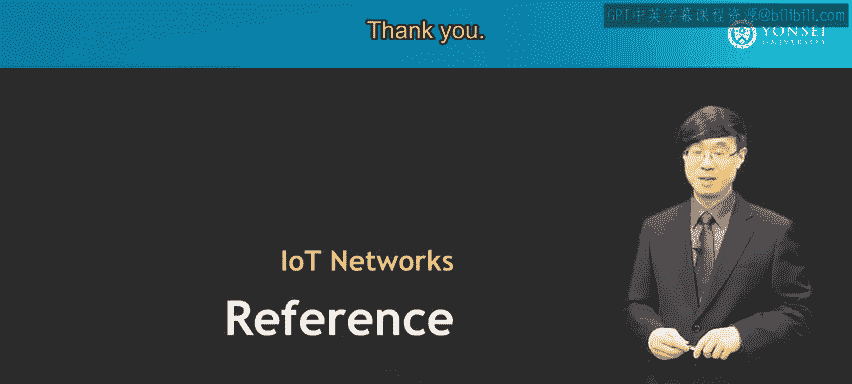

# 93：21_3.3 物联网WPAN（第2部分）📡

## 概述

在本节课中，我们将继续学习物联网无线个域网（WPAN）技术。我们将重点介绍两种重要的协议：Zigbee 和 6LoWPAN。我们将了解它们的技术特点、网络拓扑结构，并深入探讨 6LoWPAN 如何通过头部压缩技术，在资源受限的物联网设备上高效地传输 IPv6 数据包。

---

## Zigbee 协议

上一节我们介绍了 WPAN 的基础，本节中我们来看看 Zigbee 协议。Zigbee 是一种非常流行的协议，由 Zigbee 联盟支持。它基于 IEEE 802.15.4 协议，并在其之上增加了更高层的协议。它支持低功耗无线电通信。

在协议栈中，物理层（负责射频调制解调器）和 MAC 层（负责介质访问控制）的功能由 IEEE 802.15.4 协议规定。而 Zigbee 协议则提供了上层的网络层和应用层。Zigbee 协议使用了下层的介质访问控制（用于协调多用户共享网络）和物理层调制解调器（用于连接射频信道）。

Zigbee 在孤立的网络环境中运行良好。以下是其典型的网络拓扑结构：

*   **星型网络**：是最基本和最常见的拓扑结构。
*   **网状网络**和**点对点网络**：可以通过节点间的多条路由提供高可靠性。
*   **簇树网络**：是星型和点对点拓扑的结合。

这些拓扑结构之所以可行，是因为底层的 IEEE 802.15.4 协议支持这些功能。

---

## 6LoWPAN 协议

接下来，我们探讨 6LoWPAN。6LoWPAN 代表“IPv6 over Low power Wireless Personal Area Networks”（基于低功耗无线个域网的 IPv6）。这是一个由互联网工程任务组制定的标准，它使用 802.15.4 个域网技术。

6LoWPAN 支持在基于 802.15.4 的无线个域网上传输 IPv6 数据包。使用 IPv6 数据包的优势在于，它能为物联网无线网络提供 IPv6 支持。如果一个设备本身基于 IPv6 协议，那么 6LoWPAN 就成为一个非常有吸引力的选择，因为它包含了低功耗设计，这对于延长物联网设备的电池寿命非常有利。

其真正的优势在于可以直接连接到 IPv6 互联网。这意味着：

以下是直接连接 IPv6 互联网的主要优势：
1.  可以使用 IPv6 的高级安全保护，例如 IP 安全、基于 IP 的封装、认证、访问控制、防火墙协议等。
2.  IPv6 的命名、寻址、转换、查找、发现等功能都包含在内。

6LoWPAN 的特点包括：
*   支持 16 位短地址或 64 位扩展 MAC 地址的小数据包。
*   支持 20、40、250 kbps 的低数据速率。
*   使用 IEEE 802.15.4 协议的全功能设备和精简功能设备，构建星型或网状拓扑。
*   适用于低功耗、电池供电的节点（“低功耗”正是其名称中“Low”的含义）。
*   设备成本相对较低，这在部署和产品采购中很有吸引力。

---

## 6LoWPAN 与头部压缩技术

在无线个域网技术中，头部压缩至关重要。现在，让我们看看 6LoWPAN 如何处理 IPv6 和数据包大小的问题。

IPv6 的最小数据包大小为 **1280 字节**。而 IEEE 802.15.4 的最大传输单元，即能承载的最大 IP 数据包大小，被限制在 **127 字节**。显然，这里存在超过一个数量级的不匹配。

IPv6 头部很大，主要是因为其源地址和目的地址各为 128 位，这使得 IPv6 头部至少有 **40 字节**。这还只是最小头部，IPv6 头部还可以添加许多额外选项以提供更多功能，例如我们之前提到的 IP 安全等功能。

因此，我们需要压缩 IP 地址和其他字段。如果你能从头部其他字段推导出某些字段的特性，那么这些可推导的字段就可以被压缩。这意味着你可能不发送它们，或者只在开始时发送一次并保存起来。对于后续具有相同重复头部字段的数据包，你只需使用压缩格式，跳过发送这些字段，因为之前已经发送过了。这类技术就是我们所说的**头部压缩**。

具体的压缩方法包括：
*   压缩链路本地地址的前缀。
*   如果 128 位的 IPv6 地址可以从链路层地址推导出来，则完全省略它。例如，如果接收端已知链路本地地址及其映射的 IPv6 地址，那么在发送链路层地址时，就无需发送完整的 IPv6 地址，接收端可以自动匹配并重建完整的 IPv6 数据包。
*   压缩通用头部，如 TCP、UDP 和 ICMP 头部。

---

## 总结

本节课中，我们一起学习了物联网 WPAN 中的两个关键协议。我们了解了 Zigbee 协议如何构建在 IEEE 802.15.4 之上并提供上层网络功能，以及它支持的各种网络拓扑。随后，我们深入探讨了 6LoWPAN 协议，它使得 IPv6 能够运行在资源受限的低功耗网络上。我们重点分析了其核心挑战——IPv6 大包头与 IEEE 802.15.4 小帧之间的不匹配，并学习了如何通过头部压缩技术巧妙地解决这一问题，从而实现了物联网设备与 IPv6 互联网的高效、直接连接。

