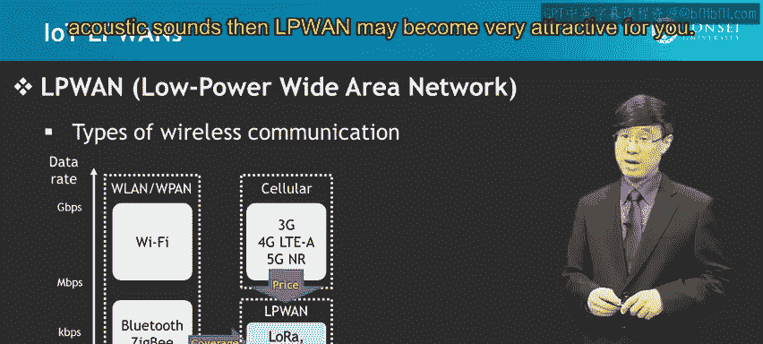

# 课程名称：延世大学《新兴技术：从智能手机到物联网再到大数据》 - P94：22_3.4 物联网LPWAN（第1部分）📡

在本节课中，我们将要学习物联网中的一项关键技术：低功耗广域网。我们将了解它的定义、特点、应用场景，并通过与其他无线技术的对比，深入理解其优势和局限性。

---

## 什么是LPWAN？🤔

LPWAN代表低功耗广域网。从名称可以自动看出，“广域”意味着其覆盖范围将非常长，网络的整体范围将非常广。此外，从名称可以看出它是“低功耗”的，这意味着它是一种非常节能的技术。

LPWAN是一种为远距离、低功耗通信而设计的无线通信技术。由于其远距离和低功耗的特性，自然导致了低比特率、低数据速率的整体应用。

典型的LPWAN类型包括基于LoRa的网络和超窄带网络。超窄带网络包括SigFox和NB-IoT，后者是移动通信中的一种协议，特别由3GPP标准化组织制定。

---

## 为什么需要LPWAN？🎯

上一节我们介绍了LPWAN的定义，本节中我们来看看它的存在意义和应用场景。

让我们观察一个图表，其中纵轴是数据速率，横轴是通信范围。当我们讨论无线局域网和个人域网时，它们当然有有限的通信范围，因为它们是局域网和个人域网。所以它们自然范围有限，这就是它们位于图表左侧的原因。但尽管它们范围有限，它们的真正优势是能够支持高数据速率，这就是为什么它们在纵轴（数据速率轴）上位置很高，甚至超过了图表上方列出的每秒千兆比特的范围。

然后是移动通信协议，如3G、4G（包括LTE和LTE-A），以及5G和基于新无线电通信的系统。它们具有广泛的范围，因为它们是基于蜂窝通信的技术。此外，它们支持高数据速率。

但是，当你考虑使用蜂窝通信的成本时，是否存在更便宜的选择？当你考虑无线个域网和无线局域网的总体覆盖范围时，特别是关注用于物联网设备的无线个域网，从传感器发送度量信息（这些信息不像使用无线局域网发送文件或使用Wi-Fi技术发送视频流那样需要高宽带数据速率访问）时，通常数据速率较低，但你可能希望获得比无线个域网服务范围更广、同时又比移动通信便宜的技术。

在典型的此类系统中，LPWAN就变得极具吸引力。

那么，什么场景需要这样的技术呢？举个例子，如果你在进行环境传感器物联网设备部署呢？你有一大片森林或山脉需要覆盖，你希望能够探测是否有火灾，或者在一定范围内是否有某种奇怪的物体或材料正在改变温度，或泄漏出某种气体，或者与周围环境相比异常明亮或黑暗。那么，如果你的传感器能够检测到这类情况，连同声音信息，LPWAN对你来说就可能变得非常有吸引力。

---

## LPWAN的优缺点对比 ⚖️

上一节我们探讨了LPWAN的应用场景，本节我们将深入细节，通过与其他技术的对比，列出其优点和缺点。

以下是基于无线局域网、无线个人域网、位于中间的LPWAN（我们当前关注的目标系统）以及移动通信蜂窝网络进行的优缺点比较。

首先，它们的真正优势是什么？

以下是各类技术的优点：

*   **无线局域网和无线个人域网**：标准成熟且广为人知。它们如此成熟，以至于存在于每一部智能手机上。
*   **LPWAN**：低功耗、低成本，这是它们如此吸引人的原因。
*   **移动通信网络**：高数据速率和充分的覆盖范围。

接下来，我们看看它们的弱点：

以下是各类技术的缺点：

*   **无线局域网和无线个人域网**：消耗大量能量，因此电池寿命有限。此外，网络成本高，你需要足够的投资用于接入点、电力，并且需要为它们提供大量的配套设施，因为它们的范围不长，这意味着在一定范围后，它们需要一个接入点或蓝牙主设备连接到有线网络，而有线网络需要交换机、路由器等设备来连接，因此你必须拥有足够的基础设施。
*   **LPWAN**：数据速率低，并且是新兴标准，因此你可能还没听说过它们。这就是它们不那么流行的原因，也正因为不流行，所以它们尚未出现在智能手机或其他智能手表上。
*   **蜂窝网络**：当然，由于高数据速率和得到良好支持的漫游能力，各种应用都可以实现，但同时你需要支付相当高的使用成本。然而，网络服务提供商、你的移动运营商也在支付大量资金，这就是为什么他们每月也要求你支付很多钱。因为你需要连接所有基站、塔楼、建筑物上的设施，在这些存在大量障碍物和基础设施的地方，你还需要添加多个毫微微蜂窝小区（小型室内基站），将它们全部连接起来。然后，你还需要将移动通信有线网络基础设施全部连接在一起，并连接到互联网。这需要资金。此外，蜂窝运营商使用的频段通常是从政府拍卖获得的，这极其昂贵。

因此，尽管LPWAN支持低数据速率、是新兴标准且尚未出现在智能手机上，但由于它们功耗低，电池可以维持很长时间，所以即使物联网设备是电池供电的，它们也有很长的生命周期。而且它们非常便宜、成本低，并且可以在长距离范围内连接，这使得它们非常有吸引力。

这就是为什么LoRa和SigFox作为LPWAN协议正在物联网市场兴起，并且正在发现各种应用它们的方式。当然，还有各种方法可以将LoRa和SigFox连接到蓝牙、Wi-Fi和ZigBee等无线个域网和局域网协议，此外，还可以将它们连接到3G、4G、LTE、LTE-A和5G网络等移动通信协议。

---

本节课中我们一起学习了物联网中的低功耗广域网技术。我们明确了LPWAN**（低功耗 × 广覆盖 × 低数据速率）** 的核心特征，理解了它在需要**远距离、低功耗、低成本**连接的物联网场景（如环境监测）中的不可替代性，并通过与Wi-Fi、蓝牙及蜂窝网络的对比，清晰认识了其优缺点。LPWAN作为连接海量物联网设备的关键桥梁，正随着标准成熟和生态发展而日益重要。