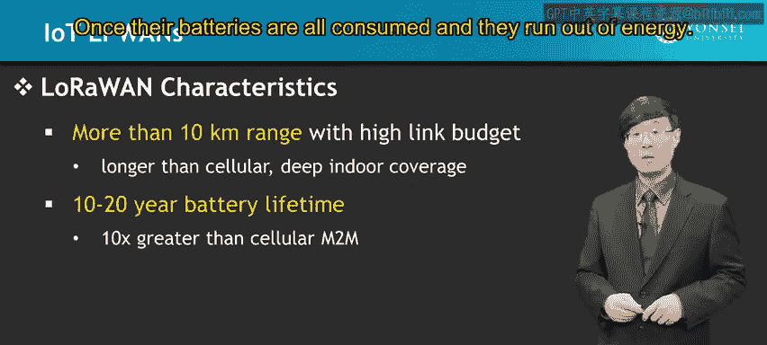

# 95：23_3.4 物联网LPWAN（第2部分）📡

在本节课中，我们将深入探讨LoRa技术。LoRa是一种支持远距离通信的无线调制技术，是构建大规模物联网网络的关键技术之一。我们将了解其工作原理、系统架构和关键特性。

## 探索LoRa技术 🎼

上一节我们介绍了LPWAN的概念，本节中我们来看看LoRa的具体实现。LoRa有时也被称为LoRaWAN，其标志设计独特。它是一种能够支持长距离通信链路的无线调制技术。

一个单一的网关或基站可以覆盖整个城市或数百平方公里的区域。当然，有些城市非常巨大，因此不能说每个城市都能被完全覆盖，但在许多应用中，确实存在足够大的区域可以被有效覆盖。

## 技术基础

LoRa使用一种名为**CSS**的协议，即**Chirp Spread Spectrum**（啁啾扩频）无线电调制技术。

它使用免许可的无线电频段，例如：
*   欧洲的169 MHz、433 MHz、868 MHz频段。
*   北美的915 MHz频段。

## LoRaWAN标准与架构

LoRaWAN标准定义了网络通信协议，包括介质访问控制（MAC）层和整体系统架构。其1.1版本于2017年10月发布，是一个相对较新的协议。这正是LoRa在当前物联网应用中极具吸引力，并且未来吸引力将更大的原因。

以下是LoRa的整体系统架构：

*   **传感器节点**：包含处理器、PHY物理层（调制解调器、天线和射频电路单元）。处理器控制应用、LoRaWAN结构、硬件抽象层（HAL）和串行外设接口（SPI）。
*   **无线网关/主机**：具备路由能力，内部有IP路由表和数据包转发能力，通过HAL、SPI和USB连接，并包含回程IP协议栈。它当然需要一个调制解调器。
*   **网络服务器**：这是一个服务器逻辑单元，包含LoRaWAN技术和支持互联网连接（TCP/IP和UDP）的回程IP协议栈。

LoRa技术负责连接传感器的物理调制解调器与无线网关主机。虽然图中用短的双向箭头表示，但这个距离实际上可能达到数公里甚至数十公里，请不要因为图示简单而低估它。

此外，以太网、LTE、4G移动通信、Wi-Fi等技术将用于连接支持IP、TCP、UDP、ICMP等互联网协议应用网络功能的回程IP网络。

当然，整个系统包含加密安全机制，确保从应用到服务器逻辑的通信都是加密和安全的。这就是LoRa或LoRaWAN的系统架构范围。

## LoRa的关键特性

了解了架构后，我们来看看LoRa的几个核心特性，这些特性使其在物联网领域脱颖而出。

以下是LoRa的关键优势：

*   **超远距离**：通信范围超过10公里，链路预算高。这比典型的蜂窝网络基站范围（通常约1-5公里）要长得多。当蜂窝网络使用微蜂窝、纳蜂窝等更小的基站时，其范围与蓝牙或Zigbee等无线个域网类似，非常小。因此，10公里或更远的范围是一个巨大的优势。
*   **超长电池寿命**：具有低能耗特性，电池寿命可达**10到20年**。这比蜂窝M2M系统的寿命长约10倍。尽管初始部署可能需要一些成本，但在10到20年内无需更换电池，届时很可能直接采用新技术进行设备更换。
*   **低数据速率**：数据速率从**0.3 kbps到50 kbps**。这可能是其一个缺点，数据速率非常低。然而，考虑到以下因素，这通常是可接受的：
    1.  环境中可能部署有大量设备。
    2.  这些设备通常不传输数据文件或多媒体视频，只是发送本地感知的数据及其位置信息到后台网络。
    3.  当覆盖广阔区域时，需要部署许多传感器。单个传感器数据速率虽低，但所有传感器汇总的数据速率会非常高。这种设计正是针对大规模、稀疏数据上报的场景，如海岸线监控、军事区监控、森林或校园设施监控等。

## LoRa联盟与标准化

LoRa的标准化工作主要由**LoRa联盟**推动。许多知名公司如思科、IBM、Semtech、Swisscom、KPN等正在引领这项努力。

## 总结

本节课中，我们一起学习了LoRa技术。我们了解到LoRa是一种基于CSS调制技术的远距离、低功耗无线通信方案，其系统架构包含终端节点、网关和网络服务器。它的核心优势在于超过10公里的通信距离、长达10-20年的电池寿命以及支持海量设备连接的能力，虽然其数据速率较低，但非常适合大规模、低频次数据传输的物联网应用场景。LoRa联盟正推动其标准化和生态发展，使其成为当前和未来物联网领域一项极具吸引力的技术。