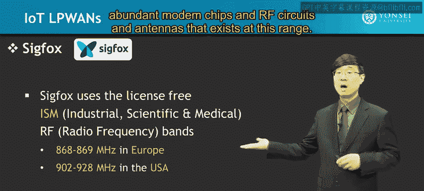
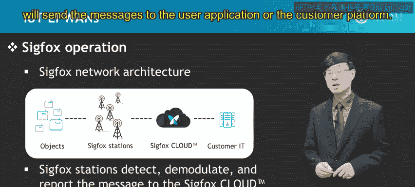
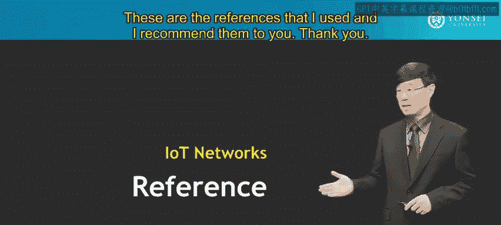

# 延世大学《新兴技术从智能手机到物联网再到大数据》课程 - P96：24_3.4 物联网LPWAN（第三部分）📡

## 概述

在本节课中，我们将要学习一种名为 **SigFox** 的低功耗广域网技术。我们将了解它的技术特点、网络架构以及工作原理，帮助你理解这种适用于物联网的轻量级通信方案。

---

## SigFox技术简介

上一节我们介绍了LPWAN的几种技术，本节中我们来看看其中一种具体实现——SigFox。

SigFox是一种LPWAN技术，它使用**超窄带调制**。这项技术适用于基于物联网服务的、低数据速率的轻量级设备。其典型的调制结构是**DBPSK**，整体工作在低比特率下，因此要求基站具有很高的接收灵敏度。

---

## 数据传输特性

SigFox网络传输的是小型、轻量的消息。以下是其关键的数据传输限制：

*   **上行链路**：传感器节点向SigFox基站或接入点发送数据。其数据包中**有效载荷**的最大限制为 **12 字节**。这意味着整个数据包会更大，但你能放入数据包的信息（即有效载荷）大小被限制在12字节内。
*   **下行链路**：从SigFox基站或主节点向传感器设备发送数据。其数据包尺寸更小，有效载荷最大为 **8 字节**，并且有一个 **14 字节** 的头部。

典型的服务设计是每天最多传输140次，数据速率为 **100 比特/秒**。

---

## 频段与优势

SigFox使用无需许可的**ISM频段**。具体使用的范围在欧洲是**800 MHz**，在美国是**900 MHz**。选择这些频段有以下几个原因：

以下是选择这些频段的主要原因：
1.  这些频率的特性使其能够很好地穿透固体物体。
2.  它们处于足够高的频率，使得天线尺寸可以做得非常小，这意味着SigFox设备不必设计得很大。
3.  在这些频段范围内，还有其他一些信号传播特性使其非常有吸引力。
4.  由于在这个频段存在丰富的调制解调器芯片、射频电路和天线，其他能够连接到它们的设备可以很容易地被设计出来。

---

## 网络架构与工作流程

了解了技术参数后，我们来看看SigFox的网络是如何构建和运行的。

SigFox的网络架构包含以下几个部分：
*   **SigFox 对象**：指那些集成了SigFox调制解调器芯片的物体（设备）。
*   **SigFox 基站**：这些是基站或接入点，负责接收来自带有SigFox调制解调器的对象的信号。
*   **SigFox 云**：这是一个云服务平台（带有商标符号）。
*   **客户IT应用**：用户的实际应用平台。

每个SigFox设备和基站都有一个唯一的**SigFox ID**。该ID及其签名会被传输，用于对每个设备进行身份验证。每个设备都通过其ID和签名被单独识别和授权。

其工作流程如下：
1.  感知数据的对象将其数据发送到SigFox基站。
2.  基站检测这些信号，对其进行解调，然后将消息报告给SigFox云。
3.  SigFox云将消息推送到用户应用程序或客户平台。
4.  服务就这样完成。

---

## 总结

本节课中，我们一起学习了物联网LPWAN技术中的**SigFox**。我们了解了它采用超窄带调制，适合传输小数据量的消息；它使用特定的ISM频段，具有穿透力强、设备体积小的优点；我们还分析了其包含对象、基站和云服务的网络架构，以及从设备感知到数据送达应用端的完整工作流程。SigFox为低功耗、广覆盖的物联网应用提供了一种高效的通信解决方案。

---

**参考资料**

这些是我使用的参考资料，也推荐给你，谢谢。

