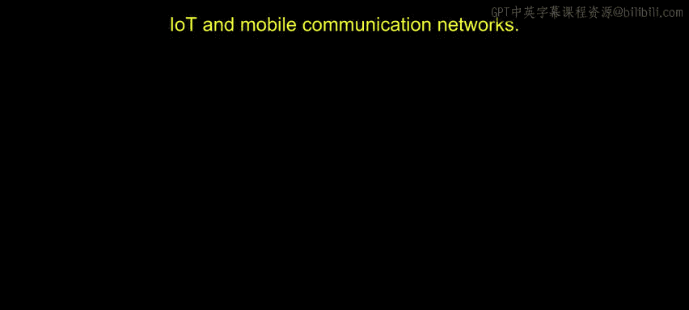
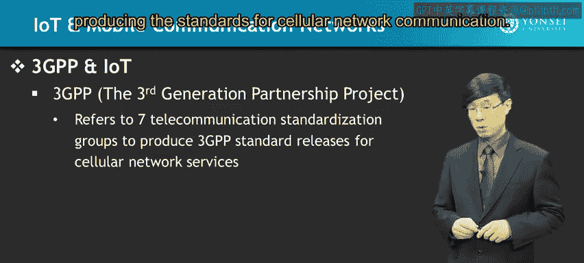
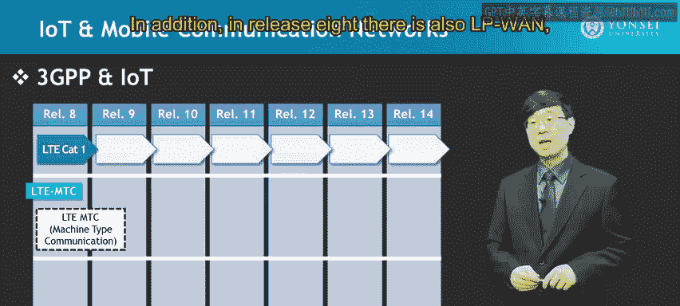
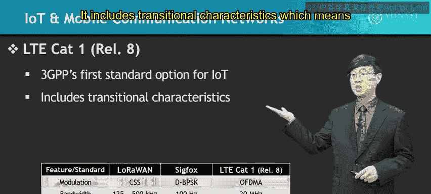
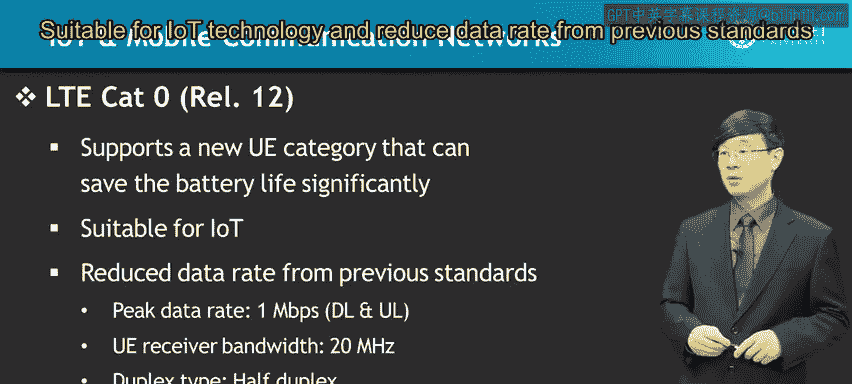

# 课程25：物联网移动通信网络（第1部分）📡

在本节课中，我们将要学习物联网与移动通信网络如何融合，以及相关的标准化发展。这是一个非常重要的主题，因为物联网与移动通信技术正在紧密结合。特别是在未来的移动通信技术中，其原始架构和设计已包含许多新内容，以便能完美地支持物联网服务与应用。

例如，在5G移动通信中，已经包含了以多种方式支持物联网的机器类型通信。此外，还有网络切片技术，它将整个5G移动通信网络划分为针对特定物联网应用目标的独立部分。

考虑到所有这些因素，物联网与移动通信网络自然需要被放在一起研究。

## 标准化组织：3GPP

上一节我们介绍了物联网与移动通信融合的重要性，本节中我们来看看主导这一融合的标准化组织。

总体而言，领导这一领域的标准化组织是3GPP，即第三代合作伙伴计划。它由七个电信标准化团体组成，负责制定蜂窝网络通信的标准。这七个团体共同参与3GPP的活动。

以下是3GPP标准涵盖的主要焦点领域：
*   无线接入
*   服务质量
*   核心传输网络
*   网络服务与安全

3GPP标准以版本的形式进行结构化，第8版及后续标准开始包含对物联网的支持。

## 标准演进与物联网支持

了解了主导组织后，我们来看看标准的具体演进路径，特别是其中对物联网的支持。

观察第8版，其中包含了LTE，即长期演进，这是第四代移动通信标准。Cat是类别的缩写。你可以在这里看到演进结构。其中包含了LTE MTC，即机器类型通信的缩写。这指的是正在被支持的物联网服务应用。

此外，在第8版中，还包含了LPWA，即低功耗广域网技术。关于如何集成该技术的规范也包含在3GPP移动通信标准的第8版中。

然后是GSM MTC，即基于全球移动通信系统的MTC。在这个标准中，这是另一种移动通信和蜂窝技术模式，是一种非常流行的、将被用于支持物联网应用的GSM移动通信和蜂窝技术。

观察标准的演进方式，你可以看到从LTE Cat 1标准开始，它们逐渐融合并支持LTE MTC标准，并持续演进最终成为LTE Cat M1，也就是eMTC标准。这现已进入第14版及以后，属于第五代移动通信蜂窝标准。

此外，在LPWA方面，NB-IoT和LTE-M协议合并为NIoT标准，这也将引领进入第14版及以后的第五代移动通信蜂窝技术。

另外，在GSM MTC领域，从其演进中我们得到了EC-GSM-IoT技术。这三种引领进入第五代标准的技术，将使第五代移动通信蜂窝网络技术能够有效地支持基于物联网的各种服务应用。

## 早期标准：LTE Cat 1

在介绍了演进路径后，我们具体分析一下早期的关键标准。首先来看第8版中的LTE Cat 1包含了什么。

你可以在这个表格中看到相关标准，其中包括调制方式、峰值数据速率、最大输出功率和功率效率。将其与LoRaWAN和Sigfox进行比较，差异显而易见。

你能看到的一些主要特点是，LTE Cat 1的功率效率较低。然而，这些设备连接到你的智能手机，智能手机有充足的电池供应，并且当前及未来模式中还加入了无线充电技术，同时它们也得到基站的支持。

此外，其整体带宽使用量和最大输出信号功率范围等特性，都高于LoRaWAN和Sigfox所使用的。另外，峰值服务范围的整体数据速率也显示在这里。

3GPP第一个物联网标准选项是第8版中的LTE Cat 1。它包含了过渡性特征，这意味着其数据速率高于后来的3GPP物联网标准。其下行链路和上行链路的峰值数据速率分别在10 Mbps到5 Mbps的范围内。

现在，这意味着什么？在最初这个时期，很难预测支持物联网应用需要什么。因此，你在这里看到的一些数据速率值有点过高。这意味着后续标准会降低数据速率，并在功耗和其他服务模式方面具有优势。所以，这些数字相对于我们现在所见的物联网支持标准来说是比较高的。

此外，UE接收机带宽为20 MHz。

## 标准改进：MTC网络与系统增强

在了解了早期标准后，我们来看看后续版本如何针对物联网进行优化。

接下来看第10版和11版中的NI-MTC和SI-MTC标准。这里的NI-MTC是指第10版中针对MTC的网络改进，为MTC制定了特定要求，以使网络更适合MTC。其中包含了物联网网络的拥塞和过载控制。

然后SI-MTC是第11版中对MTC的系统改进。其主要演进焦点是设备触发以及从应用服务器到MTC设备的高可达性。当然，这非常重要。通过短信触发请求，以及仅通过LTE可能提供的支持，是其中包含的另一个选项。

## 低功耗演进：LTE Cat 0

上一节我们看到了系统层面的改进，本节中我们关注设备层面的能效提升。

第12版中包含的LTE Cat 0。它支持新的UE类别，可以节省电池并延长UE的寿命。UE是用户设备的缩写，在基于第四代和第五代标准的LTE移动通信技术中，可以指你的智能手表、笔记本电脑、智能平板电脑以及各种其他设备，我们统称为用户设备，简称UE。

它适用于物联网技术，并且数据速率较之前的标准有所降低，通常是与第8版相比，第8版的标准设定得有点过高。

以下是LTE Cat 0的关键参数：
*   下行和上行峰值数据速率为1 Mbps。
*   UE接收机带宽为20 MHz。
*   双工类型为半双工。

---

本节课中我们一起学习了物联网与移动通信网络融合的背景、主导标准组织3GPP、从LTE Cat 1到eMTC和NB-IoT的标准演进路径，以及早期标准LTE Cat 1的特性及其与LPWAN技术的对比，最后了解了为优化物联网支持而进行的网络、系统改进以及专为低功耗设计的LTE Cat 0标准。这些构成了移动通信网络支持物联网服务的基础框架。