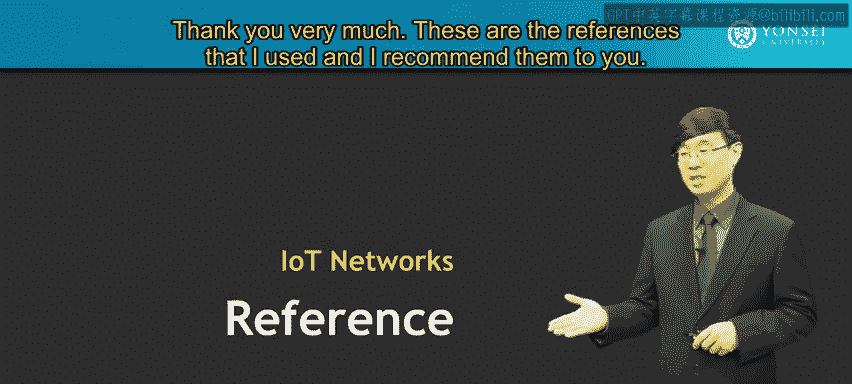

# 课程 26：物联网移动通信网络（第2部分）📡

在本节课中，我们将继续深入学习物联网移动通信网络，重点探讨基于LTE演进的几种关键物联网技术标准，包括eMTC、NB-IoT和EC-GSM IoT，并了解它们如何为未来的5G大规模机器通信奠定基础。

上一节我们介绍了物联网网络的基础架构和无线通信技术概览，本节中我们来看看几种专为物联网设计的蜂窝网络技术标准。

## eMTC：基于LTE的增强型机器通信

eMTC，即增强型机器类通信，基于3GPP Release 13标准，也称为LTE Cat-M1。其核心目标是显著降低LTE物联网网络的成本，使其在与其他低功耗无线技术（如无线局域网、个域网等）竞争时更具吸引力，从而能被集成到更多设备中。

以下是eMTC的一些关键参数：
*   **峰值数据速率**：约为**1 Mbps**或更低。
*   **用户设备接收带宽**：约**1.08 MHz**。
*   **调制方式**：**OFDMA**。
*   **用户设备发射功率**：新设备约为**20 dBm**，旧设备约为**23 dBm**。

eMTC的优势在于，它能在相同的LTE网络带宽内容纳更多的物联网流量，并且与现有LTE网络兼容，这意味着运营商可以通过软件升级而非大规模硬件改造来部署此功能，极具吸引力。

## Release 14 中的 eMTC 增强

随着技术向5G迈进，Release 14标准对eMTC进行了进一步增强。这些增强功能包括：
*   **支持定位追踪**：为基于位置的服务提供了可能。
*   **支持组播**：便于向一组设备高效发送消息。
*   **支持更高数据速率和更宽信道带宽**：例如可达**5 MHz**。
*   **支持VoLTE**：可通过LTE网络传输语音IP数据包，使用灵活且可应用多种压缩技术。

## NB-IoT：窄带物联网

NB-IoT基于3GPP Release 13标准，也称为LTE Cat-NB1。它由华为、爱立信、高通等公司共同推动，核心目标同样是降低成本。

以下是NB-IoT的一些关键参数：
*   **峰值数据速率**：下行链路目标为**250 kbps**，上行链路为**250 kbps**或**20 kbps**。
*   **用户设备接收带宽**：**180 kHz**。
*   **调制方式**：**OFDMA**。

NB-IoT的一个关键设计是尝试去除网关，让传感器数据可以直接发送到主服务器，无需进行聚合或格式转换。这不仅减少了处理时间，加快了传感信息上传速度，也简化了网络架构，降低了部署成本。成本控制对于物联网协议的广泛普及至关重要。

NB-IoT支持三种操作模式：
*   **独立模式**：使用独立的GSM载波，与LTE频段不兼容。
*   **保护带模式**：利用LTE载波保护带中未使用的资源块，非常高效地利用频谱空隙。
*   **带内模式**：使用正常的LTE频段来支持NB-IoT。

## Release 14 中的 NB-IoT 增强

在Release 14中，NB-IoT也获得了面向5G的增强，包括：
*   **支持定位和组播**。
*   **移动性和服务连续性增强**：以支持设备在移动中的连接。
*   **功耗和延迟降低**：为了与那些电池寿命可达10-20年的超低功耗设备竞争，降低功耗和延迟是必须实现的设计目标。例如，定义了新的用户设备功率等级（如14 dBm），以节省能源、延长设备寿命。

## EC-GSM IoT：扩展覆盖的GSM物联网

EC-GSM IoT基于Release 13标准，是GSM技术面向物联网的演进，EC代表“扩展覆盖”。

以下是EC-GSM IoT的一些关键参数：
*   **峰值数据速率**：**474 kbps**（下行链路约**2.2 Mbps**）。
*   **用户设备接收带宽**：**200 kHz**。
*   **调制方式**：基于**TDMA/FDMA**。
*   **用户设备发射功率**：**23 dBm**或**33 dBm**。
*   **电池寿命**：预期可达**10年**。

## 大规模机器通信与5G未来

最后，我们展望未来。大规模机器通信是国际电信联盟定义的5G三大应用场景之一。它将eMTC、NB-IoT和EC-GSM IoT等技术融合进5G mMTC标准中。

其关键要求包括：
*   **广域覆盖**：使用**694-790 MHz**频段，为联网汽车和车队服务设计。
*   **超高连接密度**：在**1平方公里**区域内支持**100万台设备**，这是智慧城市和智能电表等应用所必需的。

本节课中我们一起学习了物联网移动通信网络中的几种核心蜂窝技术。我们了解到，为了满足物联网设备低成本、低功耗、广覆盖和海量连接的需求，3GPP组织从LTE标准出发，演化出了eMTC、NB-IoT和EC-GSM IoT等专门技术，并持续向5G mMTC标准演进。在这些无线技术中，Wi-Fi和蓝牙因其普及性也将被广泛使用，而这将是我们下一个模块要详细讨论的内容。

---
**参考资料**
（课程中使用的推荐参考文献列表）