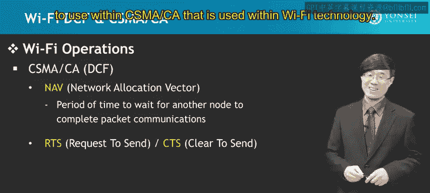

# 延世大学《新兴技术从智能手机到物联网再到大数据》课程 P100：28_4.2 Wi-Fi DCF CSMA-CA（第1部分）📡

在本节课中，我们将学习Wi-Fi通信中的一项核心技术：分布式协调功能及其核心协议——载波侦听多路访问/冲突避免。我们将了解它们为何重要，以及它们如何协同工作以避免数据包冲突，从而保证无线网络的效率。

## Wi-Fi DCF与CSMA/CA概述

Wi-Fi的运行基于一系列标准。其中，**分布式协调功能**是一种用于实现Wi-Fi通信的技术。

在DCF中，用于访问ISM频段信道的一项核心网络技术被称为**载波侦听多路访问/冲突避免**，简称**CSMA/CA**。

我们之所以需要这项技术，是因为ISM频段被许多设备共享使用，这些设备无需许可即可使用该频段，而这正是ISM频段的设计初衷。

在这种应用结构下，由于多个设备在无需许可的结构中使用同一频段，当它们访问信道时，我们希望它们能**监视载波频率**。如果当前没有其他设备在使用，我们希望它们能决定何时以及如何使用该信道。

因此，我们得到了“载波侦听”这个词，即感知载波频率（2.4 GHz或5 GHz频段）。同时，我们试图实现一种非常敏感、精确的“多路访问”，让多个设备能以特定的方式使用信道而互不冲突，这就是我们加上“冲突避免”一词的原因。

## 为何需要避免冲突？

DCF和CSMA/CA的作用在于，我们希望避免因数据包冲突而导致的通信失败。

如果多个用户的数据包发生冲突，这些数据包将全部作废，变得无用。此外，如果你正在进行一连串的通信，那么整个数据包序列很可能都会浪费掉，变得毫无用处。这会降低网络的效率和利用率，因此我们极力避免这种情况。

这种情况之所以发生，再次是因为这是一个无需许可的ISM频段。

## CSMA/CA的工作原理

CSMA/CA的操作首先进行**载波侦听**。这意味着设备首先会查看它将要使用的信道，并试图在无其他设备使用时才使用它。

为了知道何时使用信道，以及何时其他设备没有使用，你需要感知载波频率。这就是CSMA中“CS”部分所代表的含义。

另一部分是**冲突避免**。你希望避免冲突。因此，如果通过载波侦听检测到其他设备正在使用信道，你就不应发送数据。

一旦你检测到其他设备将要使用信道，必须有一个**NAV周期**。在此周期内，因为你检测到其他设备正在使用信道，所以你不使用该信道。设置这个NAV周期对于避免冲突至关重要。

NAV是**网络分配矢量**的缩写，意味着你已经分配了网络并且有人正在使用它，因此我将不使用它以避免冲突。

## RTS与CTS协议

以下是用于在本地节点中设置NAV的两种协议消息：**请求发送**和**允许发送**。

请求发送用于发起一个通信会话。发送方会说“请求发送”，并要求对方回复。当希望与之通信的节点（站点）回复一个“允许发送”作为对“请求发送”的响应时，由于这两个信号（RTS和CTS），所有看到我们交换了RTS或CTS（或两者都看到）的周围设备，在NAV周期内都将**克制发送任何数据**。这就是我们避免冲突的方式，也是Wi-Fi技术中使用的CSMA/CA内部的冲突避免技术。

因此，RTS和CTS是交换的消息，使得本地设备看到后，在NAV期间会克制发送任何数据包。

## 解决隐藏节点问题

这是ISM频段中**隐藏节点问题**的解决方案。我们不知道谁在监视信道，谁想要发送数据。因此，对于那些我们不知道谁想发送、谁计划发送的节点，我们可以利用RTS、CTS和NAV持续时间来防止它们与我们的数据包发生冲突。

这就是为什么我们说它是隐藏节点问题的解决方案，因为那些我的节点未察觉的隐藏节点，将能够看到我们交换的RTS和CTS，从而避免冲突。

你将看到，通信是通过RTS请求的。而CTS帧用于接受RTS发出的通信请求。

## 总结

本节课中，我们一起学习了Wi-Fi通信的基础机制。我们了解到，**分布式协调功能**通过**载波侦听多路访问/冲突避免**协议来管理对共享无线信道的访问。其核心在于先侦听后发言，并利用**RTS/CTS握手**和**NAV机制**来主动避免数据包冲突，特别是解决了**隐藏节点问题**，从而显著提升了无线网络的整体效率和可靠性。